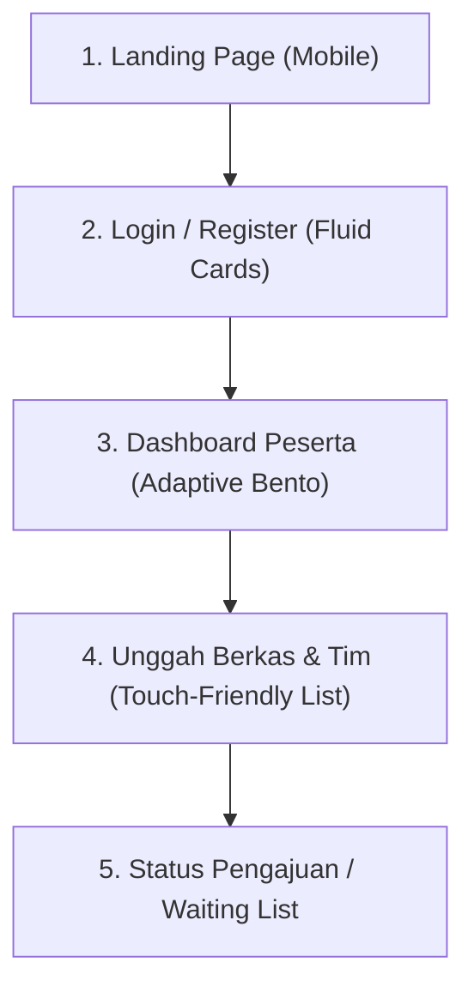

# Rencana Kerja: Revamp Responsif Mobile Terintegrasi (Gaya LENTERA Sleman)

Dokumen ini merinci rencana teknis untuk mengoptimalkan tampilan mobile (*Mobile-First Responsive Design*) pada seluruh alur utama peserta MagKom: mulai dari **Landing Page**, **Login**, **Registrasi**, **Dashboard Peserta**, hingga **Pemberkasan (Upload Dokumen & Status Pengajuan/Menunggu Konfirmasi Admin)**, mengacu pada standar ergonomi aplikasi mobile Kabupaten Sleman (referensi: *LENTERA Sleman*).

---

## 1. Tujuan
Menghadirkan pengalaman pengguna mobile (*mobile UX*) yang mulus, rapi, ergonomis (*one-handed thumb-zone friendly*), dan bebas dari elemen terpotong (*no horizontal scroll, no clipped text*) pada seluruh alur pengguna:
1. **Landing Page**: Navigasi mobile, hero banner, katalog kuota carousel/grid, tahapan alur, dan footer.
2. **Autentikasi (Login & Register)**: Form fluid layar penuh, tombol segmented tipe pendaftaran, input captcha dan formulir anggota tim yang tersusun rapi secara vertikal.
3. **Dashboard Peserta**: Bento grid yang adaptif, hero greeting, stepper onboarding, dan KPI metrics.
4. **Detail Berkas & Unggah Dokumen**: Stepper fase mobile, kartu berkas individu & kelompok yang nyaman disentuh, serta submission bar yang mudah diakses jempol.
5. **Status Pengajuan & Konfirmasi Admin**: Kartu status (Menunggu Verifikasi / Waiting List) dengan hierarki visual yang jelas dan modal aksi responsif.

---

## 2. Asumsi & Pertanyaan Terbuka

### Asumsi Kerja:
1. **Baseline Viewport Mobile**: Target pengujian mencakup resolusi `320px` (layar kecil/ekstrem seperti iPhone SE gen 1), `360px - 390px` (standar Android/iPhone 12-15), dan `414px - 480px` (layar phablet), hingga breakpoint tablet `768px`.
2. **Touch Target Size**: Mengikuti standar WCAG 2.1 AA dan mobile UX Sleman, seluruh elemen interaktif (tombol, input form, pill tab, ikon aksi) memiliki area sentuh minimum `44px x 44px`.
3. **Zero JavaScript Framework**: Mempertahankan arsitektur Vanilla CSS & Vanilla JS (ES Modules) via Vite tanpa menambahkan pustaka UI pihak ketiga (React, Tailwind, Bootstrap, dll.).
4. **Blade Read-Only Priority**: Mengutamakan penyempurnaan styling melalui scoped CSS di `resources/css/pages/` dan modular JS di `resources/js/`. Markup Blade hanya disesuaikan bila mutlak diperlukan untuk struktur semantic/wrapper mobile.

---

## 3. Evaluasi Opsi Arsitektur

### Opsi A: Mobile-First Responsive Overhaul Scoped per Halaman (Direkomendasikan)
- **Deskripsi**: Menambahkan breakpoint terstruktur (`@media (max-width: 768px)` dan `@media (max-width: 480px)`) langsung pada stylesheet scoped masing-masing halaman (`landing.css`, `auth-depth.css`, `dashboard.css`, `pemberkasan.css`, `pendaftaran-index.css`).
- **Kelebihan**:
  - Isolasi gaya sempurna; perubahan mobile di halaman berkas tidak akan mempengaruhi halaman landing atau autentikasi.
  - Sesuai dengan aturan repository MAGKOM (`AGENTS.md`) di mana styling berpusat di `resources/css/`.
  - Mudah di-debug dan dipelihara secara modular per modul fitur.
- **Kekurangan**: Membutuhkan penulisan media query pada 5 file CSS terpisah.

### Opsi B: Utility Global Mobile Override Monolitik
- **Deskripsi**: Membuat satu file CSS baru `mobile-overrides.css` yang dimuat secara global di layout utama.
- **Kelebihan**: Seluruh aturan mobile terkumpul dalam satu file.
- **Kekurangan**:
  - Berisiko tinggi menimbulkan *CSS specificity clash* (`!important` war) dan regresi visual pada halaman lain.
  - Melanggar arsitektur modular Vite yang sudah mapan di MAGKOM.

> **Rekomendasi**: **Opsi A** karena menjamin stabilitas baseline, mencegah regresi, dan mempertahankan standar arsitektur CSS MAGKOM.

---

## 4. Rincian Perubahan per Halaman (LENTERA Sleman Style)

### 4.1. Landing Page (`resources/css/pages/public/landing.css`)
- **Navigasi & Header**: Drawer navigasi mobile yang halus, tinggi header kompak (60px), logo Sleman & MagKom proporsional.
- **Hero Carousel**: Tombol panah geser (`prev/next`) diposisikan aman dari tepi layar; teks judul `clamp(1.5rem, 4vw, 2.25rem)`.
- **Katalog Kuota**: Kartu kuota tampil 1 kolom penuh pada mobile (<768px), tombol "Pilih Kuota" memiliki tinggi sentuh nyaman (44px).
- **Milestone Tahapan Alur**: Mengubah garis horizontal/offset besar menjadi garis vertikal ringkas di sebelah kiri dengan kartu milestone yang pas di layar 360px.

### 4.2. Halaman Login & Registrasi (`resources/css/pages/auth/auth-depth.css`)
- **Container Layar Penuh**: Pada layar <768px, card auth membentang 100% lebar layar dengan padding samping `16px`.
- **Tipe Pendaftaran Tab**: Tombol `Individu` dan `Kelompok` memiliki tinggi min 44px dengan teks tidak terpotong.
- **Roster Anggota Kelompok (`.card-anggota-item`)**: Mengubah layout input grid `1fr 1fr` pada mobile (<480px) menjadi `1fr` vertikal bertumpuk agar input Nama, NIM, No HP, dan Email tidak sempit/terjepit.
- **CAPTCHA Row**: Gambar CAPTCHA dan tombol reload tertata rapi berdampingan tanpa keluar dari tepi container.
- **Live Quota Status Card**: Teks fleksibel dan wrap rapi saat layar sempit.

### 4.3. Dashboard Peserta (`resources/css/pages/peserta/dashboard.css`)
- **Bento Hero Banner**: Penataan vertikal untuk foto profil, sapaan selamat datang, dan status badge magang.
- **Onboarding Tracker (Stepper)**: Mengadopsi scroll horizontal halus (*smooth touch scroll*) atau penumpukan vertikal bertahap dengan indikator nomor yang jelas.
- **Grid Metrik KPI**: Penataan dari 4 kolom menjadi 2 kolom di tablet dan 1 kolom di mobile (<480px).
- **Notifikasi & Pengumuman**: Kartu peringatan/informasi dengan padding 14px agar memaksimalkan ruang baca.

### 4.4. Detail Berkas & Upload (`resources/css/pages/peserta/pemberkasan.css`)
- **Stepper Status**: Tampilan tahap 1 (Berkas) -> tahap 2 (Verifikasi) -> tahap 3 (Hasil) tidak lagi terpotong teksnya; menggunakan mode ringkas berbasis ikon dan badge aktif.
- **Section Berkas Kelompok & Anggota**: Penataan judul dengan garis biru aksen, kartu berkas individu tersusun vertikal bersih.
- **Kartu Dokumen (`_doc_card_compact`)**: Tombol unggah dokumen (*dropzone/file input*) berukuran penuh dengan teks status file yang jelas.
- **Submission Bar Bawah (`.pemberkasan-submit-card`)**:
  - Pada mobile (<640px), elemen ikon, judul status, dan tombol beralih ke layout vertikal (`flex-direction: column; align-items: stretch`).
  - Tombol **"Ajukan Pendaftaran"** membentang selebar kartu (100% width) di bagian bawah, memberikan akses instan untuk jempol (*thumb-friendly*).

### 4.5. Status Pengajuan & Waiting List
- **Alert Status Pendaftaran**: Banner status "Menunggu Verifikasi Admin" atau "Waiting List" memiliki kontras tinggi, ikon informatif, dan penjelasan langkah berikutnya yang mudah dibaca.
- **Modal Batal / Pratinjau Dokumen**: Modal dialog membentang responsif (lebar 92-95vw) dengan tombol tutup yang mudah dijangkau.

---

## 5. Rencana Perubahan File

| File | Aksi | Ringkasan Perubahan |
| :--- | :--- | :--- |
| `resources/css/pages/public/landing.css` | **Modify** | Optimasi breakpoint mobile (<768px, <480px, <360px): navigasi, hero, kuota cards, dan tahapan alur. |
| `resources/css/pages/auth/auth-depth.css` | **Modify** | Form fluid layar penuh, responsive grid kartu anggota kelompok bertumpuk vertikal pada mobile, penyesuaian CAPTCHA. |
| `resources/css/pages/peserta/dashboard.css` | **Modify** | Bento mobile stacking, hero banner responsive, stepper touch-scroll, dan single-column alert cards. |
| `resources/css/pages/peserta/pemberkasan.css` | **Modify** | Responsive stepper tahap pendaftaran, touch targets kartu berkas, dan submission bar full-width bertumpuk pada mobile. |
| `resources/css/pages/peserta/pendaftaran-index.css` | **Modify** | Katalog kuota kartu vertikal fluid, riwayat pendaftaran accordion touch-friendly pada layar kecil. |

---

## 6. Langkah Implementasi Bertahap

### Fase 1: Optimasi Mobile Autentikasi (Login & Registrasi)
- [ ] Sesuaikan media query `@media (max-width: 480px)` pada `resources/css/pages/auth/auth-depth.css`.
- [ ] Ubah grid form anggota tim kelompok dari 2-kolom (`1fr 1fr`) menjadi 1-kolom bertumpuk pada mobile agar input tidak sempit.
- [ ] Pastikan padding form `16px` pada layar sempit dan tombol submit `100%` width.
- [ ] Uji responsivitas formulir registrasi mandiri dan registrasi kelompok pada viewport 360px & 390px.

### Fase 2: Optimasi Mobile Landing Page
- [ ] Periksa dan sempurnakan touch swipe / button padding pada carousel kuota di `resources/css/pages/public/landing.css`.
- [ ] Sesuaikan kartu tahapan alur magang agar tidak ada teks terpotong pada layar <400px.
- [ ] Pastikan drawer navigasi mobile dapat dibuka/tutup dengan mulus tanpa pergeseran horizontal (*zero horizontal scrollbar*).

### Fase 3: Optimasi Mobile Dashboard Peserta
- [ ] Sesuaikan bento hero banner di `resources/css/pages/peserta/dashboard.css` agar nama dan status tersusun rapi secara vertikal pada mobile.
- [ ] Rapikan onboarding phase stepper agar ramah layar sentuh (*touch-friendly touch target* min 44px).
- [ ] Susun ulang bento metric cards menjadi 1 kolom pada layar <480px.

### Fase 4: Optimasi Mobile Pemberkasan (Detail Berkas & Submission)
- [ ] Tambahkan media query mobile untuk submission bar (`.pemberkasan-submit-card`) di `resources/css/pages/peserta/pemberkasan.css`: susun vertikal pada mobile dengan tombol "Ajukan Pendaftaran" 100% width.
- [ ] Optimalkan kartu upload berkas (`.doc-card-premium` / `_doc_card_compact`) agar tombol aksi unduh/pratinjau/ganti berkas tidak saling bertumpuk di layar sempit.
- [ ] Sempurnakan bento kartu anggota kelompok di halaman berkas agar avatar dan nama tetap sejajar dan rapi.

### Fase 5: Quality Gate & Verifikasi Komprehensif
- [ ] Jalankan kompilasi aset: `npm run build` dan verifikasi bebas error.
- [ ] Jalankan audit formatting: `./vendor/bin/pint --test`.
- [ ] Jalankan seluruh rangkaian Feature Test: `php artisan test --filter="PesertaPendaftaranFlowTest|PendaftaranPesertaTest|PendaftaranKelompokTest|AuthDepthVisualParityTest"`.
- [ ] Verifikasi visual langsung pada browser DevTools dengan orientasi responsif: iPhone SE (375px), Pixel 7 (412px), iPhone 14 Pro Max (430px), dan Galaxy Fold (layar sempit 280-320px).

---

## 7. Strategi Testing

1. **Automated Regression Tests**:
   - `php artisan test --filter=AuthDepthVisualParityTest`: Memastikan seluruh elemen markup, form field, dan status auth tetap lengkap.
   - `php artisan test --filter=PesertaPendaftaranFlowTest`: Memastikan alur pendaftaran, upload berkas, dan pembatalan tidak terganggu oleh perubahan styling.
   - `php artisan test --filter=PendaftaranKelompokTest`: Memastikan data anggota tim tetap tersimpan akurat.
2. **Manual Multi-Device Viewport Check**:
   - `320px x 568px` (Layar ultra-kompak / iPhone SE 1st gen).
   - `360px x 800px` (Layar Android standar).
   - `390px x 844px` (iPhone 12/13/14).
   - `412px x 915px` (Pixel / Samsung Galaxy).
   - `768px x 1024px` (Tablet Portrait).
3. **Pemeriksaan UX Spasial**:
   - Tidak ada scrollbar horizontal pada halaman mana pun (`overflow-x: hidden`).
   - Seluruh teks dapat terbaca jelas tanpa terpotong (*no ellipsis on critical instructional copy*).
   - Tombol utama berada dalam jangkauan satu tangan (*thumb-zone accessibility*).

---

## 8. Risiko & Mitigasi

| Risiko | Tingkat | Dampak | Mitigasi |
| :--- | :---: | :--- | :--- |
| Perubahan CSS memengaruhi tampilan desktop | Rendah | Visual desktop bergeser | Gunakan media query ketat `@media (max-width: 768px)` dan `@media (max-width: 480px)` tanpa menyentuh rule desktop baseline. |
| Input form terpotong pada layar <360px | Sedang | Registrasi gagal diisi | Terapkan `box-sizing: border-box`, `width: 100%`, dan `padding: 0 12px` fluid. |
| Tombol submit pendaftaran tertutup keyboard virtual | Rendah | Pengguna bingung cara submit | Gunakan sticky bottom bar atau natural scrolling dengan margin-bottom yang cukup pada form. |

---

## 9. Kriteria Selesai (Definition of Done)
- [ ] Landing page responsif sempurna di viewport 320px - 768px tanpa scrollbar horizontal.
- [ ] Form login & registrasi (mandiri & kelompok) fluid, kartu anggota kelompok bertumpuk rapi di mobile.
- [ ] Dashboard peserta menampilkan bento dan onboarding stepper secara proporsional.
- [ ] Halaman unggah berkas memiliki kartu upload yang mudah disentuh dan tombol ajukan selebar kartu di bagian bawah.
- [ ] Status pendaftaran (Waiting List / Menunggu Konfirmasi) tampil informatif dan rapi di mobile.
- [ ] `npm run build` sukses 100%.
- [ ] Laravel Pint passed (`./vendor/bin/pint --test`).
- [ ] Semua PHPUnit test terkait pendaftaran & auth berstatus hijau (PASS).

