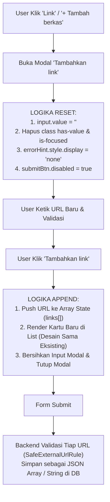

# Rencana Kerja: Fitur Multi-Link & Reset Input Modal Pop-up (Pembimbing & Peserta)

Dokumen ini merinci rencana teknis untuk mengatasi batasan tautan (link) pada sistem penugasan MagKom. Berdasarkan kebutuhan pengguna, sistem akan memungkinkan penambahan **lebih dari satu link** (link ke-2, ke-3, dst.), memastikan **input pada modal pop-up selalu bersih/kosong** saat dibuka untuk menambahkan link berikutnya, serta menangani alur **tugas yang dikembalikan oleh pembimbing (status Perlu Revisi)** secara konsisten tanpa merubah desain antarmuka (UI/CSS).

---

## 1. Analisis Masalah Saat Ini & Root Cause

### 1.1 Masalah di Sisi Pembimbing (Buat & Edit Tugas)
- **Root Cause di JS (`tugas-create.js` & `tugas-edit.js`)**:
  - Pada saat modal *"Tambahkan link"* dibuka, fungsi `openModal()` membaca nilai dari input tersembunyi `realInput`:
    ```javascript
    inputUrl.value = realInput?.value || '';
    ```
  - Pada halaman `pembimbing/tugas/edit.blade.php`, atribut `value` input modal bahkan terisi nilai lama dari Blade: `value="{{ old('link_referensi', $tugas->link_referensi) }}"`.
  - **Dampaknya**: Ketika pembimbing sudah memasukkan link pertama (misal `https://www.tiktok.com/`) lalu ingin menambahkan link kedua dan mengklik tombol *"Link"*, modal terbuka dalam kondisi masih terisi link pertama.
  - Selain itu, fungsi `renderLinkCard()` langsung menimpa kontainer kartu (`innerHTML = ...`) dan variabel `realInput.value` hanya menyimpan 1 URL tunggal sehingga link sebelumnya hilang tertimpa.

### 1.2 Masalah di Sisi Peserta (Pengumpulan Tugas & Revisi)
- **Root Cause di JS (`tugas-detail.js`)**:
  - Saat item dropdown *"Link"* diklik (`data-action="open-modal-link"`), elemen `inputUrlLink` **tidak pernah dibersihkan** (`inputUrlLink.value = ''`). Nilai URL yang baru saja dimasukkan tetap menempel di input.
  - State internal `activeItem` bertipe objek tunggal (`{ type: null, name: null, ... }`).
  - **Dampaknya**: Ketika peserta sudah memasukkan link pertama (misal `https://www.youtube.com/...`) lalu ingin menambahkan link kedua, modal kembali terbuka dengan input masih terisi link pertama. Jika diserahkan, link baru menimpa link lama.

### 1.3 Kasus Khusus: Pembimbing Mengembalikan Tugas (Status "Perlu Revisi")
- **Kondisi Eksisting**:
  - Ketika pembimbing mengembalikan tugas dengan catatan revisi, riwayat kiriman tugas pertama tetap ditampilkan di panel kanan peserta (`submitted-preview-card`, misal `Buka Tautan Tugas ↗ https://www.tiktok.com/`).
  - Peserta kemudian menambahkan link tugas baru untuk revisi (misal `https://www.youtube.com/...`). Link ini muncul di `#attachmentsList` di bawah riwayat lama ("dobel" kartu di layar: kartu riwayat lama + kartu berkas baru).
  - Namun ketika peserta ingin menambahkan link kedua pada tugas revisinya, modal pop-up justru menampilkan link sebelumnya (atau bahkan mempertahankan draft lama).
  - Peserta membutuhkan:
    1. Tugas pertama yang dikembalikan tetap terlihat di layar sebagai riwayat acuan.
    2. Saat menambahkan link revisi pertama, kedua, maupun ketiga, modal pop-up harus **selalu bersih/kosong** (tidak memuat link tugas pertama yang dikembalikan dan tidak memuat link revisi sebelumnya).
    3. Peserta dapat menyerahkan beberapa link sekaligus untuk revisi tersebut.

---

## 2. Prinsip & Batasan Utama (Guardrails)

> [!IMPORTANT]
> - **Zero Visual / CSS Changes**: Tampilan antarmuka, tata letak, ukuran, warna, token CSS, dan styling kartu lampiran **tidak boleh diubah**. Kartu link tambahan menggunakan class komponen eksisting (`tugas-attached-card` untuk pembimbing dan `attached-item-card` untuk peserta).
> - **Strict Logic Only**: Perubahan difokuskan murni pada logika JavaScript (state management & modal lifecycle), Form Request validation, Eloquent model accessors, dan backward-compatible database storage.
> - **Backward Compatibility**: Data tugas dan pengumpulan tugas lama yang hanya memiliki 1 link string harus tetap terbaca normal tanpa error.

---

## 3. Arsitektur Solusi & Logika



### 3.1 Logika Reset Modal Pop-up (Clean State on Open & Close)
Baik di `tugas-create.js`, `tugas-edit.js`, maupun `tugas-detail.js`:
1. Setiap kali trigger tombol buka modal diklik:
   - `inputUrl.value = '';`
   - Elemen pembungkus input (`.tugas-field-filled` / `#wrapFieldModalLink`) dihapus kelas `has-value`, `has-error`, dan `is-focused`.
   - Elemen hint error (`#linkErrorHint`) disembunyikan (`display: none;`) dan teksnya dikosongkan.
   - Tombol submit modal (`btnSubmitAddLink` / `btnSubmitLink`) diatur `disabled = true`.
   - Panggil `inputUrl.focus()` agar kursor langsung siap mengetik.
2. Saat tombol "Batal", icon close "X", atau backdrop luar diklik:
   - Tutup modal dan pastikan nilai input kembali dikosongkan.
3. Pada `resources/views/pembimbing/tugas/edit.blade.php`:
   - Hapus atribut `value="{{ old('link_referensi', $tugas->link_referensi) }}"` dari input modal `#inputModalLinkUrl` agar HTML awal bersih.

### 3.2 Logika Multi-Link di Sisi Pembimbing
1. **Frontend (`tugas-create.js` & `tugas-edit.js`)**:
   - Ganti variabel string tunggal dengan array: `let attachedLinks = [];`.
   - Saat inisialisasi halaman (terutama di edit tugas atau bila ada `old('link_referensi')`), parse nilai awal (jika berupa string tunggal, masukkan 1 elemen; jika JSON array, parse ke `attachedLinks`).
   - Saat link baru ditambahkan dari modal:
     - Normalisasi URL (tambahkan `https://` jika belum ada protokol).
     - Validasi regex URL.
     - Tambahkan ke array: `attachedLinks.push(url);`.
     - Render ulang kontainer `#attachedLinksContainer`: setiap elemen di array dirender menjadi kartu `.tugas-attached-card` dengan markup dan CSS yang sudah ada saat ini.
     - Setiap kartu memiliki tombol hapus `[data-link-index="i"]`. Mengklik tombol hapus akan menghapus elemen pada indeks `i` dari `attachedLinks` dan me-render ulang list.
     - Sinkronkan array ke input tersembunyi `#realLinkInput`: `realLinkInput.value = JSON.stringify(attachedLinks);` (atau string URL langsung jika hanya 1 link untuk fleksibilitas).
     - Perbarui counter badge: `(opsional) · X lampiran` (menghitung `attachedLinks.length` + keberadaan file lampiran).

2. **Backend & Database**:
   - Migrasi Database: Tambahkan migrasi untuk memperbesar kolom `link_referensi` pada tabel `tugas` dari `VARCHAR(255)` menjadi `VARCHAR(2048)` atau `TEXT` agar muat menampung multiple URL.
   - Model `Tugas`:
     - Tambahkan aksesor runtime `getLinksAttribute(): array`:
       ```php
       public function getLinksAttribute(): array
       {
           if (blank($this->link_referensi)) {
               return [];
           }
           $raw = trim($this->link_referensi);
           if (str_starts_with($raw, '[') && str_ends_with($raw, ']')) {
               $decoded = json_decode($raw, true);
               if (is_array($decoded)) {
                   return array_values(array_filter($decoded, fn($item) => is_string($item) && $item !== ''));
               }
           }
           if (str_contains($raw, "\n")) {
               return array_values(array_filter(array_map('trim', explode("\n", $raw))));
           }
           return [$raw];
       }
       ```
   - `TugasRequest`:
     - Pada `prepareForValidation`: jika input `link_referensi` berupa JSON array string, validasi formatnya.
     - Pada `rules`: buat validasi yang mendukung URL tunggal maupun array/JSON of URLs, di mana setiap URL divalidasi dengan `SafeExternalUrlRule`.
   - Views (`pembimbing/tugas/show.blade.php`, `peserta/tugas/show.blade.php`, dll):
     - Ganti pengecekan tunggal `@if($tugas->link_referensi)` menjadi perulangan `@foreach($tugas->links as $linkRef)` dengan tetap memakai markup kartu eksisting (`tugas-attached-card tugas-attached-card--readonly`).

### 3.3 Logika Multi-Link di Sisi Peserta & Penanganan Kasus Revisi
1. **Frontend (`tugas-detail.js`)**:
   - Struktur state diperluas:
     ```javascript
     let activeFile = null; // { type: 'file' | 'recent', name, meta, value }
     let activeLinks = [];  // array of string URLs: ['https://...', 'https://...']
     ```
   - Saat modal dibuka melalui `data-action="open-modal-link"`:
     - Reset input modal menjadi kosong bersih.
     - Reset tombol submit menjadi disabled.
   - Saat modal submit ("Tambahkan link"):
     - Validasi format URL.
     - Masukkan ke `activeLinks.push(urlVal)`.
     - Render ulang kontainer `#attachmentsList`:
       - Jika ada `activeFile`, render kartu filenya.
       - Untuk setiap item di `activeLinks`, render kartu link dengan markup eksisting `.attached-item-card` lengkap dengan tombol hapus (X).
     - Tombol hapus (X) pada kartu link akan membuang link dari `activeLinks` berdasarkan indeks dan me-render ulang list.
     - Simpan data ke hidden input:
       - `formLinkInput.value = activeLinks.length === 0 ? '' : (activeLinks.length === 1 ? activeLinks[0] : JSON.stringify(activeLinks));`
     - Tombol *"Serahkan / Kirim Progres"* atau *"Serahkan Ulang Revisi"* diaktifkan jika `activeLinks.length > 0 || activeFile !== null`.

2. **Alur pada Kasus Tugas Dikembalikan (Perlu Revisi)**:
   - **Tampilan Awal**:
     - Bagian `.submitted-items-container` tetap merender kartu riwayat tugas pertama yang dikembalikan oleh pembimbing (`Buka Tautan Tugas ↗ https://www.tiktok.com/`).
     - Alert catatan revisi pembimbing tetap muncul di atas form penyerahan ulang.
     - Area `#attachmentsList` dalam kondisi kosong.
     - Input modal pop-up bersih.
   - **Saat Peserta Menambah Link Revisi Pertama**:
     - Modal terbuka kosong. Peserta mengetik `https://www.youtube.com/...`.
     - Link ditambahkan ke `#attachmentsList`.
     - Sekarang di layar tampak:
       1. Kartu riwayat kiriman sebelumnya (tugas pertama).
       2. Kartu kiriman revisi baru (tugas kedua).
       *(Kondisi "dobel" ini tepat secara UX agar peserta mengetahui perbandingan tugas sebelumnya dan revisi yang sedang disiapkan)*.
   - **Saat Peserta Menambah Link Revisi Kedua / Ketiga**:
     - Peserta mengklik dropdown `+ Tambah berkas` -> `Link`.
     - Modal pop-up terbuka kembali dalam kondisi **KOSONG/BERSIH** (tidak ada link dari tugas pertama yang dikembalikan, dan tidak ada link revisi pertama yang barusan dimasukkan).
     - Peserta mengetik link berikutnya dan mengklik *"Tambahkan link"*.
     - Link kedua ditambahkan ke `#attachmentsList`.
   - **Saat Peserta Mengklik "Serahkan Ulang Revisi"**:
     - Form mengirimkan semua tautan revisi ke `Peserta\TugasController@unggahProgres`.
     - Database membuat baris `ProgresLog` baru yang berisi link-link revisi terbaru dan status `menunggu`.
     - Riwayat `ProgresLog` lama tetap tersimpan untuk audit trail dan perbandingan evaluasi pembimbing.

3. **Backend & Model `ProgresLog`**:
   - Kolom `link` pada tabel `progres_log` sudah bertipe `VARCHAR(2048)`.
   - Model `ProgresLog`:
     - Tambahkan aksesor runtime `getLinksAttribute(): array`:
       ```php
       public function getLinksAttribute(): array
       {
           if (blank($this->link)) {
               return [];
           }
           $raw = trim($this->link);
           if (str_starts_with($raw, '[') && str_ends_with($raw, ']')) {
               $decoded = json_decode($raw, true);
               if (is_array($decoded)) {
                   return array_values(array_filter($decoded, fn($item) => is_string($item) && $item !== ''));
               }
           }
           if (str_contains($raw, "\n")) {
               return array_values(array_filter(array_map('trim', explode("\n", $raw))));
           }
           return [$raw];
       }
       ```
   - `ProgresLogRequest`:
     - Memvalidasi setiap URL dalam `link` (baik single string maupun JSON array string) menggunakan `SafeExternalUrlRule`.
   - Tampilan Penyerahan di `resources/views/peserta/tugas/show.blade.php`:
     - Pada `.submitted-items-container`, lakukan perulangan untuk setiap tautan pada `$latestProgres->links`:
       ```blade
       @foreach($latestProgres->links as $submittedLink)
           <div class="submitted-preview-card">
               <div class="submitted-preview-info">
                   <a href="{{ $submittedLink }}" target="_blank" rel="noopener noreferrer" class="submitted-preview-name" title="{{ $submittedLink }}">
                       <span>Buka Tautan Tugas ↗</span>
                   </a>
                   <span class="submitted-preview-type" title="{{ $submittedLink }}">{{ $submittedLink }}</span>
               </div>
               <div class="submitted-preview-thumb">
                   <svg width="20" height="20" viewBox="0 0 24 24" fill="none" stroke="currentColor" stroke-width="1.8">
                       <path d="M10 13a5 5 0 0 0 7.54.54l3-3a5 5 0 0 0-7.07-7.07l-1.72 1.71"></path>
                       <path d="M14 11a5 5 0 0 0-7.54-.54l-3 3a5 5 0 0 0 7.07 7.07l1.71-1.71"></path>
                   </svg>
               </div>
           </div>
       @endforeach
       ```
   - Tampilan Review Pembimbing di `resources/views/pembimbing/tugas/show.blade.php`:
     - Pada bagian `compact-link-strip`, lakukan perulangan `@foreach($latestLog->links as $linkUrl)` dengan markup strip yang sudah ada sehingga pembimbing dapat melihat semua tautan kiriman peserta secara rapi.

---

## 4. Rincian File yang Akan Dimodifikasi & Dibuat

| No | File Path | Tipe Aksi | Alasan Perubahan |
|:---|:---|:---|:---|
| 1 | `database/migrations/2026_11_17_000001_expand_link_referensi_on_tugas_table.php` | Create | Memperbesar kapasitas kolom `link_referensi` menjadi `VARCHAR(2048)` agar mampu menampung multi-link tanpa truncate. |
| 2 | `app/Models/Tugas.php` | Modify | Menambahkan aksesor `getLinksAttribute(): array` untuk mendukung parsing single URL, JSON array, atau newline. |
| 3 | `app/Models/ProgresLog.php` | Modify | Menambahkan aksesor `getLinksAttribute(): array` untuk mendukung multi-link pada hasil kiriman tugas peserta. |
| 4 | `app/Http/Requests/TugasRequest.php` | Modify | Mendukung validasi multi-link pada `link_referensi` menggunakan `SafeExternalUrlRule`. |
| 5 | `app/Http/Requests/ProgresLogRequest.php` | Modify | Mendukung validasi multi-link pada kiriman peserta menggunakan `SafeExternalUrlRule`. |
| 6 | `resources/js/pages/pembimbing/tugas-create.js` | Modify | Reset nilai input modal saat dibuka, kelola array `attachedLinks`, render kartu multi-link, dan tombol hapus per item. |
| 7 | `resources/js/pages/pembimbing/tugas-edit.js` | Modify | Reset nilai input modal saat dibuka, inisialisasi multi-link yang ada, kelola array `attachedLinks`, dan render kartu multi-link. |
| 8 | `resources/views/pembimbing/tugas/edit.blade.php` | Modify | Menghapus atribut `value="{{ old('link_referensi', ...) }}"` dari input modal `#inputModalLinkUrl` agar modal selalu terbuka dalam keadaan kosong. |
| 9 | `resources/js/pages/peserta/tugas-detail.js` | Modify | Reset nilai input modal saat dibuka (`data-action="open-modal-link"`), kelola array `activeLinks`, render kartu multi-link di `#attachmentsList`, tombol hapus per link, dan penanganan revisi. |
| 10 | `resources/views/peserta/tugas/show.blade.php` | Modify | Looping multi-link pada lampiran acuan pembimbing (`$tugas->links`) dan riwayat kiriman peserta (`$latestProgres->links`). |
| 11 | `resources/views/pembimbing/tugas/show.blade.php` | Modify | Looping multi-link pada bagian review kiriman tugas peserta (`$latestLog->links`) menggunakan `compact-link-strip`. |
| 12 | `tests/Feature/MultiLinkTugasTest.php` | Create | Test suite PHPUnit untuk memastikan pembuatan tugas multi-link, pengumpulan tugas multi-link, penyerahan revisi, dan validasi keamanan URL berjalan sempurna. |

---

## 5. Rencana Pengujian & Quality Gates

1. **Unit & Feature Testing (PHPUnit)**:
   - Tes pembuatan tugas oleh pembimbing dengan 1 link, 2 link, dan 3 link.
   - Tes update tugas dengan menambah dan menghapus link.
   - Tes pengumpulan tugas oleh peserta dengan 1 link dan multi-link.
   - Tes penyerahan ulang tugas revisi (status `perlu_revisi`) dengan link baru tanpa menghilangkan riwayat log lama.
   - Tes validasi URL berbahaya (SSRF, javascript:, non-https) via `SafeExternalUrlRule` pada multi-link.
2. **Regression Testing**:
   - Menjalankan seluruh test suite penugasan (`php artisan test --filter=Tugas`) untuk memastikan tidak ada fitur atau kontrak lama yang terganggu.
3. **Static Analysis & Code Style**:
   - `./vendor/bin/pint --test`
   - `./vendor/bin/phpstan analyse --memory-limit=1G`
4. **Frontend Asset Build**:
   - `npm run build` untuk memastikan bundle Vite terkompilasi bersih tanpa error sintaks JS.
5. **UI & Verification Manual**:
   - Memastikan tidak ada pergeseran styling CSS, tombol tetap berpenampilan pill/clean, dan kartu-kartu lampiran tampil presisi sesuai desain yang ada saat ini.
