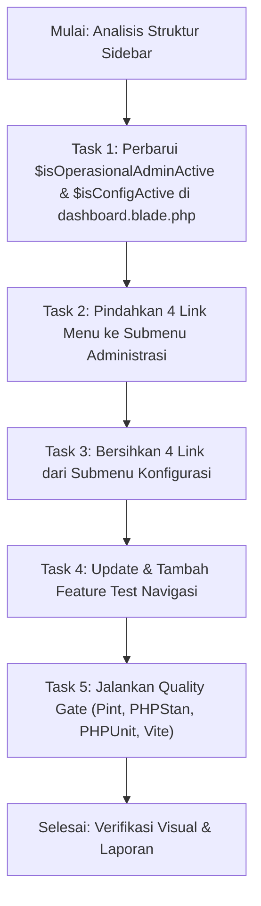

# IMPLEMENTATION PLAN: INTEGRASI 4 TAMPILAN MASTER OPERASIONAL KE MENU ADMINISTRASI

> **Dari:** Senior Software Engineer / Lead Architect  
> **Kepada:** Tim Pengembang / Junior Developer / AI Assistant  
> **Target Repositori:** `MAGKOM` (Portal Manajemen Magang Dinas Kominfo Kabupaten Sleman)  
> **Status:** READY FOR REVIEW & USER APPROVAL (MENUNGGU PERSETUJUAN)  
> **Tingkat Prioritas:** Medium (Information Architecture & UI/UX Navigation Reorganization)  
> **Dokumen Terkait:** `docs/01-PRD-MagKom.md`, `docs/security/rbac-permission-matrix.md`, `resources/views/layouts/dashboard.blade.php`  
> **Tanggal Dokumen:** 20 November 2026  

---

## 1. 🎯 RINGKASAN EKSEKUTIF & LATAR BELAKANG

### 1.1 Masalah & Analisis Permintaan Pengguna
Pengguna mengunggah 2 tangkapan layar antarmuka sidebar:
1. **Gambar 1 (4 Menu Master/Operasional)**:
   - `Periode Magang` (`superadmin.bulan.index`)
   - `Jalur Khusus` (`superadmin.slot-khusus.index`)
   - `Data Jurusan` (`superadmin.jurusan.index`)
   - `Unit Kerja` (`superadmin.bidang.index`)
2. **Gambar 2 (Dropdown Menu Administrasi)**:
   - Menu accordion **Administrasi** di bawah kelompok **MODUL OPERASIONAL** pada sidebar, yang saat ini hanya berisi:
     - `Verifikasi Berkas`
     - `Kuota Magang`
     - `Penempatan Peserta`
     - `Laporan & Ekspor`

Pengguna menginstruksikan:
> *"buat plan untuk membuat 4 tampilan ini ada di administrasi di situ"*

### 1.2 Justifikasi Information Architecture (IA)
Pada struktur eksisting:
- 4 tampilan tersebut (`Periode Magang`, `Jalur Khusus`, `Data Jurusan`, `Unit Kerja`) diletakkan di bawah menu accordion **SISTEM &rarr; Konfigurasi**.
- Secara operasional di Dinas Kominfo, penetapan siklus bulan magang, kuota jalur kemitraan/khusus, verifikasi jurusan pelamar, dan pemilihan bidang/unit kerja merupakan **tugas inti ketatausahaan/administrasi magang**, bukan konfigurasi teknis server/CMS sistem.
- Menempatkan 4 menu tersebut ke dalam dropdown **Administrasi** akan membuat kelompok menu menjadi kohesif, intuitif, dan sesuai dengan alur kerja operasional harian.

---

## 2. 📊 PERBANDINGAN STRUKTUR NAVIGASI (BEFORE VS AFTER)

### 2.1 Struktur Eksisting (Current State)
```text
SIDEBAR SUPERADMIN
├── DASHBOARD
├── [MODUL OPERASIONAL]
│   ├── [v] Administrasi (4 Menu)
│   │   ├── Verifikasi Berkas
│   │   ├── Kuota Magang
│   │   ├── Penempatan Peserta
│   │   └── Laporan & Ekspor
│   ├── [>] Pembimbing (3 Menu)
│   └── [>] Peserta (1 Menu)
└── [SISTEM]
    ├── Data Staf
    ├── Hak Akses
    ├── Audit Log
    ├── Backup Database
    └── [v] Konfigurasi (6 Menu)
        ├── Pengaturan
        ├── Canvas Editor
        ├── Periode Magang   <-- (Dipindahkan)
        ├── Jalur Khusus      <-- (Dipindahkan)
        ├── Data Jurusan      <-- (Dipindahkan)
        └── Unit Kerja        <-- (Dipindahkan)
```

### 2.2 Struktur Target (Target State)
```text
SIDEBAR SUPERADMIN
├── DASHBOARD
├── [MODUL OPERASIONAL]
│   ├── [v] Administrasi (8 Menu Terpadu)
│   │   ├── Verifikasi Berkas           (admin.pendaftaran.index)
│   │   ├── Kuota Magang                (admin.kuota.index)
│   │   ├── Penempatan Peserta          (admin.penempatan.index)
│   │   ├── Laporan & Ekspor            (admin.laporan.index)
│   │   ├── Periode Magang              (superadmin.bulan.index)      <-- BARU DI ADMINISTRASI
│   │   ├── Jalur Khusus                 (superadmin.slot-khusus.index) <-- BARU DI ADMINISTRASI
│   │   ├── Data Jurusan                 (superadmin.jurusan.index)     <-- BARU DI ADMINISTRASI
│   │   └── Unit Kerja                   (superadmin.bidang.index)      <-- BARU DI ADMINISTRASI
│   ├── [>] Pembimbing (3 Menu)
│   └── [>] Peserta (1 Menu)
└── [SISTEM]
    ├── Data Staf
    ├── Hak Akses
    ├── Audit Log
    ├── Backup Database
    └── [v] Konfigurasi (2 Menu Ramping)
        ├── Pengaturan                   (superadmin.pengaturan.index)
        └── Canvas Editor                (superadmin.site-editor.index)
```

---

## 3. 🔍 DUA SKENARIO IMPLEMENTASI (OPSI ARSITEKTUR)

Untuk memberikan transparansi penuh, kami merumuskan 2 opsi cakupan akses yang dapat dipilih pengguna:

| Parameter | Skenario A (Rekomendasi Utama) | Skenario B (Ekspansi Hak Akses) |
| :--- | :--- | :--- |
| **Deskripsi** | Reorganisasi navigasi visual pada sidebar SuperAdmin sesuai persis Gambar 2. | Menata ulang sidebar SuperAdmin **DAN** memberikan hak akses kepada akun Staf Administrasi (`admin`). |
| **Cakupan Pengguna** | SuperAdmin | SuperAdmin dan Staf Administrasi (`admin`) |
| **Perubahan Route** | Tidak ada perubahan rute backend (rute tetap `superadmin.bulan.*`, dsb.). | Penyesuaian middleware route `routes/web.php` menjadi `role:admin,superadmin`. |
| **Tingkat Risiko** | **Sangat Rendah (Zero Regression)** | Sedang (Perlu update RBAC permission seeder & matrix). |
| **Dampak Test Suite** | 100% tes eksisting tetap kompatibel. | Perlu penyesuaian assertions pada beberapa test suite RBAC. |

> [!TIP]
> **Rekomendasi:** Jalankan **Skenario A** terlebih dahulu karena fokus utama permintaan pengguna adalah menata submenu pada kelompok *"Administrasi di situ"* (Gambar 2). Skenario B dapat diaktifkan jika dinas menginginkan staf admin operasional juga bisa mengedit master jurusan/bidang/periode secara langsung.

---

## 4. 📁 SPESIFIKASI TEKNIS & PERUBAHAN BERKAS

### 4.1 Berkas Utama yang Dimodifikasi
- **`resources/views/layouts/dashboard.blade.php`**
  1. **Update Variabel Active State (`$isOperasionalAdminActive`)**:
     Menambahkan deteksi rute 4 menu baru agar menu dropdown "Administrasi" otomatis terbuka (*expanded*) dan memiliki highlight saat salah satu dari 4 menu ini dibuka:
     ```php
     $isOperasionalAdminActive = request()->routeIs('admin.pendaftaran.*') 
         || request()->routeIs('admin.kuota.*') 
         || request()->routeIs('admin.penempatan.*') 
         || request()->routeIs('admin.laporan.*')
         || request()->routeIs('superadmin.bulan.*')
         || request()->routeIs('superadmin.slot-khusus.*')
         || request()->routeIs('superadmin.jurusan.*')
         || request()->routeIs('superadmin.bidang.*');
     ```
  2. **Pindahkan 4 Item Menu ke dalam Submenu Administrasi**:
     Letakkan link ke:
     - `superadmin.bulan.index` (`Periode Magang`)
     - `superadmin.slot-khusus.index` (`Jalur Khusus`)
     - `superadmin.jurusan.index` (`Data Jurusan`)
     - `superadmin.bidang.index` (`Unit Kerja`)
     tepat di bawah `admin.laporan.index` di dalam kontainer `<div class="nav-sub-menu {{ $isOperasionalAdminActive ? 'show' : '' }}">`.
  3. **Rampingkan Submenu Konfigurasi**:
     - Hapus 4 link tersebut dari dropdown Konfigurasi.
     - Perbarui variabel `$isConfigActive` menjadi hanya:
     ```php
     $isConfigActive = request()->routeIs('superadmin.pengaturan.*') 
         || request()->routeIs('superadmin.site-editor.*') 
         || request()->routeIs('superadmin.landing.*');
     ```

### 4.2 Pembaruan Test Suite Otomatis
- **`tests/Feature/SuperAdminFigmaDesignAlignmentTest.php`**:
  - Pastikan assertion teks `Periode Magang`, `Jalur Khusus`, `Data Jurusan`, dan `Unit Kerja` tetap lolos.
  - Tambahkan assertion bahwa 4 item tersebut kini ter-render di dalam blok submenu Administrasi.
- **`tests/Feature/SuperAdminNavigationReorganizationTest.php`** *(Test Baru)*:
  - Menguji bahwa mengakses `route('superadmin.bulan.index')` membuat grup dropdown "Administrasi" berstatus `has-active` dan `aria-expanded="true"`.
  - Menguji bahwa mengakses `route('superadmin.jurusan.index')` membuat grup "Administrasi" aktif.

---

## 5. 📋 TAHAPAN EKSEKUSI LANGKAH-DEMI-LANGKAH (TASK RECIPE)



### Task 1: Perbarui Logika Kondisi Aktif di `resources/views/layouts/dashboard.blade.php`
- Buka baris ~364 pada file `resources/views/layouts/dashboard.blade.php`.
- Perluas array rute pada `$isOperasionalAdminActive` dengan 4 rute master operasional.
- Perbarui baris ~496 pada `$isConfigActive` agar hanya mengecek rute pengaturan dan site editor.

### Task 2: Pindahkan Elemen Submenu Navigasi
- Salin 4 tag `<a>` (Bulan Magang, Slot Khusus, Master Jurusan, Bidang Dinas) lengkap dengan atribut `sr-only` dan helper translations `__()`.
- Tempelkan ke dalam blok submenu Administrasi (setelah `Laporan & Ekspor`).
- Hapus tag lama dari blok submenu Konfigurasi.

### Task 3: Verifikasi Kompatibilitas Screen Reader & A11y
- Pertahankan label `<span class="sr-only">Bulan Magang</span>`, `<span class="sr-only">Slot Khusus</span>`, `<span class="sr-only">Master Jurusan</span>`, dan `<span class="sr-only">Bidang Dinas</span>` agar kompatibel dengan standard WCAG 2.1 AA dan test suite Figma alignment.

### Task 4: Uji Coba Otomatis (Quality Gate)
- Jalankan pemeriksaan formatting Pint:
  ```bash
  ./vendor/bin/pint --test
  ```
- Jalankan static analysis PHPStan:
  ```bash
  ./vendor/bin/phpstan analyse --memory-limit=1G
  ```
- Jalankan test navigasi dan visual:
  ```bash
  php artisan test tests/Feature/SuperAdminFigmaDesignAlignmentTest.php
  ```
- Jalankan build aset Vite:
  ```bash
  npm run build
  ```

---

## 6. ✅ DEFINISI SELESAI (DEFINITION OF DONE)

- [ ] Menu **Administrasi** di sidebar SuperAdmin (di bawah `MODUL OPERASIONAL`) memuat 8 item lengkap:
  1. Verifikasi Berkas
  2. Kuota Magang
  3. Penempatan Peserta
  4. Laporan & Ekspor
  5. Periode Magang
  6. Jalur Khusus
  7. Data Jurusan
  8. Unit Kerja
- [ ] Menu **Konfigurasi** di bawah `SISTEM` dirampingkan menjadi hanya 2 item:
  1. Pengaturan
  2. Canvas Editor
- [ ] Dropdown "Administrasi" otomatis terbuka dan berwarna aktif (*has-active*) saat pengguna membuka salah satu dari 4 menu tersebut.
- [ ] Seluruh fungsi CRUD pada 4 halaman tersebut tetap berfungsi 100% normal tanpa ada broken links atau URL yang rusak.
- [ ] Seluruh automated test suite (`php artisan test`) lulus 100% hijau tanpa regresi.
- [ ] Format kode lolos `./vendor/bin/pint --test` dan PHPStan bersih tanpa error.
