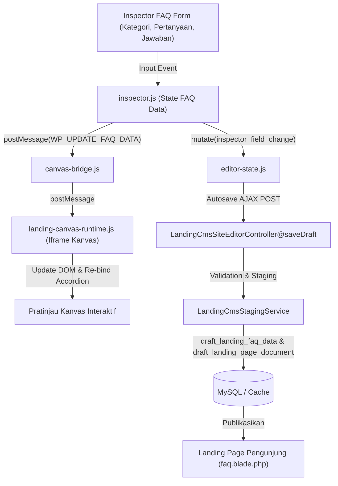

# Rencana Kerja: Pengelolaan Pertanyaan dan Jawaban (Q&A Statement) FAQ pada Canvas Editor

**Tanggal**: 23 November 2026  
**Status**: Siap Diimplementasikan (Pending Approval)  
**Dokumen Terkait**: `docs/01-PRD-MagKom.md`, `docs/02-TDD-MagKom.md`, `docs/07-DESIGN-SYSTEM-MAGKOM.md`, `.agents/rules/AGENTS.md`  
**Area Terdampak**: SuperAdmin Canvas Editor (`_inspector.blade.php`), Inspector JS Module, Canvas Bridge, Landing Canvas Runtime, Staging Service, Block Schema Validator, Feature Tests.

---

## 1. Latar Belakang & Kebutuhan Pengguna

Berdasarkan permintaan pengguna serta tangkapan layar blok FAQ pada kanvas editor (`media_1795418135679_3f7b6ce3.jpg`):
1. **Kebutuhan Pengguna**: SuperAdmin di bagian Canvas Editor membutuhkan kemampuan untuk **merubah atau mengganti pertanyaan serta keterangan/statement jawaban dari FAQ** secara fleksibel dan langsung.
2. **Kondisi Saat Ini**:
   - Panel Inspector untuk blok FAQ (`_inspector.blade.php`) saat ini hanya memiliki 1 kolom input, yaitu *Judul Bagian FAQ* (`landing_faq_heading`).
   - Tidak ada antarmuka input di Inspector untuk mengedit kategori, butir-butir pertanyaan, maupun pernyataan/keterangan jawaban akordeon.
   - Teks instruksi di panel sebelumnya hanya menyarankan pengeditan via Form Builder lama, yang tidak terintegrasi langsung dengan pratinjau kanvas real-time.
3. **Ekspektasi Hasil**:
   - SuperAdmin dapat memilih kategori FAQ (misal: "Syarat dan Tata Cara Mendaftar", "Akun", "Kuis", "Benefit Magang", "Kewajiban Peserta Magang").
   - SuperAdmin dapat mengedit teks setiap pertanyaan (Q) dan keterangan statement jawaban (A).
   - SuperAdmin dapat menambah butir pertanyaan baru (+ Tambah Pertanyaan) atau menghapus pertanyaan yang tidak diperlukan.
   - Perubahan langsung tercermin secara instan di kanvas pratinjau (real-time tanpa reload iframe), tersimpan otomatis dalam draf autosave dengan indikator notifikasi mengambang, dan dapat dipublikasikan ke halaman publik.

---

## 2. Analisis Struktur Data & Komponen Terkait

### A. Struktur Data FAQ (`landing_faq_data`)
Data FAQ di MAGKOM tersimpan dalam format array JSON terstruktur:
```json
[
  {
    "id": "syarat",
    "nama": "Syarat dan Tata Cara Mendaftar",
    "items": [
      {
        "q": "Bagaimana alur dan tata cara mendaftar magang di Diskominfo Sleman?",
        "a": "Pendaftaran dilakukan secara mandiri atau kelompok melalui portal MAGKOM: (1) Buat akun portal, (2) Pilih formasi bidang dan bulan pelaksanaan yang masih tersedia kuotanya, (3) Unggah berkas persyaratan, (4) Tunggu verifikasi admin."
      },
      {
        "q": "Apakah siswa SMK dan mahasiswa perguruan tinggi memiliki syarat yang berbeda?",
        "a": "Secara umum sama, namun untuk siswa SMK surat permohonan ditandatangani oleh Kepala Sekolah / Waka Hubin..."
      }
    ]
  },
  {
    "id": "akun",
    "nama": "Akun",
    "items": [
      {
        "q": "Bagaimana jika tidak menerima email verifikasi akun?",
        "a": "Silakan periksa folder Spam atau Promosi pada email Anda. Jika dalam 15 menit belum masuk, Anda dapat meminta kirim ulang link verifikasi."
      }
    ]
  }
]
```

### B. Aliran Data Dua Arah (Dual-Way Sync)


---

## 3. Rencana Desain Antarmuka Inspector FAQ

Di dalam panel Inspector (`_inspector.blade.php`) pada accordion `.block-form-faq`:

1. **Judul Bagian FAQ**:
   - Input text: `Judul Bagian FAQ` (`data-field="landing_faq_heading"`).
2. **Pemilih Kategori FAQ (Category Tab / Select)**:
   - Dropdown pemilihan kategori: `<select id="select-faq-category" class="wp-select-input">`.
   - Input rename kategori terpilih: `<input type="text" id="input-faq-category-name" class="wp-text-input">`.
   - Tombol aksi kategori: `+ Tambah Kategori Baru` dan `Hapus Kategori`.
3. **Repeater Butir Pertanyaan & Jawaban (Q&A Cards)**:
   - Header repeater: Label jumlah pertanyaan pada kategori aktif + Tombol `+ Tambah Pertanyaan` (`#btn-add-faq-item`).
   - Kontainer dinamis: `<div id="wp-faq-items-list" class="wp-faq-items-list"></div>`.
   - Setiap kartu pertanyaan memuat:
     - Header kartu: Badge `#1`, `#2`, dll. + Tombol Hapus (ikon trash) + Tombol geser urutan (atas/bawah).
     - Field Pertanyaan: `<input type="text" class="wp-text-input input-faq-q" placeholder="Tuliskan pertanyaan...">`.
     - Field Keterangan / Statement Jawaban: `<textarea class="wp-textarea-input input-faq-a" rows="3" placeholder="Tuliskan keterangan jawaban lengkap..."></textarea>`.

---

## 4. Tahapan Rencana Implementasi

### Tahap 1: Struktur Markup Inspector (`resources/views/superadmin/site-editor/partials/_inspector.blade.php`)
- Mengganti teks statis bantuan di dalam `.block-form-faq` dengan:
  - Selector kategori FAQ.
  - Input nama kategori.
  - Header repeater dengan tombol `+ Tambah Pertanyaan`.
  - Kontainer `#wp-faq-items-list`.
- Mengoper data `landing_faq_data` awal via atribut data hidden di `index.blade.php` atau objek `cmsData`.

### Tahap 2: Styling CSS Inspector (`resources/css/pages/superadmin/site-editor.css`)
- Menambahkan styling responsif untuk kartu repeater FAQ:
  - `.wp-faq-item-card`: Kartu dengan border halus, radius 8px, background surface netral.
  - `.wp-faq-item-header`: Tata letak flex dengan badge nomor pertanyaan dan tombol aksi hapus/pindah.
  - Penyesuaian spacing, label input teks, dan textarea keterangan.

### Tahap 3: Logika Inspector JS (`resources/js/pages/superadmin/site-editor/inspector.js`)
- Mengelola state `faqCategoriesData` di memori editor.
- Fungsi render dinamis:
  - `renderFaqCategoriesSelect()`: Mengisi dropdown kategori.
  - `renderFaqItemsList()`: Me-render daftar kartu pertanyaan dan jawaban untuk kategori yang sedang aktif.
  - Event listener untuk perubahan teks pertanyaan (`input-faq-q`) dan keterangan jawaban (`input-faq-a`).
  - Handler untuk tombol `+ Tambah Pertanyaan`, hapus pertanyaan, tambah kategori, dan rename kategori.
  - Sinkronisasi perubahan ke `canvasBridge.sendToCanvas({ type: 'WP_UPDATE_FAQ_DATA', data: this.faqCategoriesData })`.
  - Pemicu mutasi perubahan ke `editorState` agar tersimpan otomatis.

### Tahap 4: Live Canvas Runtime Bridge (`resources/js/pages/superadmin/site-editor/canvas-bridge.js` & `landing-canvas-runtime.js`)
- `canvas-bridge.js`: Menambahkan helper method `updateFaqData(faqData)`.
- `landing-canvas-runtime.js`:
  - Menangani pesan tipe `WP_UPDATE_FAQ_DATA`.
  - Me-render ulang markup elemen `#faqCategoryAccordion` di kanvas pratinjau secara instan.
  - Memanggil ulang binding interaktif akordeon (buka/tutup kategori dan buka/tutup pertanyaan emas).

### Tahap 5: Validasi & Backend Staging Service
- `SaveLandingSiteEditorRequest`:
  - Menambahkan aturan validasi untuk array `landing_faq_data` dan item-itemnya (`id`, `nama`, `items.*.q`, `items.*.a`).
- `LandingCmsStagingService`:
  - Menyimpan array `landing_faq_data` ke `draft_landing_faq_data`.
  - Menyinkronkan item FAQ ke `draft_landing_page_document` (pada blok `faq` -> `content['items']`).
  - Menangani penerbitan (*publish*) ke `landing_faq_data` dan sinkronisasi `landing_page_document` versi live.

### Tahap 6: Pengujian Otomatis & Quality Gates
- **Feature Test** di `tests/Feature/SuperAdmin/LandingCmsSiteEditorTest.php`:
  - Pengujian SuperAdmin dapat menyimpan draf perubahan pertanyaan dan jawaban FAQ via AJAX.
  - Pengujian SuperAdmin dapat menerbitkan (*publish*) perubahan FAQ ke versi live.
  - Pengujian halaman publik landing page me-render pertanyaan dan jawaban yang baru diperbarui.
- **Quality Gates**:
  - `npm run build` (Vite build aset frontend).
  - `./vendor/bin/pint --test` (Pemeriksaan PSR-12).
  - `./vendor/bin/phpstan analyse --memory-limit=1G` (Analisis statis).
  - `php artisan test` (Pengujian fungsional).

---

## 5. Matriks Dampak Berkas

| Berkas | Jenis Perubahan | Alasan |
| :--- | :--- | :--- |
| `resources/views/superadmin/site-editor/partials/_inspector.blade.php` | Markup Blade | Menambahkan kontainer selector kategori dan kartu repeater Q&A FAQ. |
| `resources/css/pages/superadmin/site-editor.css` | Styling CSS | Desain kartu repeater pertanyaan/jawaban FAQ sesuai design system. |
| `resources/js/pages/superadmin/site-editor/inspector.js` | Modul ES JS | Logika interaktif edit, tambah, hapus pertanyaan dan statement FAQ. |
| `resources/js/pages/superadmin/site-editor/canvas-bridge.js` | Modul ES JS | Pengiriman sinyal dual-way update FAQ ke iframe kanvas. |
| `resources/js/pages/public/landing-canvas-runtime.js` | Modul ES JS | Penerima pesan kanvas untuk update instan DOM akordeon FAQ. |
| `app/Http/Requests/SuperAdmin/SaveLandingSiteEditorRequest.php` | Backend Request | Validasi skema array `landing_faq_data`. |
| `app/Services/LandingCmsStagingService.php` | Backend Service | Staging draf dan sinkronisasi publikasi FAQ. |
| `tests/Feature/SuperAdmin/LandingCmsSiteEditorTest.php` | Unit/Feature Test | Test suite otomatis untuk verifikasi end-to-end edit FAQ. |

---

## 6. Permohonan Persetujuan Perubahan Blade (AGENTS.md Aturan 3.3)

Sesuai aturan **AGENTS.md Bagian 3.3 (Pengecualian perubahan Blade)**:
- **Alasan**: Penambahan fitur pengeditan pertanyaan dan keterangan/statement FAQ membutuhkan kontainer input baru (selector kategori, nama kategori, dan repeater container `#wp-faq-items-list`) yang saat ini belum ada di panel Inspector.
- **Berkas yang Diubah**: `resources/views/superadmin/site-editor/partials/_inspector.blade.php` (pada baris 270–284 di dalam `<details class="wp-accordion block-form-faq">`).
- **Jaminan**: Tidak ada CSS inline, tidak ada JavaScript inline, dan tidak ada business logic di Blade. Seluruh styling diletakkan di `resources/css/` dan interaksi di `resources/js/`.

