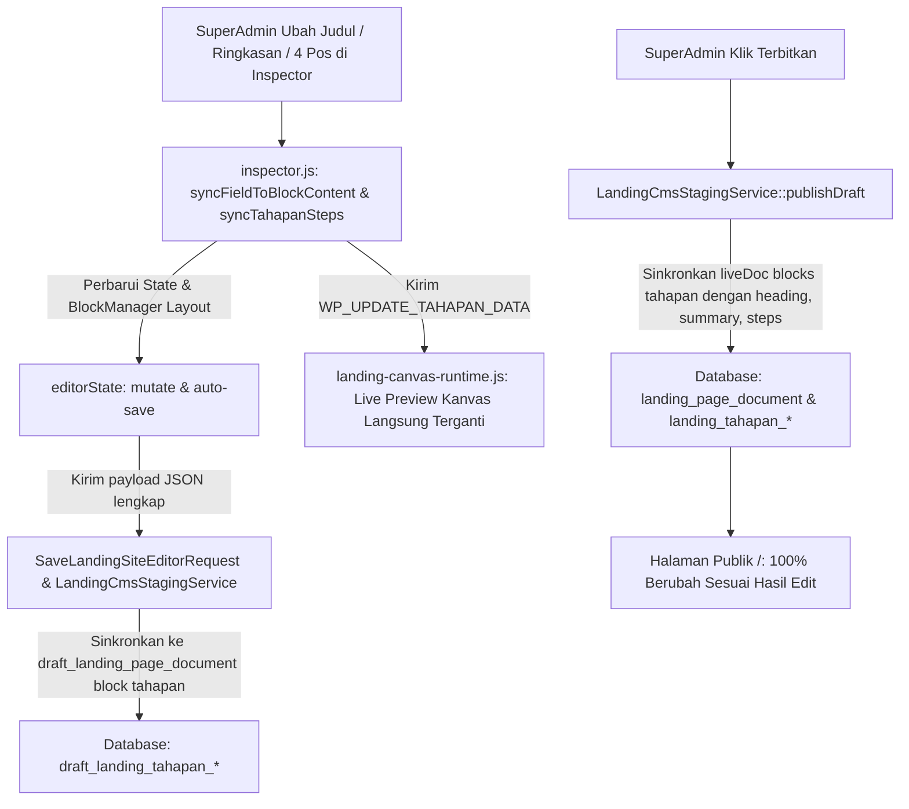

# Rencana Perbaikan: Sinkronisasi, Live Preview, & Publikasi Blok Alur & Tahapan Canvas Editor

**Dokumen**: `docs/plans/2026-11-23-perbaikan-sinkronisasi-dan-publikasi-blok-alur-tahapan.md`  
**Tanggal**: 23 November 2026  
**Status**: Usulan / Menunggu Persetujuan Pengguna  
**Referensi Aturan**: `AGENTS.md` (Strict Verification, Minimal Changes, Quality Gates)

---

## 1. Masalah & Analisis Akar Penyebab (Root Cause Analysis)

### Gejala Masalah
Saat SuperAdmin mengubah **Judul Bagian Alur**, **Ringkasan Alur Naratif**, atau **Judul & Deskripsi 4 Pos Halte Checkpoint** di Canvas Editor (`/superadmin/site-editor`), lalu menekan tombol **Terbitkan Draf**, perubahan tersebut **tidak tersimpan / tidak berubah** pada halaman publik maupun pratinjau kanvas.

### Analisis Akar Penyebab (4 Titik Kerusakan)

1. **Backend `LandingCmsStagingService::saveSiteEditorDraft`**:
   - Saat menyimpan draf, sistem melakukan mapping flat keys ke dalam objek `landing_page_document.blocks`.
   - Blok `hero` dan `faq` telah disinkronkan, namun blok `tahapan` **terlewatkan / belum disinkronkan**. Akibatnya, blok `tahapan` di dalam dokumen JSON tetap memegang konten lama.
   - Tepat setelah itu, `LegacyCmsAdapter::syncDocumentToLegacySettings()` dijalankan. Karena membaca dokumen blok yang belum terbarui, fungsi ini secara tidak sengaja **menimpa kembali (`overwrite`)** kunci `draft_landing_tahapan_heading`, `draft_landing_tahapan_summary`, dan `draft_landing_tahapan_steps` dengan nilai lama!

2. **Backend `LandingCmsStagingService::publishDraft`**:
   - Saat tombol *Terbitkan* ditekan, proses sinkronisasi live document `landing_page_document` hanya memperbarui blok `hero` dan `faq`. Blok `tahapan` tidak diperbarui dengan nilai live yang baru diterbitkan.
   - Karena template Blade `public/blocks/tahapan.blade.php` membaca dari `$content['heading']`, `$content['summary']`, dan `$content['steps']` terlebih dahulu (prioritas blok dokumen), halaman publik tetap merender teks lama dari dokumen JSON.

3. **Frontend `inspector.js` (`syncTahapanSteps`)**:
   - Fungsi `syncTahapanSteps()` hanya mengisi `this.state['landing_tahapan_steps'] = steps`, tetapi **tidak memperbarui** `targetBlock.content.steps` di dalam `this.blockManager.layout`.
   - Akibatnya, saat `doc.blocks = blockManager.getLayout()` dikirim ke server via AJAX, array `steps` pada blok tahapan selalu merupakan data lama.
   - Di `setBlockManager()`, nilai awal tahapan belum diselaraskan ke dalam `state`.

4. **Live Canvas Preview (`landing-canvas-runtime.js` & `canvas-bridge.js`)**:
   - Belum ada pesan bridge `WP_UPDATE_TAHAPAN_DATA` untuk memperbarui judul, ringkasan, dan kartu pos tahapan secara langsung di iframe kanvas preview tanpa reload.

---

## 2. Solusi Arsitektur & Rencana Perbaikan



### Rincian Perbaikan per Modul:

### A. Backend Staging Service (`app/Services/LandingCmsStagingService.php`)
1. **Di dalam `saveSiteEditorDraft()`**:
   Tambahkan sinkronisasi blok `tahapan` ke dalam `landing_page_document.blocks`:
   ```php
   if (($b['type'] ?? '') === 'tahapan') {
       if (isset($data['landing_tahapan_heading'])) {
           $b['content']['heading'] = (string) $data['landing_tahapan_heading'];
       }
       if (isset($data['landing_tahapan_summary'])) {
           $b['content']['summary'] = (string) $data['landing_tahapan_summary'];
       }
       if (isset($data['landing_tahapan_steps']) && is_array($data['landing_tahapan_steps'])) {
           $b['content']['steps'] = $data['landing_tahapan_steps'];
       }
   }
   ```
2. **Di dalam `publishDraft()`**:
   Tambahkan penyelarasan blok `tahapan` pada dokumen live sebelum disimpan:
   ```php
   $liveTahapanHeading = Pengaturan::getLive('landing_tahapan_heading');
   $liveTahapanSummary = Pengaturan::getLive('landing_tahapan_summary');
   $liveTahapanSteps = Pengaturan::json('landing_tahapan_steps');

   if (($b['type'] ?? '') === 'tahapan') {
       if ($liveTahapanHeading !== null) {
           $b['content']['heading'] = $liveTahapanHeading;
           $docChanged = true;
       }
       if ($liveTahapanSummary !== null) {
           $b['content']['summary'] = $liveTahapanSummary;
           $docChanged = true;
       }
       if (is_array($liveTahapanSteps) && count($liveTahapanSteps) > 0) {
           $b['content']['steps'] = $liveTahapanSteps;
           $docChanged = true;
       }
   }
   ```

### B. Frontend Inspector & Canvas Bridge
1. **Di dalam `resources/js/pages/superadmin/site-editor/inspector.js`**:
   - Di `setBlockManager()`: Muat data `tahapan` dari blok layout ke dalam state inspector (`landing_tahapan_heading`, `landing_tahapan_summary`, `landing_tahapan_steps`).
   - Di `syncTahapanSteps()`: Perbarui langsung `tahapanBlock.content.steps = steps` pada `this.blockManager.layout`, lalu kirimkan pesan live update melalui `this.bridge.updateTahapanData(...)`.
   - Di `syncFieldToBlockContent()`: Pastikan perubahan `landing_tahapan_heading` dan `landing_tahapan_summary` juga memicu `this.bridge.updateTahapanData(...)`.
2. **Di dalam `resources/js/pages/superadmin/site-editor/canvas-bridge.js`**:
   Tambahkan metode:
   ```javascript
   updateTahapanData(tahapanData) {
       if (!this.iframe || !this.iframe.contentWindow) return;
       this.iframe.contentWindow.postMessage({
           type: 'WP_UPDATE_TAHAPAN_DATA',
           tahapanData: tahapanData,
       }, this.targetOrigin);
   }
   ```
3. **Di dalam `resources/js/pages/public/landing-canvas-runtime.js`**:
   - Tangkap event `WP_UPDATE_TAHAPAN_DATA`.
   - Perbarui DOM kanvas secara live:
     - Judul utama (`.tahapan-main-heading`).
     - Baris ringkasan naratif (`.tahapan-summary-list`).
     - Kartu 4 pos halte checkpoint (`.tahapan-card-item`: `.tahapan-card-title` dan `.tahapan-card-desc`).
     - Tooltip / aria-label pada node SVG jalan raya (desktop dan mobile).

### C. Backend Request Validation (`app/Http/Requests/SuperAdmin/SaveLandingSiteEditorRequest.php`)
Pastikan validasi struktur array `landing_tahapan_steps` eksplisit:
```php
'landing_tahapan_steps' => ['sometimes', 'nullable', 'array'],
'landing_tahapan_steps.*.step' => ['required_with:landing_tahapan_steps', 'string', 'max:10'],
'landing_tahapan_steps.*.title' => ['required_with:landing_tahapan_steps', 'string', 'max:150'],
'landing_tahapan_steps.*.badge' => ['sometimes', 'nullable', 'string', 'max:150'],
'landing_tahapan_steps.*.desc' => ['required_with:landing_tahapan_steps', 'string', 'max:1000'],
```

---

## 3. Rencana Pengujian Otomatis (Feature Tests)

Tambahkan automated test komprehensif pada `tests/Feature/SuperAdmin/LandingCmsSiteEditorTest.php`:
`test_superadmin_can_update_and_publish_tahapan_heading_summary_and_steps()`:
1. Login sebagai SuperAdmin.
2. Kirim request simpan draf dengan:
   - `landing_tahapan_heading`: "Alur Baru Pendaftaran Magang Sleman 2026"
   - `landing_tahapan_summary`: "Langkah satu registrasi akun portal.\nLangkah dua seleksi berkas dinas."
   - `landing_tahapan_steps`: 4 pos dengan judul dan deskripsi baru (misal: "Pos 01: Registrasi Akun Mandiri", "Pos 02: Kurasi Berkas Resmi", dst).
3. Publikasikan draf ke live (`site-editor/publish`).
4. Kunjungi halaman publik (`/`).
5. Assert status 200 dan pastikan seluruh teks judul baru, ringkasan baru, serta judul & deskripsi pos baru muncul di HTML halaman live.

---

## 4. Langkah-Langkah Eksekusi Bertahap

- [ ] **Langkah 1**: Perbarui validasi pada `SaveLandingSiteEditorRequest.php`.
- [ ] **Langkah 2**: Perbaiki logika sinkronisasi blok tahapan di `LandingCmsStagingService.php` (`saveSiteEditorDraft` dan `publishDraft`).
- [ ] **Langkah 3**: Perbaiki `inspector.js` (`syncTahapanSteps`, `setBlockManager`) dan tambahkan bridge `updateTahapanData` di `canvas-bridge.js`.
- [ ] **Langkah 4**: Implementasikan penanganan live DOM update di `landing-canvas-runtime.js`.
- [ ] **Langkah 5**: Buat automated feature test di `LandingCmsSiteEditorTest.php`.
- [ ] **Langkah 6**: Jalankan Quality Gates (`npm run build`, `pint --test`, `phpstan analyse`, dan `php artisan test`).

