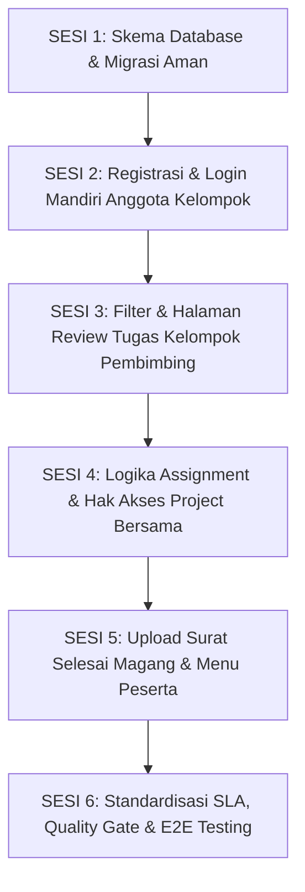

# PLAN: Pengembangan dan Penyesuaian Logika Sistem Magang Diskominfo (MagKom)

Dokumen ini memuat rencana kerja arsitektural dan implementasi bertahap untuk 5 kebutuhan utama pengembangan sistem MAGKOM:
1. Perbaikan Registrasi dan Login Peserta Kelompok (Multi-Akun Mandiri).
2. Penambahan Filter Review Tugas pada Dashboard Pembimbing (Semua, Individu, Kelompok).
3. Pengembangan Halaman Review Tugas Kelompok & Logika Hak Akses Project Bersama.
4. Penyesuaian Upload Surat Keterangan Selesai Magang Individual & Menu Selesai Magang Peserta.
5. Verifikasi Konsistensi Penamaan Pengaturan SLA Verifikasi Berkas.

---

## 🏛️ Analisis Arsitektur & Dampak Sistem Existing

### 1. Registrasi & Autentikasi Kelompok
- **Kondisi Eksisting**:
  - `AuthController::register`: Data anggota kelompok hanya disimpan di tabel `kelompok_anggota` tanpa akun `User` dan tanpa kata sandi.
  - `PlacementService` & `AssignPesertaAction`: Hanya membuat record `Penempatan` untuk ketua kelompok (`pendaftaran.user_id`). Anggota kelompok tidak memiliki akun login mandiri dan tidak terhubung ke penempatan pembimbing.
- **Rancangan Penyesuaian**:
  - Skema database: Menambahkan `user_id` pada tabel `kelompok_anggota` (`foreignId('user_id')->nullable()->constrained('users')->nullOnDelete()`).
  - Form registrasi kelompok: Menambahkan input `password` dan `password_confirmation` untuk setiap anggota kelompok.
  - Registrasi: Membuat akun `User` (`role: peserta`) dan `PesertaProfil` untuk setiap anggota kelompok, di-hash dengan aman.
  - Penerimaan Admin & Penempatan: Saat admin menerima pendaftaran kelompok dan menetapkan pembimbing, sistem secara otomatis mengenerate `Penempatan` untuk ketua dan seluruh anggota kelompok secara atomik.
  - Setiap anggota kelompok dapat langsung login mandiri ke portal peserta.

### 2. Tugas, Review Tugas & Project Bersama Pembimbing
- **Kondisi Eksisting**:
  - Tabel `tugas` terikat 1:1 ke `penempatan_id`. Tidak ada konsep tugas kelompok / project bersama multi-peserta.
  - Halaman `pembimbing.tugas.index` hanya menampilkan daftar mentee dan tugas individual per penempatan.
- **Rancangan Penyesuaian**:
  - Menambahkan kolom `tipe` pada `tugas` (`enum: 'individu', 'kelompok'`) dan `kelompok_magang_id` (nullable).
  - Membuat tabel pivot `tugas_peserta` (`tugas_id`, `penempatan_id` / `user_id`, `created_at`): memetakan anggota mana saja yang di-assign oleh pembimbing ke dalam project bersama.
  - Logika Pembatasan Hak Akses:
    - Di sisi pembimbing: Filter `Semua`, `Individu`, `Kelompok`. Pada filter `Kelompok`, tampilkan daftar kelompok bimbingan -> klik kelompok menuju detail anggota -> tab *Review Individu* vs *Project Bersama*.
    - Di sisi peserta: Query tugas peserta memfilter:
      `WHERE penempatan_id = :my_penempatan OR id IN (SELECT tugas_id FROM tugas_peserta WHERE user_id = :my_user_id)`.
    - Peserta yang tidak ditugaskan dalam project bersama **sama sekali tidak bisa melihat** data project di list, detail, maupun endpoint API/download.

### 3. Surat Keterangan Selesai Magang & Menu Selesai Magang Peserta
- **Kondisi Eksisting**:
  - Tabel `penempatan` hanya memiliki `file_surat_diterima`. Belum ada penyimpanan khusus surat keterangan selesai magang per peserta.
  - Menu sidebar peserta belum memiliki tautan khusus "Selesai Magang".
- **Rancangan Penyesuaian**:
  - Skema database: Menambahkan `file_surat_selesai` (string nullable) dan `tgl_upload_surat_selesai` pada tabel `penempatan`.
  - Di Administrasi (menu Penempatan / Arsip Kelulusan Admin):
    - Admin dapat mengunggah file surat keterangan selesai magang secara individual per peserta (termasuk tiap anggota kelompok).
    - Tombol upload hanya aktif jika peserta magang telah berstatus selesai (`status = 'selesai'`).
  - Di Dashboard Peserta:
    - Menambahkan menu sidebar "Selesai Magang" (`route('peserta.selesai-magang.index')`).
    - Peserta dapat melihat ringkasan kelulusan dan mengunduh surat selesai magang miliknya sendiri dengan pengamanan otorisasi ketat (larangan IDOR).

---

## 📋 Urutan Pengerjaan Per Sesi (Execution Roadmap)

Pengerjaan dibagi ke dalam **5 Sesi Terstruktur** agar rapi, terisolasi, dan mudah diverifikasi:

---

### 🔹 SESI 1: Skema Database & Migrasi Aman (Data Architecture Foundation)
**Fokus:** Menyiapkan struktur tabel tanpa merusak data yang sudah berjalan.
1. **Migrasi 1 (`kelompok_anggota`):**
   - Tambah kolom `user_id` (foreign key ke `users.id`, nullable, `nullOnDelete`).
2. **Migrasi 2 (`tugas` & `tugas_peserta`):**
   - Tambah kolom `tipe` (`'individu'`, `'kelompok'`) default `'individu'`, dan `kelompok_magang_id` (nullable) pada tabel `tugas`.
   - Buat tabel pivot `tugas_peserta` (`id`, `tugas_id`, `penempatan_id`, `user_id`, `timestamps`) dengan indexing tepat.
3. **Migrasi 3 (`penempatan`):**
   - Tambah kolom `file_surat_selesai` (nullable) dan `tgl_upload_surat_selesai` (nullable) pada tabel `penempatan`.
4. **Model Updates:**
   - Update `KelompokAnggota`: relasi `user(): BelongsTo`.
   - Update `Tugas`: relasi `pesertaDitugaskan(): BelongsToMany`, relasi `kelompokMagang(): BelongsTo`.
   - Update `Penempatan`: mutator & aksesor URL surat selesai magang.

---

### 🔹 SESI 2: Registrasi, Pembuatan Akun & Login Mandiri Anggota Kelompok
**Fokus:** Memastikan setiap anggota kelompok memiliki kredensial mandiri dan terhubung ke kelompok.
1. **UI Form Registrasi Kelompok (`resources/views/auth/register.blade.php`):**
   - Tambahkan input `password` dan `password_confirmation` untuk setiap baris anggota tim pada form registrasi dinamis.
   - Pertahankan interaksi JS dinamis penambahan/pengurangan slot anggota.
2. **Backend Validation & Processing (`AuthController.php`):**
   - Validasi array anggota: `anggota.*.password` (min 8 karakter, konfirmasi cocok), `anggota.*.email` unik di tabel `users`.
   - Buat akun `User` (`role: peserta`, `status_aktif: true`) dan `PesertaProfil` untuk masing-masing anggota.
   - Hubungkan `kelompok_anggota.user_id` ke user baru yang dibuat.
3. **Penerimaan & Alokasi Penempatan Otomatis (`PlacementService.php` & `AssignPesertaAction.php`):**
   - Saat pendaftaran kelompok disetujui admin:
     - Generate penempatan untuk Ketua Kelompok.
     - Generate penempatan paralel untuk masing-masing Anggota Kelompok dengan pembimbing, bidang, dan periode yang identik.
4. **Verifikasi Login Mandiri:**
   - Uji login ketua kelompok -> masuk dashboard peserta.
   - Uji login anggota kelompok 1, 2, dst -> masing-masing masuk dashboard peserta pribadinya.

---

### 🔹 SESI 3: Filter Review Tugas Dashboard Pembimbing (Semua, Individu, Kelompok)
**Fokus:** Filter fungsional di backend dan tampilan DS-MagKom pada menu review tugas pembimbing.
1. **Query & Service Pembimbing (`TugasDashboardService.php` & `TugasIndexQuery.php`):**
   - Tambahkan parameter filter `jenis_tugas`: `semua` (default), `individu`, `kelompok`.
   - Scope query menyaring penugasan berdasarkan tipe tugas yang relevan dengan tanggung jawab pembimbing aktif.
2. **UI Tab Filter (`resources/views/pembimbing/tugas/index.blade.php`):**
   - Tambahkan 3 pill filter: **Semua**, **Individu**, **Kelompok**.
   - Indikator badge jumlah tugas aktif di masing-masing kategori.

---

### 🔹 SESI 4: Halaman Review Tugas Kelompok & Logika Project Bersama
**Fokus:** Alur bertingkat (Daftar Kelompok -> Detail Anggota -> Assignment Project Bersama).
1. **A. Halaman Daftar Kelompok (`pembimbing.tugas.index` mode kelompok):**
   - Tampilkan tabel/kartu daftar kelompok bimbingan: Nama Kelompok, Nama Ketua, Jumlah Anggota, Status Kelompok.
2. **B. Halaman Detail Kelompok & Anggota (`pembimbing/tugas/kelompok/show.blade.php`):**
   - Tampilkan informasi profil kelompok dan tabel seluruh anggota (termasuk ketua).
   - Dua toggle view:
     - **Review Individu**: Menampilkan ringkasan tugas masing-masing anggota kelompok secara terpisah.
     - **Project Bersama**: Menampilkan daftar project kelompok bimbingan tersebut.
3. **C. Pembuatan & Penugasan Project Bersama (Assignment Logic):**
   - Form pembuatan project bersama oleh pembimbing: input instruksi, deadline, materi, serta **checklist pemilihan anggota yang ditugaskan**.
   - Simpan data assignment ke tabel `tugas_peserta`.
4. **D. Proteksi Hak Akses di Backend (Security Boundary):**
   - **Peserta Dashboard / Tugas Index**: Query hanya memunculkan project bersama jika `auth()->id()` terdaftar di `tugas_peserta`.
   - **Peserta Show Tugas**: Authorize check: jika tugas bertipe kelompok, pastikan user ada di `tugas_peserta` atau kembalikan HTTP 403 Forbidden.
   - Peserta non-assigned (contoh: Dimas) sama sekali tidak memiliki jejak akses ke project tersebut.

---

### 🔹 SESI 5: Upload Surat Keterangan Selesai Magang & Menu Peserta
**Fokus:** Distribusi surat selesai magang per individu dan akses unduh di dashboard peserta.
1. **Fitur Upload Admin (`Admin/PenempatanController.php` atau `Admin/KelulusanController`):**
   - Pada tabel penempatan/peserta selesai magang, sediakan aksi upload surat selesai magang per baris peserta (baik individu maupun anggota kelompok satu per satu).
   - Validasi: Format PDF/dokumen, ukuran maks 2MB, status penempatan harus `selesai`.
   - Surat tersimpan aman di disk privat (`storage/app/surat_selesai/`).
2. **Menu Sidebar Peserta "Selesai Magang":**
   - Tambahkan navigasi baru di sidebar peserta: `Selesai Magang` (`route('peserta.selesai-magang.index')`).
   - Halaman menampilkan:
     - Ringkasan periode kelulusan dan pembimbing.
     - Status ketersediaan berkas surat selesai magang.
     - Tombol unduh / pratinjau surat keterangan selesai magang milik user bersangkutan.
   - Endpoint unduh dengan proteksi otorisasi: hanya peserta pemilik dokumen yang dapat mengunduh.

---

### 🔹 SESI 6: Penamaan Pengaturan SLA, Quality Gate & Verifikasi Komprehensif
**Fokus:** Konsistensi label SLA, audit kode, dan pengujian otomatis.
1. **Verifikasi Penamaan Pengaturan SLA:**
   - Pastikan teks "Target Batas Waktu SLA Verifikasi Berkas (Hari Kerja)" tampil konsisten di form Administrasi, request validation, dan lang files tanpa mengubah mekanisme hitung hari kerja.
2. **Automated Testing Suite (Pest / PHPUnit):**
   - `KelompokMultiAccountRegistrationTest`: Registrasi kelompok dengan password anggota, verifikasi akun `users` tercipta.
   - `KelompokApprovalAndLoginTest`: Penerimaan kelompok oleh admin dan uji login mandiri anggota.
   - `PembimbingTugasFilterTest`: Pengujian filter Semua, Individu, Kelompok.
   - `ProjectBersamaAccessControlTest`: Uji isolasi hak akses project bersama (Andi, Budi, Citra bisa lihat; Dimas 403 / tidak melihat).
   - `SuratSelesaiMagangIndividualTest`: Uji upload surat per peserta dan proteksi unduh milik pribadi.
3. **Build & Formatting:**
   - `npm run build`
   - `./vendor/bin/pint --test`
   - `php artisan test`

---

## ❓ Konfirmasi Sebelum Memulai Eksekusi Sesi 1

Sebelum kita mulai mengeksekusi kode pada Sesi 1, mohon konfirmasi Anda terkait:
1. **Password Anggota pada Registrasi Kelompok:** Apakah seluruh anggota kelompok wajib diisikan password oleh ketua saat pendaftaran, atau apakah sistem juga menyediakan opsi generate password default sementara jika tidak diisi? (Rekomendasi: Wajib diisi dan dikonfirmasi langsung oleh ketua tim sesuai instruksi Anda).
2. **Urutan Pengerjaan:** Apakah urutan sesi di atas (Sesi 1 s/d Sesi 6) sudah sesuai dengan yang Anda harapkan? Jika sudah disetujui, kita akan segera memulai **Sesi 1 (Skema Database & Migrasi)**.

