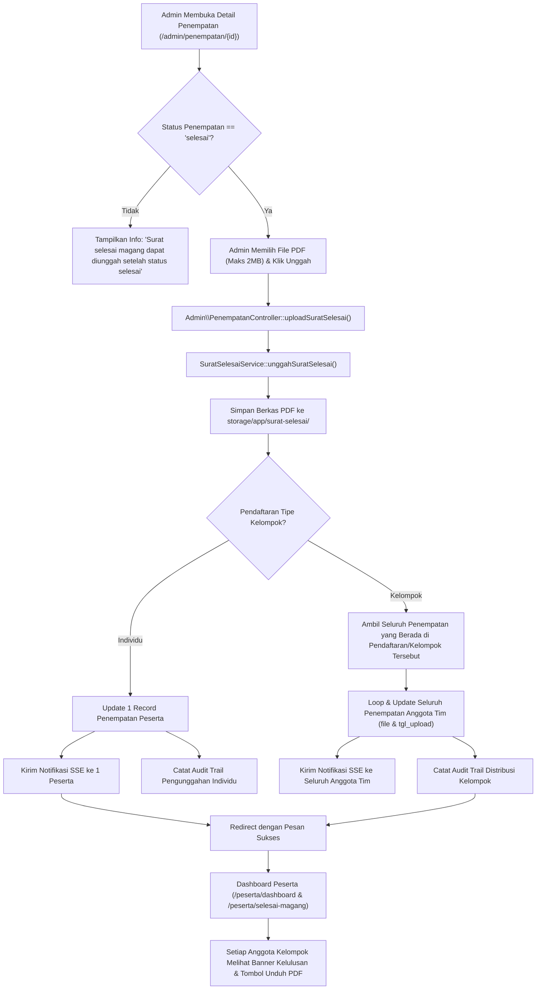

# TASK & PRD PLAN: DISTRIBUSI UNGGAH SURAT KETERANGAN SELESAI MAGANG UNTUK PESERTA INDIVIDU DAN KELOMPOK

> **Dari:** Senior Software Architect / Lead Developer  
> **Kepada:** Junior Developer / AI Implementation Engineer (Gemini 3.8 Flash Compatible)  
> **Target Repositori:** `MAGKOM` (Portal Manajemen Magang Diskominfo Kabupaten Sleman)  
> **Status Dokumen:** READY FOR REVIEW / MENUNGGU PERSETUJUAN  
> **Tingkat Prioritas:** High (Core Feature: Siklus Kelulusan & Distribusi Dokumen Magang)  
> **Tanggal Dokumen:** 24 November 2026  
> **Spesifikasi Modul:** Administrasi Magang (`/admin/penempatan`) & Dashboard Peserta (`/peserta/dashboard`, `/peserta/selesai-magang`)  

---

## 1. 🎯 RINGKASAN EKSEKUTIF & LATAR BELAKANG (PRD)

### 1.1 Latar Belakang Masalah (Problem Statement)
Sistem **MAGKOM** saat ini telah mengadopsi dua tipe pendaftaran magang resmi:
1. **Peserta Individu**: 1 pendaftaran untuk 1 peserta mandiri.
2. **Peserta Kelompok**: 1 pendaftaran mewakili 1 tim (misal 1 kelompok terdiri dari 3 orang: 1 Ketua dan 2 Anggota), di mana **setiap anggota kini sudah memiliki akun login mandiri dan dashboard peserta masing-masing**.

Pada tahap akhir masa magang (fase kelulusan/selesai), pihak **Administrasi Instansi (`admin`)** menerbitkan **Surat Keterangan Selesai Magang (PDF)** resmi.
Namun pada implementasi eksisting:
- Metode `Admin\PenempatanController::uploadSuratSelesai()` saat ini bersifat individual kaku (`$penempatan->update(...)`).
- Jika peserta merupakan bagian dari kelompok, staf administrasi harus mencari satu per satu record penempatan setiap anggota tim dan mengunggah dokumen yang sama berulang kali (3x unggah untuk tim isi 3 orang). Hal ini rawan kelalaian (*human error*), inkonsistensi waktu penerbitan, dan membebani staf dinas.
- Di sisi peserta, antarmuka dashboard utama (`/peserta/dashboard`) pada fase selesai (`_phase_selesai.blade.php`) belum menampilkan kartu aksi langsung untuk mengunduh Surat Keterangan Selesai Magang, sehingga peserta harus berpindah atau kebingungan mencari lokasi berkas resminya.

### 1.2 Sasaran Fitur (Target Objectives)
1. **Unggah Sekali, Terdistribusi ke Seluruh Tim (Atomic Group Distribution)**:
   - Ketika Administrator mengunggah Surat Keterangan Selesai Magang pada salah satu peserta kelompok, sistem secara otomatis mendeteksi bahwa peserta tersebut berada dalam rombongan kelompok.
   - Sistem mendistribusikan / menyinkronkan path berkas surat selesai dan timestamp penerbitan ke **seluruh record penempatan anggota kelompok yang terdaftar**.
   - Jika peserta adalah individu, surat selesai hanya masuk ke record penempatan peserta individu bersangkutan.
2. **Dashboard Peserta Ramah & Terpadu (Unified Mentee Dashboard)**:
   - Di dashboard peserta (`/peserta/dashboard`), ketika status magang telah `Selesai` dan surat selesai telah diunggah oleh admin, muncul kartu kelulusan resmi dengan tombol unduh dokumen PDF langsung.
   - Tampilan menginformasikan status dokumen resmi, tanggal penerbitan, serta konteks apakah surat tersebut merupakan surat perorangan atau kelompok.
   - Halaman `/peserta/selesai-magang` tetap sinkron dan menampilkan berkas yang sama.
3. **Keamanan Ketat (IDOR Protection, Storage Isolation, Mime-Type Validation)**:
   - File tersimpan di disk `local` pada direktori `surat-selesai/` yang tidak dapat diakses secara publik (*protected storage*).
   - Pengunduhan diwajibkan melalui controller terautentikasi yang memastikan peserta hanya dapat mengunduh dokumen jika ID pengguna terhubung dengan record penempatan sah miliknya.

---

## 2. 🛡️ PRINSIP ARSITEKTUR & KEAMANAN (SENIOR GUARDRAILS)

Semua developer / AI junior wajib mematuhi panduan ketat repositori MAGKOM:

1. **JANGAN MERUSAK STRUKTUR DATABASE (Zero-Schema Migration)**:
   - Tabel `penempatan` **sudah memiliki kolom**:
     - `file_surat_selesai` (VARCHAR 255, nullable)
     - `tgl_upload_surat_selesai` (TIMESTAMP, nullable)
   - Tabel `pendaftaran` **sudah memiliki kolom**:
     - `tipe` ('individu' vs 'kelompok')
     - `kelompok_magang_id` (FK ke `kelompok_magang`)
   - **TIDAK PERLU** membuat file migrasi database baru. Manfaatkan kolom eksisting secara optimal.
2. **Database Transaction & Idempotency**:
   - Proses distribusi berkas ke seluruh anggota kelompok wajib dibungkus dalam `DB::transaction(..., 3)` untuk mencegah *partial failure* jika salah satu baris anggota terkendala.
3. **Prinsip Skinny Controller & Fat Service**:
   - Logika penanganan berkas, penentuan target anggota kelompok, penyimpanan storage, penulisan audit log, dan broadcast event SSE diletakkan di dalam Service khusus: `App\Services\Admin\Penempatan\SuratSelesaiService.php`.
   - Controller `PenempatanController` hanya bertugas menerima HTTP request, memvalidasi form, memanggil service, dan mengembalikan respon redirect dengan pesan yang informatif.
4. **Aturan Khusus Blade (No Inline Scripts/Styles)**:
   - DILARANG menulis `<style>` atau `<script>` baru di dalam file Blade.
   - Gunakan class CSS yang sudah ada di Design System MagKom / Tailwind / Gentelella parity (`saas-card`, `btn-doc-action`, `doc-pdf-card`, dsb.).
5. **IDOR & Storage Traversal Defense**:
   - Endpoint unduh (`/peserta/selesai-magang/unduh`) wajib memeriksa kepemilikan data melalui `Penempatan::where('peserta_id', $user->id)`. Dilarang menerima parameter `$penempatan_id` bebas dari query parameter/URL peserta tanpa otorisasi ketat.

---

## 3. 🧩 DIAGRAM LOGIKA ALUR BISNIS (BUSINESS WORKFLOW)



---

## 4. 📁 INVENTARISASI & MATRIKS PERUBAHAN BERKAS

| No | File Path | Aksi | Tanggung Jawab & Alasan Perubahan |
| :--- | :--- | :---: | :--- |
| 1 | `app/Services/Admin/Penempatan/SuratSelesaiService.php` | **Create** | Service domain untuk menangani upload, validasi berkas fisik, penghapusan berkas lama jika update, broadcast update ke seluruh anggota kelompok, dan pencatatan audit log. |
| 2 | `app/Http/Controllers/Admin/PenempatanController.php` | **Modify** | Refactor method `uploadSuratSelesai()` agar memanfaatkan `SuratSelesaiService` dan memberikan flash message dinamis (jumlah anggota yang menerima surat). |
| 3 | `app/Models/Pendaftaran.php` | **Modify** | Tambahkan relasi `penempatans(): HasMany` untuk mendukung pengambilan seluruh entri penempatan jika pendaftaran bertipe kelompok. |
| 4 | `app/Models/Penempatan.php` | **Modify** | Tambahkan helper methods `isKelompok(): bool` dan `getRekanKelompokPenempatan(): Collection`. |
| 5 | `resources/views/admin/penempatan/show.blade.php` | **Modify** | Perkaya panel upload surat selesai dengan info kelompok: deteksi apakah peserta kelompok, tampilkan daftar nama rekan tim yang akan ikut menerima surat, dan badge info distribusi otomatis. |
| 6 | `resources/views/peserta/dashboard/partials/_phase_selesai.blade.php` | **Modify** | Tambahkan kartu unduh dokumen resmi Surat Keterangan Selesai Magang langsung di dashboard utama peserta fase selesai. |
| 7 | `tests/Feature/AdminSuratSelesaiIndividuKelompokTest.php` | **Create** | Test suite komprehensif menguji skenario individu, skenario kelompok (distribusi ke 3 anggota), IDOR safety, dan validasi berkas. |

---

## 5. 📝 PANDUAN LANGKAH-DEMI-LANGKAH IMPLEMENTASI (STEP-BY-STEP)

### Langkah 1: Tambahkan Helper Relasi pada Model Pendaftaran & Penempatan

#### 1.1 Model Pendaftaran: `app/Models/Pendaftaran.php`
Buka file [app/Models/Pendaftaran.php](file:///g:/MAGKOM/app/Models/Pendaftaran.php).
Tambahkan relasi `penempatans()` di samping relasi `penempatan()` yang sudah ada:

```php
/**
 * Seluruh record penempatan yang terikat dengan pendaftaran ini (untuk pendaftaran kelompok).
 *
 * @return \Illuminate\Database\Eloquent\Relations\HasMany<\App\Models\Penempatan>
 */
public function penempatans(): \Illuminate\Database\Eloquent\Relations\HasMany
{
    return $this->hasMany(Penempatan::class, 'pendaftaran_id');
}
```

#### 1.2 Model Penempatan: `app/Models/Penempatan.php`
Buka file [app/Models/Penempatan.php](file:///g:/MAGKOM/app/Models/Penempatan.php).
Tambahkan helper method untuk memeriksa keanggotaan kelompok:

```php
/**
 * Memeriksa apakah penempatan ini merupakan bagian dari pendaftaran kelompok.
 */
public function isKelompok(): bool
{
    return $this->pendaftaran?->tipe === 'kelompok' || ! empty($this->pendaftaran?->kelompok_magang_id);
}

/**
 * Mengambil seluruh penempatan rekan satu kelompok (termasuk dirinya sendiri).
 *
 * @return \Illuminate\Database\Eloquent\Collection<int, \App\Models\Penempatan>
 */
public function getRekanKelompokPenempatan(): \Illuminate\Database\Eloquent\Collection
{
    if (! $this->isKelompok() || ! $this->pendaftaran_id) {
        return new \Illuminate\Database\Eloquent\Collection([$this]);
    }

    return self::with(['peserta.profil'])
        ->where('pendaftaran_id', $this->pendaftaran_id)
        ->get();
}
```

---

### Langkah 2: Buat Service Khusus `SuratSelesaiService.php`

**File Baru:** `app/Services/Admin/Penempatan/SuratSelesaiService.php`  
Service ini mengisolasi seluruh *business logic* pengunggahan dan distribusi berkas.

**Spesifikasi Detail Kode:**
```php
<?php

declare(strict_types=1);

namespace App\Services\Admin\Penempatan;

use App\Enums\RealtimeEventTypeEnum;
use App\Enums\StatusPenempatanEnum;
use App\Enums\TipeAuditEnum;
use App\Models\Penempatan;
use App\Models\User;
use App\Services\AuditService;
use App\Services\RealtimeEventService;
use Illuminate\Http\UploadedFile;
use Illuminate\Support\Collection;
use Illuminate\Support\Facades\DB;
use Illuminate\Support\Facades\Storage;
use InvalidArgumentException;

class SuratSelesaiService
{
    public function __construct(
        protected AuditService $auditService,
        protected RealtimeEventService $realtimeService
    ) {}

    /**
     * Mengunggah Surat Keterangan Selesai Magang dan mendistribusikannya secara otomatis
     * jika peserta merupakan bagian dari kelompok magang.
     *
     * @return array{jumlah_penerima: int, is_kelompok: bool, nama_kelompok: ?string, path: string}
     *
     * @throws InvalidArgumentException
     */
    public function unggahDanDistribusikan(
        Penempatan $penempatan,
        UploadedFile $file,
        User $admin
    ): array {
        if ($penempatan->status !== StatusPenempatanEnum::Selesai) {
            throw new InvalidArgumentException('Surat selesai magang hanya dapat diunggah jika status peserta telah dinyatakan selesai magang.');
        }

        return DB::transaction(function () use ($penempatan, $file, $admin) {
            // 1. Simpan berkas fisik baru ke storage lokal terisolasi
            $path = $file->store('surat-selesai', 'local');

            $isKelompok = $penempatan->isKelompok();
            $targetPenempatans = $isKelompok 
                ? $penempatan->getRekanKelompokPenempatan() 
                : new Collection([$penempatan]);

            $namaKelompok = $penempatan->pendaftaran?->kelompokMagang?->nama_kelompok;
            $now = now();
            $jumlahPenerima = 0;

            /** @var Penempatan $target */
            foreach ($targetPenempatans as $target) {
                // Hapus berkas lama jika target sebelumnya sudah punya berkas berbeda
                if ($target->file_surat_selesai && 
                    $target->file_surat_selesai !== $path && 
                    Storage::disk('local')->exists($target->file_surat_selesai)) {
                    // Hanya hapus jika tidak sedang dipakai oleh penempatan lain
                    $masihDipakai = Penempatan::where('file_surat_selesai', $target->file_surat_selesai)
                        ->where('id', '!=', $target->id)
                        ->exists();
                    if (! $masihDipakai) {
                        Storage::disk('local')->delete($target->file_surat_selesai);
                    }
                }

                // Update record penempatan
                $target->update([
                    'file_surat_selesai' => $path,
                    'tgl_upload_surat_selesai' => $now,
                ]);

                $jumlahPenerima++;

                // Kirim notifikasi SSE ke masing-masing peserta penerima
                if ($target->peserta_id) {
                    $this->realtimeService->publish(
                        RealtimeEventTypeEnum::StatusPendaftaran,
                        [
                            'title' => 'Surat Keterangan Selesai Magang Terbit',
                            'message' => 'Surat keterangan selesai magang resmi Anda telah diterbitkan oleh Diskominfo Sleman.',
                            'status' => 'surat_selesai_terbit',
                            'action_url' => route('peserta.dashboard'),
                        ],
                        $target->peserta_id
                    );
                }

                // Catat jejak audit per peserta
                $this->auditService->catat(
                    tipe: TipeAuditEnum::Aksi,
                    tabel: 'penempatan',
                    idData: $target->id,
                    nilaiLama: null,
                    nilaiBaru: [
                        'file_surat_selesai' => $path,
                        'tgl_upload_surat_selesai' => $now->toDateTimeString(),
                    ],
                    detail: [
                        'aksi' => 'unggah_surat_selesai',
                        'admin_id' => $admin->id,
                        'peserta_id' => $target->peserta_id,
                        'is_kelompok' => $isKelompok,
                        'nama_kelompok' => $namaKelompok,
                    ],
                    user: $admin->id
                );
            }

            return [
                'jumlah_penerima' => $jumlahPenerima,
                'is_kelompok' => $isKelompok,
                'nama_kelompok' => $namaKelompok,
                'path' => $path,
            ];
        }, 3);
    }
}
```

---

### Langkah 3: Perbarui Controller `Admin\PenempatanController.php`

**File:** [app/Http/Controllers/Admin/PenempatanController.php](file:///g:/MAGKOM/app/Http/Controllers/Admin/PenempatanController.php)  
Suntikkan `SuratSelesaiService` melalui constructor atau method injection, dan perbarui method `uploadSuratSelesai()`:

```php
use App\Services\Admin\Penempatan\SuratSelesaiService;

// Di dalam uploadSuratSelesai:
public function uploadSuratSelesai(
    Penempatan $penempatan, 
    Request $request, 
    SuratSelesaiService $suratSelesaiService
): RedirectResponse {
    $this->authorize('manage', Penempatan::class);

    if ($penempatan->status !== StatusPenempatanEnum::Selesai) {
        return back()->withErrors(['file_surat' => 'Surat selesai magang hanya dapat diunggah jika status peserta telah dinyatakan selesai magang.']);
    }

    $request->validate([
        'file_surat' => ['required', 'file', 'mimes:pdf', 'max:2048'],
    ], [
        'file_surat.required' => 'Berkas surat selesai magang wajib dipilih.',
        'file_surat.file' => 'Berkas yang diunggah harus berupa file yang valid.',
        'file_surat.mimes' => 'Format berkas harus berupa dokumen PDF.',
        'file_surat.max' => 'Ukuran berkas surat selesai tidak boleh melebihi 2MB.',
    ]);

    try {
        $result = $suratSelesaiService->unggahDanDistribusikan(
            penempatan: $penempatan,
            file: $request->file('file_surat'),
            admin: $request->user()
        );

        if ($result['is_kelompok']) {
            $pesan = "Surat keterangan selesai magang berhasil diunggah dan otomatis didistribusikan ke seluruh {$result['jumlah_penerima']} anggota kelompok ({$result['nama_kelompok']}).";
        } else {
            $pesan = "Surat keterangan selesai magang untuk peserta ".($penempatan->peserta?->nama ?? 'Peserta')." berhasil diunggah.";
        }

        return back()->with('success', $pesan);
    } catch (\Throwable $e) {
        return back()->withErrors(['file_surat' => 'Gagal mengunggah surat selesai: '.$e->getMessage()]);
    }
}
```

---

### Langkah 4: Perbarui Tampilan Admin pada Form Upload (`show.blade.php`)

**File:** [resources/views/admin/penempatan/show.blade.php](file:///g:/MAGKOM/resources/views/admin/penempatan/show.blade.php)  
**Target:** Sekitar baris 440-460.
Tampilkan badge informasi jika penempatan ini merupakan bagian dari kelompok:

```blade
@if($penempatan->isKelompok())
    @php
        $rekanList = $penempatan->getRekanKelompokPenempatan();
        $namaKelompok = $penempatan->pendaftaran?->kelompokMagang?->nama_kelompok ?? __('Kelompok Magang');
    @endphp
    <div style="margin-top: 8px; padding: 10px 12px; background: #EFF6FF; border: 1px solid #BFDBFE; border-radius: 8px;">
        <div style="display: flex; align-items: center; gap: 6px; font-size: 0.775rem; font-weight: 700; color: #1E40AF; margin-bottom: 4px;">
            <svg width="14" height="14" viewBox="0 0 24 24" fill="none" stroke="currentColor" stroke-width="2.5"><path d="M17 21v-2a4 4 0 0 0-4-4H5a4 4 0 0 0-4 4v2"></path><circle cx="9" cy="7" r="4"></circle><path d="M23 21v-2a4 4 0 0 0-3-3.87"></path><path d="M16 3.13a4 4 0 0 1 0 7.75"></path></svg>
            <span>{{ __('Pendaftaran Kelompok: :nama (:count Orang)', ['nama' => $namaKelompok, 'count' => $rekanList->count()]) }}</span>
        </div>
        <p style="margin: 0; font-size: 0.725rem; color: #3B82F6; line-height: 1.35;">
            {{ __('Mengunggah berkas ini akan otomatis mendistribusikan surat selesai ke seluruh dashboard anggota tim di atas.') }}
        </p>
    </div>
@endif
```

---

### Langkah 5: Perbarui Dashboard Peserta Fase Selesai (`_phase_selesai.blade.php`)

**File:** [resources/views/peserta/dashboard/partials/_phase_selesai.blade.php](file:///g:/MAGKOM/resources/views/peserta/dashboard/partials/_phase_selesai.blade.php)  
Tambahkan panel kelulusan dan tombol unduh surat keterangan selesai magang langsung di dashboard:

```blade
@php
    /** @var \App\Models\Penempatan|null $penempatan */
    $hasSuratSelesai = $penempatan && ! empty($penempatan->file_surat_selesai) && \Illuminate\Support\Facades\Storage::disk('local')->exists($penempatan->file_surat_selesai);
    $isKelompok = $penempatan?->isKelompok();
    $namaKelompok = $penempatan?->pendaftaran?->kelompokMagang?->nama_kelompok;
@endphp
@if($penempatan)
    <div class="saas-card">
        <div class="saas-card-header">
            <div>
                <h3 class="saas-item-title">
                    {{ __('Penyelesaian Program Magang Diskominfo Sleman') }}
                </h3>
                <p class="saas-card-subtitle">
                    {{ __('Selamat! Anda telah menuntaskan seluruh masa magang dengan baik.') }}
                </p>
            </div>
            <span class="saas-badge-approved">
                <svg width="14" height="14" viewBox="0 0 24 24" fill="none" stroke="currentColor" stroke-width="2" aria-hidden="true">
                    <circle cx="12" cy="8" r="7"></circle>
                    <polyline points="8.21 13.89 7 23 12 20 17 23 15.79 13.88"></polyline>
                </svg>
                <span>{{ __('Lulus & Selesai') }}</span>
            </span>
        </div>

        <div class="saas-card-body">
            <div class="saas-selesai-banner">
                <div class="saas-selesai-text-box">
                    <p class="saas-selesai-desc">
                        {{ __('Seluruh kewajiban magang pada :bidang bersama pembimbing lapangan :pembimbing telah diverifikasi dan dinyatakan selesai secara lengkap.', [
                            'bidang' => $penempatan->bidang->nama_bidang ?? 'Dinas Kominfo Sleman',
                            'pembimbing' => $penempatan->pembimbing->nama ?? 'Tim Pembimbing Diskominfo',
                        ]) }}
                    </p>
                    @if($isKelompok && $namaKelompok)
                        <div style="margin-top: 6px; font-size: 0.8rem; font-weight: 700; color: #1E40AF;">
                            <span>{{ __('Anggota Tim: :kelompok', ['kelompok' => $namaKelompok]) }}</span>
                        </div>
                    @endif
                </div>
            </div>

            {{-- Kartu Dokumen Resmi Surat Keterangan Selesai Magang --}}
            <div style="margin-top: 1rem; padding: 16px; border-radius: 12px; border: 1.5px solid {{ $hasSuratSelesai ? '#BBF7D0' : '#FDE68A' }}; background: {{ $hasSuratSelesai ? '#F0FDF4' : '#FFFBEB' }}; display: flex; flex-wrap: wrap; align-items: center; justify-content: space-between; gap: 12px;">
                <div style="display: flex; align-items: center; gap: 12px;">
                    <div style="width: 40px; height: 40px; border-radius: 10px; background: {{ $hasSuratSelesai ? '#DCFCE7' : '#FEF3C7' }}; color: {{ $hasSuratSelesai ? '#15803D' : '#D97706' }}; display: flex; align-items: center; justify-content: center; flex-shrink: 0;">
                        <svg width="22" height="22" viewBox="0 0 24 24" fill="none" stroke="currentColor" stroke-width="2"><path d="M14 2H6a2 2 0 0 0-2 2v16a2 2 0 0 2 2h12a2 2 0 0 0 2-2V8z"></path><polyline points="14 2 14 8 20 8"></polyline><line x1="16" y1="13" x2="8" y2="13"></line><line x1="16" y1="17" x2="8" y2="17"></line></svg>
                    </div>
                    <div>
                        <h4 style="margin: 0 0 2px; font-size: 0.95rem; font-weight: 800; color: {{ $hasSuratSelesai ? '#166534' : '#92400E' }};">
                            {{ $hasSuratSelesai ? __('Surat Keterangan Selesai Magang (Dokumen Resmi)') : __('Surat Keterangan Selesai Sedang Diproses') }}
                        </h4>
                        <p style="margin: 0; font-size: 0.8rem; color: {{ $hasSuratSelesai ? '#15803D' : '#B45309' }};">
                            @if($hasSuratSelesai)
                                {{ __('Diterbitkan pada :tanggal WIB. Dokumen sah terverifikasi dinas.', ['tanggal' => $penempatan->tgl_upload_surat_selesai?->translatedFormat('d M Y H:i') ?? '-']) }}
                            @else
                                {{ __('Berkas resmi sedang dalam proses penandatanganan dan pengunggahan oleh administrator.') }}
                            @endif
                        </p>
                    </div>
                </div>

                @if($hasSuratSelesai)
                    <a href="{{ route('peserta.selesai-magang.unduh') }}" 
                       class="btn-doc-action btn-doc-download" 
                       style="display: inline-flex; align-items: center; gap: 8px; padding: 10px 18px; font-size: 0.85rem; font-weight: 800; background: #003566; color: #FFFFFF; border-radius: 8px; text-decoration: none;">
                        <svg width="16" height="16" viewBox="0 0 24 24" fill="none" stroke="currentColor" stroke-width="2.5"><path d="M21 15v4a2 2 0 0 1-2 2H5a2 2 0 0 1-2-2v-4"></path><polyline points="7 10 12 15 17 10"></polyline><line x1="12" y1="15" x2="12" y2="3"></line></svg>
                        <span>{{ __('Unduh Surat Selesai (PDF)') }}</span>
                    </a>
                @endif
            </div>
        </div>
    </div>
@endif
```

---

### Langkah 6: Pembuatan Automated Feature Test Suite

**File Baru:** `tests/Feature/AdminSuratSelesaiIndividuKelompokTest.php`  
Buat pengujian dengan pola AAA (Arrange-Act-Assert):

1. **Test 1: Individu Upload**:
   - Arrange: Buat 1 penempatan peserta individu status Selesai.
   - Act: Admin mengunggah berkas PDF `surat-test.pdf`.
   - Assert: Flash message sukses, kolom `file_surat_selesai` terisi, berkas tersimpan di disk `local`.
2. **Test 2: Individu Download**:
   - Act: Login sebagai peserta individu bersangkutan, hit `GET /peserta/selesai-magang/unduh`.
   - Assert: Status 200, Header `Content-Type: application/pdf`, file terunduh dengan nama yang sesuai.
3. **Test 3: Kelompok Multi-Recipient Broadcast**:
   - Arrange: Buat 1 pendaftaran kelompok (misal 3 anggota: User A ketua, User B anggota, User C anggota).
   - Buat 3 record penempatan berstatus Selesai untuk A, B, dan C dengan `pendaftaran_id` yang sama.
   - Act: Admin mengunggah 1 file PDF pada penempatan User A.
   - Assert:
     - Record Penempatan A, B, dan C **semuanya** memiliki `file_surat_selesai` yang sama persis.
     - Record Penempatan A, B, dan C memiliki `tgl_upload_surat_selesai` yang tidak null.
     - Flash message menyebutkan "3 anggota kelompok".
4. **Test 4: Unduh Mandiri Semua Anggota Kelompok**:
   - Act:
     - Login sebagai User B (Anggota 1) -> Unduh berkas -> Status 200.
     - Login sebagai User C (Anggota 2) -> Unduh berkas -> Status 200.
   - Assert: Setiap anggota dapat mengunduh dokumen resmi tersebut tanpa hambatan.
5. **Test 5: IDOR Protection**:
   - Act: Login sebagai User D (peserta luar yang tidak ada hubungan) -> Coba unduh surat.
   - Assert: 404 Not Found atau 403 Forbidden.
6. **Test 6: Validasi Input**:
   - File selain PDF (misal `.exe` atau `.jpg`) ditolak validasi.
   - Ukuran lebih dari 2MB ditolak validasi.

---

## 6. 🛡️ VERIFIKASI SEBELUM SELESAI (DEFINITION OF DONE)

Developer / AI pelaksana wajib menjalankan perintah verifikasi berikut:
```powershell
# 1. Jalankan test suite baru
./vendor/bin/phpunit tests/Feature/AdminSuratSelesaiIndividuKelompokTest.php

# 2. Jalankan test suite peserta & selesai magang eksisting
./vendor/bin/phpunit tests/Feature/PesertaSelesaiMagangTest.php

# 3. Analisis statis backend (PHPStan)
./vendor/bin/phpstan analyse app/Services/Admin/Penempatan/SuratSelesaiService.php app/Http/Controllers/Admin/PenempatanController.php app/Http/Controllers/Peserta/SelesaiMagangController.php --memory-limit=1G

# 4. Standar formatting kode (Laravel Pint)
./vendor/bin/pint --test

# 5. Build frontend Vite
npm run build
```

Semua perintah di atas harus berhasil (Exit Code 0) tanpa kegagalan.

---

## 7. 📌 KEPUTUSAN & PERMINTAAN KONFIRMASI USER

Rencana kerja ini telah disusun secara komprehensif, presisi, dan aman terhadap arsitektur eksisting MAGKOM.  
Mohon konfirmasi pengguna:
**"Apakah Anda menyetujui rencana kerja ini untuk segera diimplementasikan?"**
