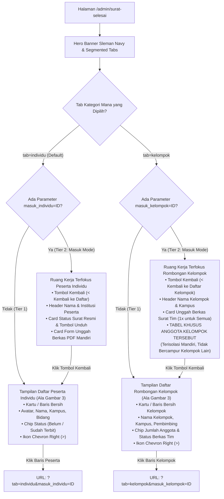

# TASK & PRD IMPLEMENTATION PLAN: REDESIGN HALAMAN SURAT SELESAI MAGANG MENJADI TWO-TIER FOCUSED WORKSPACE (ALA DAFTAR PENUGASAN & PROGRES MENTEE)

> **Dari:** Senior Software Architect / Lead Developer  
> **Kepada:** Junior Developer / AI Implementation Engineer (Gemini 3.8 Flash Compatible)  
> **Target Repositori:** `MAGKOM` (Portal Manajemen Magang Diskominfo Kabupaten Sleman)  
> **Status Dokumen:** READY FOR IMPLEMENTATION / MENUNGGU PERSETUJUAN USER  
> **Tingkat Prioritas:** High (Core UI/UX Polish: Penyederhanaan Alur Operasional Administrasi)  
> **Tanggal Dokumen:** 24 November 2026  
> **Referensi Gambar User:**
> 1. Gambar 1: `media_1795506880848_3b28552f.jpg` (Tabel Peserta Individu eksisting: Form file input berjejal di setiap baris)
> 2. Gambar 2: `media_1795506892093_35e227f6.png` (Tabel Rombongan Kelompok eksisting: Form upload tim di baris tabel & tombol dropdown anggota)
> 3. Gambar 3: `media_1795506913041_4b2be1fe.png` (Referensi Desain Target: "Daftar Penugasan & Progres Mentee" dengan kartu bersih, status badges, dan chevron `>` klik untuk masuk)
> 4. Gambar 4: `media_1795507056858_b2750493.png` (Tampilan dropdown accordion kelompok eksisting yang menyatu di tengah tabel kelompok lain)

---

## 1. 🎯 RINGKASAN EKSEKUTIF & LATAR BELAKANG PRD

### 1.1 Evaluasi Masalah UI Eksisting (Problem Statement)
Berdasarkan tinjauan langsung pada antarmuka saat ini (Gambar 1, 2, dan 4):
1. **Form Input Berjejal di Baris Tabel (Row Clutter)**:
   - Pada tabel individu (Gambar 1) dan tabel kelompok (Gambar 2), elemen `<input type="file">` dan tombol "Unggah"/"Ganti" diletakkan langsung di dalam setiap baris tabel.
   - Hal ini membuat tabel terlihat sempit, berantakan, tidak estetis, dan rawan salah klik file pada baris yang tidak sesuai.
2. **Accordion Dropdown Kelompok Menyatu dengan Kelompok Lain (Visual Inconsistency)**:
   - Pada tabel kelompok (Gambar 4), saat tombol "Anggota" diklik, sistem membuka sub-tabel tepat di bawah baris kelompok tersebut (accordion inline).
   - Ketika ada banyak kelompok magang, membuka accordion membuat baris kelompok membengkak di tengah-tengah kelompok lain ("gabung dengan tabel Daftar Kelompok Selesai Magang sama kelompok lain"), sehingga staf administrasi merasa tidak fokus dan sulit melihat hierarki kelompok.
3. **Kebutuhan Alur Operasional "Klik Dulu Baru Masuk" (Focused Workspace)**:
   - Staf administrasi menginginkan alur yang bersih dan teratur seperti yang sudah diterapkan pada modul **Daftar Penugasan & Progres Mentee** (Gambar 3).
   - Pengguna melihat daftar ringkas yang rapi. Untuk melakukan aksi (unggah berkas atau kelola anggota), pengguna **klik baris/kartu terlebih dahulu**, lalu **masuk ke ruang kerja terfokus (workspace mode)** yang dilengkapi tombol kembali (`< Kembali`).

### 1.2 Target Solusi (Objectives & Key Results)
1. **Penerapan Pola Two-Tier Master-Detail (Focused Mode)**:
   - **Tier 1 (Master List)**: Menampilkan kartu/tabel ringkasan peserta individu atau rombongan kelompok yang bersih (Avatar, Nama, Institusi, Bidang, Status Surat, dan ikon chevron `>`). Tidak ada form file input yang berjejal di baris ini.
   - **Tier 2 (Focused Workspace / Masuk Mode)**: Ketika baris/kartu diklik, pengguna masuk ke tampilan terfokus:
     - Dilengkapi tombol kembali (`mentee-chevron-back-btn`) dengan ikon `<` panah kiri.
     - Filter pencarian utama otomatis disembunyikan agar layar lapang dan tidak mendistraksi.
     - **Untuk Individu**: Menampilkan ringkasan profil peserta, status terbit berkas resmi (dengan tombol unduh jika sudah terbit), dan form unggah PDF terdedikasi yang lega dan profesional.
     - **Untuk Kelompok**: Menampilkan ringkasan kelompok, area unggah surat tim terpusat (1x unggah untuk seluruh anggota), dan **Tabel Anggota Kelompok Mandiri** yang khusus menampilkan anggota tim tersebut saja (tidak tercampur dengan kelompok lain).

---

## 2. 🛡️ ATURAN ARSITEKTUR & KEAMANAN (SENIOR GUARDRAILS)

Setiap Junior Developer atau AI yang mengeksekusi tugas ini wajib tunduk pada aturan tetap proyek:

1. **JANGAN MERUSAK STRUKTUR DATABASE (Zero-Schema Change)**:
   - Dilarang membuat migrasi baru atau mengubah skema tabel `penempatan`, `pendaftaran`, `kelompok_magang`, atau `kelompok_anggota`. Seluruh data sudah tersedia secara relasional.
2. **Kepatuhan Aturan Blade (STRICT NO INLINE CSS/JS)**:
   - Dilarang menulis tag `<style>` atau `<script>` di dalam file Blade `resources/views/admin/surat-selesai/index.blade.php`.
   - Dilarang menambahkan event handler inline (`onclick`, `onchange`, dll.).
   - Seluruh CSS ditempatkan di `resources/css/pages/admin/surat-selesai-index.css`.
   - Seluruh interaksi JavaScript ditempatkan di `resources/js/pages/admin/surat-selesai-index.js`.
3. **Perlindungan Akses & IDOR (Insecure Direct Object Reference)**:
   - Parameter `masuk_individu` (ID penempatan) dan `masuk_kelompok` (ID pendaftaran) wajib divalidasi statusnya (`StatusPenempatanEnum::Selesai`). Jika ID tidak ditemukan atau tidak memenuhi syarat, lakukan fallback aman kembali ke daftar utama tanpa error 500.
   - Otorisasi pengunggahan dan pengunduhan tetap melalui policy dan route terproteksi yang sudah ada (`admin.penempatan.surat-selesai.upload` dan `admin.penempatan.surat-selesai.unduh`).
4. **PHP 8.3 & Tooling Standard**:
   - Eksekusi command testing dan artisan menggunakan binary PHP 8.3 aktual repositori: `F:\laragon\bin\php\php-8.3.28-Win32-vs16-x64\php.exe`.

---

## 3. 🧩 DIAGRAM ALUR NAVIGASI TWO-TIER (MERMAID)



---

## 4. 🎨 WIREFRAME ASCII VISUAL PERBANDINGAN

### 4.1 Tier 1: Daftar Peserta Individu (Tanpa Form Upload Sempit)
Mengadopsi kartu rapi ala Gambar 3:
```
+---------------------------------------------------------------------------------------------------+
| [Hero Banner Sleman Navy - Daftar Surat Selesai Magang]                                           |
+---------------------------------------------------------------------------------------------------+
| [ (User) Peserta Individu (5) ]   [ (Users) Rombongan Kelompok (2) ]                              |
+---------------------------------------------------------------------------------------------------+
| Cari Peserta: [ Ketik nama, NIM...                 ]   Status: [ Semua Status v ]   [ Cari ]      |
+---------------------------------------------------------------------------------------------------+
| DAFTAR PESERTA INDIVIDU SELESAI MAGANG                                          5 Peserta Terdata |
|                                                                                                   |
|  [Foto] Aditya Pratama               Bidang EGOV           23 Nov 2026   [BELUM DIUNGGAH]     >   |
|         AMIKOM • 21.11.4589          Pembimbing: Budi                                             |
| ------------------------------------------------------------------------------------------------- |
|  [Foto] Putri Maharani               Bidang IKP            20 Nov 2026   [SUDAH TERBIT]       >   |
|         UIN Sunan Kalijaga • 2010... Pembimbing: Budi                    22 Nov 2026 14:37        |
+---------------------------------------------------------------------------------------------------+
*(Klik pada baris atau chevron > untuk masuk ke workspace unggah)*
```

### 4.2 Tier 2: Workspace Masuk Terfokus - Peserta Individu
```
+---------------------------------------------------------------------------------------------------+
| [ < Kembali ke Daftar Peserta ]                                                                   |
| [Foto] ADITYA PRATAMA                                                                             |
|        Universitas AMIKOM Yogyakarta • NIM: 21.11.4589 • Bidang: Aplikasi Informatika (EGOV)     |
+---------------------------------------------------------------------------------------------------+
| STATUS BERKAS RESMI SAAT INI:                                                                     |
| Status: [ ⚠️ BELUM DIUNGGAH ]                                                                      |
| Berkas resmi belum diterbitkan oleh bagian administrasi. Silakan unggah berkas bertanda tangan.   |
+---------------------------------------------------------------------------------------------------+
| FORMULIR UNGGAH SURAT KETERANGAN SELESAI MAGANG                                                   |
| Format berkas: PDF (Maksimal 2MB). Berkas akan otomatis tersedia di dashboard peserta.           |
|                                                                                                   |
| Pilih Berkas PDF: [ Choose File ] Tidak ada berkas yang dipilih                                   |
| [ 📤 Unggah Surat Selesai ]                                                                       |
+---------------------------------------------------------------------------------------------------+
```

### 4.3 Tier 1: Daftar Rombongan Kelompok (Tanpa Upload di Baris & Tanpa Dropdown Inline)
```
+---------------------------------------------------------------------------------------------------+
| [ (User) Peserta Individu (5) ]   [ (Users) Rombongan Kelompok (2) ]                              |
+---------------------------------------------------------------------------------------------------+
| Cari Kelompok: [ Ketik nama tim, kampus...         ]   Status: [ Semua Status v ]   [ Cari ]      |
+---------------------------------------------------------------------------------------------------+
| DAFTAR KELOMPOK SELESAI MAGANG                                                 2 Kelompok Terdata |
|                                                                                                   |
|  [Icon] Tim CSIRT & Keamanan Siber Sleman        Infrastruktur TI (ITI)    [BELUM DIUNGGAH]   >   |
|         Universitas Negeri Yogyakarta            Pembimbing: Sri Wahyuni   [ 3 Anggota Tim ]      |
| ------------------------------------------------------------------------------------------------- |
|  [Icon] Tim Pengembang Smart City Sleman         Aplikasi E-Gov (EGOV)     [SURAT TIM TERBIT] >   |
|         Universitas Gadjah Mada                  Pembimbing: Budi          [ 3 Anggota Tim ]      |
+---------------------------------------------------------------------------------------------------+
*(Klik pada baris atau chevron > untuk masuk ke pengelolaan berkas kelompok)*
```

### 4.4 Tier 2: Workspace Masuk Terfokus - Rombongan Kelompok
**Kunci Permintaan User:** Form unggah terpusat + Tabel Anggota Khusus Kelompok Ini Saja (Mandiri & Terpisah):
```
+---------------------------------------------------------------------------------------------------+
| [ < Kembali ke Daftar Kelompok ]                                                                  |
| [Icon] TIM CSIRT & KEAMANAN SIBER SLEMAN                                                          |
|        Universitas Negeri Yogyakarta • Bidang: Infrastruktur TI (ITI) • 3 Anggota Terdaftar       |
+---------------------------------------------------------------------------------------------------+
| 📤 UNGGAH SURAT KETERANGAN SELESAI MAGANG TIM (1X UNTUK SEMUA ANGGOTA)                            |
| 1 kali unggah otomatis mendistribusikan berkas ke dashboard masing-masing anggota kelompok ini.   |
|                                                                                                   |
| Status Berkas Tim: [ ⚠️ BELUM DIUNGGAH ]                                                          |
| Pilih Berkas PDF: [ Choose File ] Tidak ada berkas yang dipilih                                   |
| [ 📤 Unggah Surat Tim ]                                                                           |
+---------------------------------------------------------------------------------------------------+
| 👥 DAFTAR ANGGOTA KELOMPOK: TIM CSIRT & KEAMANAN SIBER SLEMAN                                     |
| (Tabel khusus kelompok ini saja — tidak tercampur dengan kelompok lain)                           |
+----+-----------------------+------------------+-------------------+--------------------+----------+
| NO | NAMA ANGGOTA          | PERAN TIM        | NIM / INSTITUSI   | STATUS SURAT TIM   | AKSI     |
+----+-----------------------+------------------+-------------------+--------------------+----------+
| 1  | Farhan Aditya Pratama | [Ketua Kelompok] | 21520244001 • UNY | Mengikuti Surat Tim| [Detail] |
| 2  | Maya Safira Kusuma    | [Anggota]        | 21520244002 • UNY | Mengikuti Surat Tim| [Detail] |
| 3  | Gilang Pamungkas      | [Anggota]        | 21520244003 • UNY | Mengikuti Surat Tim| [Detail] |
+----+-----------------------+------------------+-------------------+--------------------+----------+
```

---

## 5. 📁 INVENTARISASI & MATRIKS PERUBAHAN BERKAS

| No | File Path | Aksi | Tanggung Jawab & Detail Perubahan |
| :--- | :--- | :---: | :--- |
| 1 | `app/Http/Controllers/Admin/SuratSelesaiController.php` | **Modify** | Tangkap query parameter `masuk_individu` dan `masuk_kelompok`. Validasi ID, muat relasi lengkap (`peserta.profil`, `bidang`, `pembimbing`, `anggota.user.profil`), dan teruskan ke view. |
| 2 | `resources/views/admin/surat-selesai/index.blade.php` | **Modify** | Implementasikan conditional rendering: Master View (Tier 1) dan Focused View (Tier 2) untuk individu dan kelompok. Hilangkan form upload di sel tabel dan hilangkan accordion inline. |
| 3 | `resources/css/pages/admin/surat-selesai-index.css` | **Modify** | Tambahkan style `.surat-master-card`, `.surat-card-header`, `.mentee-chevron-back-btn`, `.dedicated-upload-card`, dan `.dedicated-group-table`. |
| 4 | `resources/js/pages/admin/surat-selesai-index.js` | **Modify** | Hapus logika accordion baris tabel yang lama. Tambahkan event handler baris kartu clickable via link, aksesibilitas keyboard, dan file input name feedback. |
| 5 | `tests/Feature/AdminSuratSelesaiIndividuKelompokTest.php` | **Modify** | Tambahkan skenario test untuk: render daftar master, masuk mode individu, masuk mode kelompok, dan penanganan ID tidak valid. |

---

## 6. 🛠️ SPESIFIKASI TEKNIS IMPLEMENTASI LANGKAH DEMI LANGKAH

### Langkah 1: Modifikasi Controller (`SuratSelesaiController.php`)
1. Baca input:
   ```php
   $masukIndividuId = $request->input('masuk_individu');
   $masukKelompokId = $request->input('masuk_kelompok');
   ```
2. Jika `$masukIndividuId` ada:
   - Cari data `Penempatan` dengan ID tersebut yang memiliki status `Selesai`.
   - Eager load: `['peserta.profil.jurusan', 'bidang', 'pembimbing', 'pendaftaran']`.
   - Simpan di `$masukPenempatan`.
3. Jika `$masukKelompokId` ada:
   - Cari data `Pendaftaran` dengan ID tersebut yang bertipe kelompok dan memiliki penempatan selesai.
   - Eager load: `['kelompokMagang.ketua.profil', 'kelompokMagang.anggota.user.profil.jurusan', 'penempatans.peserta.profil.jurusan', 'penempatans.bidang', 'penempatans.pembimbing']`.
   - Simpan di `$masukPendaftaran`.
4. Kirim variabel `$masukPenempatan` dan `$masukPendaftaran` ke view `admin.surat-selesai.index`.
5. Catat jejak audit trail untuk akses detail/focus mode.

### Langkah 2: Refactoring Blade View (`index.blade.php`)
1. **Header Breadcrumbs & Navigation**:
   - Jika `$masukPenempatan`: Ubah judul menjadi nama peserta dan sediakan tombol kembali `<a href="{{ route('admin.surat-selesai.index', request()->except('masuk_individu')) }}" class="mentee-chevron-back-btn">`.
   - Jika `$masukPendaftaran`: Ubah judul menjadi nama kelompok dan sediakan tombol kembali `<a href="{{ route('admin.surat-selesai.index', request()->except('masuk_kelompok')) }}" class="mentee-chevron-back-btn">`.
2. **Tab Individu**:
   - **Mode Normal (`!$masukPenempatan`)**:
     - Tampilkan toolbar pencarian individu.
     - Render daftar peserta individu menggunakan kartu ringkas `.surat-master-card` (persis format Gambar 3).
     - Seluruh area kartu dibungkus link `<a href="{{ route('admin.surat-selesai.index', array_merge(request()->query(), ['masuk_individu' => $item->id])) }}">` dengan chevron icon di kanan.
   - **Mode Masuk (`$masukPenempatan`)**:
     - Sembunyikan filter pencarian.
     - Tampilkan panel profil peserta, informasi tanggal selesai, status terbit berkas resmi (termasuk tombol Unduh jika ada).
     - Tampilkan card form upload berkas PDF (Maks 2MB) dengan tombol aksi yang jelas.
3. **Tab Kelompok**:
   - **Mode Normal (`!$masukPendaftaran`)**:
     - Tampilkan toolbar pencarian kelompok.
     - Render daftar kelompok menggunakan kartu ringkas `.surat-master-card`.
     - Tampilkan Nama Kelompok, Kampus, Bidang & Pembimbing, Chip Jumlah Anggota, Status Berkas Tim, dan chevron icon.
     - Tidak ada form upload di baris ini!
   - **Mode Masuk (`$masukPendaftaran`)**:
     - Sembunyikan filter pencarian.
     - Tampilkan header kelompok lengkap (Nama Tim, Asal Institusi, Bidang, Pembimbing, Total Anggota).
     - Tampilkan Card Unggah Berkas Tim Terpusat (1x unggah untuk seluruh anggota tim) lengkap dengan tombol unduh berkas tim.
     - Tampilkan **Tabel Khusus Anggota Kelompok Tersebut** (Tabel mandiri berisi: No, Avatar & Nama Anggota, Peran Tim [Ketua/Anggota], NIM/Institusi, Status Berkas Surat, dan Aksi Detail). Tabel ini 100% terpisah dari kelompok lain!

### Langkah 3: Penyesuaian Stylesheet CSS (`surat-selesai-index.css`)
Tambahkan aturan CSS berikut di `resources/css/pages/admin/surat-selesai-index.css`:
```css
/* Kartu Master Ala MagKom Classroom (Gambar 3) */
.surat-stream-container {
    display: flex;
    flex-direction: column;
    gap: 12px;
    width: 100%;
}

.surat-master-card {
    background: #FFFFFF;
    border: 1.5px solid #CBD5E1;
    border-radius: 12px;
    overflow: hidden;
    transition: all 0.2s cubic-bezier(0.16, 1, 0.3, 1);
    box-shadow: 0 1px 3px rgba(15, 23, 42, 0.04);
}

.surat-master-card:hover {
    border-color: #01347C;
    box-shadow: 0 4px 14px rgba(1, 52, 124, 0.08);
    transform: translateY(-1px);
}

.surat-card-link {
    display: flex;
    align-items: center;
    justify-content: space-between;
    padding: 16px 20px;
    text-decoration: none !important;
    color: inherit !important;
    gap: 16px;
}

/* Tombol Kembali Chevron Left */
.mentee-chevron-back-btn {
    display: inline-flex;
    align-items: center;
    justify-content: center;
    width: 36px;
    height: 36px;
    border-radius: 8px;
    color: #475569;
    background: #F1F5F9;
    border: 1px solid #E2E8F0;
    text-decoration: none;
    transition: all 0.2s ease;
    cursor: pointer;
}

.mentee-chevron-back-btn:hover {
    background: #E2E8F0;
    color: #01347C;
    transform: translateX(-2px);
}

/* Card Unggah Terdedikasi */
.dedicated-upload-card {
    background: #FFFFFF;
    border: 1.5px solid #E2E8F0;
    border-radius: 12px;
    padding: 24px;
    margin-bottom: 20px;
    box-shadow: 0 2px 6px rgba(15, 23, 42, 0.03);
}

/* Tabel Khusus Anggota Kelompok */
.dedicated-group-table {
    width: 100%;
    border-collapse: collapse;
    font-size: 0.875rem;
    background: #FFFFFF;
    border-radius: 10px;
    overflow: hidden;
    border: 1px solid #E2E8F0;
}
```

### Langkah 4: Interaktivitas JavaScript (`surat-selesai-index.js`)
1. Hapus event listener accordion lama (`toggle-kelompok-detail`).
2. Pasang pendengar interaksi pada input berkas `.dedicated-file-input` untuk menampilkan nama berkas terpilih secara langsung sebelum dikirimkan.
3. Berikan konfirmasi dialog saat mengganti berkas yang sudah ada untuk mencegah penimpaan berkas yang tidak sengaja.

### Langkah 5: Pengujian Otomatis (`AdminSuratSelesaiIndividuKelompokTest.php`)
Tambahkan assertion test berikut:
1. `test_admin_dapat_melihat_daftar_master_individu_dengan_link_masuk()`:
   - Response melihat data peserta individu dengan link URL `?tab=individu&masuk_individu={id}`.
2. `test_admin_dapat_masuk_ke_mode_fokus_individu()`:
   - Request `?tab=individu&masuk_individu={id}` me-render form unggah dan profil individu, serta tombol kembali.
3. `test_admin_dapat_melihat_daftar_master_kelompok_dengan_link_masuk()`:
   - Response melihat kelompok dengan link URL `?tab=kelompok&masuk_kelompok={id}`.
4. `test_admin_dapat_masuk_ke_mode_fokus_kelompok_dan_melihat_tabel_anggota_mandiri()`:
   - Request `?tab=kelompok&masuk_kelompok={id}` me-render form unggah berkas tim dan tabel anggota tim yang terisolasi.

---

## 7. ✅ CHECKLIST QUALITY GATE & DEFINISI SELESAI (DOD)

Junior Developer / AI harus memastikan setiap poin berikut telah terpenuhi sebelum melapor selesai:

- [ ] **Desain & UX Sesuai Permintaan User**:
  - [ ] Tabel individu tidak lagi memiliki input file yang berjejal di setiap baris.
  - [ ] Tabel kelompok tidak lagi memiliki input file di setiap baris dan tidak lagi menggunakan dropdown accordion yang menyatu di antara kelompok lain.
  - [ ] Tampilan mengadopsi gaya kartu "Daftar Penugasan & Progres Mentee" dengan chevron `>`.
  - [ ] Alur "Klik dulu baru masuk" berfungsi mulus dengan tombol kembali (`< Kembali ke Daftar`).
  - [ ] Anggota kelompok ditampilkan dalam tabel kelompok tersendiri yang terisolasi (tidak tercampur dengan kelompok lain).
- [ ] **Kepatuhan Arsitektur & Aturan Repositori**:
  - [ ] Nol tag `<style>` dan `<script>` di dalam Blade (`resources/views/admin/surat-selesai/index.blade.php`).
  - [ ] CSS bersih di `resources/css/pages/admin/surat-selesai-index.css`.
  - [ ] JS modular di `resources/js/pages/admin/surat-selesai-index.js`.
  - [ ] Tidak ada perubahan skema database (zero schema change).
- [ ] **Verifikasi Teknis & Testing**:
  - [ ] Kompilasi aset Vite: `npm run build` berhasil tanpa error.
  - [ ] Seluruh test PHPUnit berhasil dengan PHP 8.3:
    `& "F:\laragon\bin\php\php-8.3.28-Win32-vs16-x64\php.exe" artisan test --filter=AdminSuratSelesaiIndividuKelompokTest`
  - [ ] Audit formatting Laravel Pint:
    `& "F:\laragon\bin\php\php-8.3.28-Win32-vs16-x64\php.exe" vendor/bin/pint --test`
