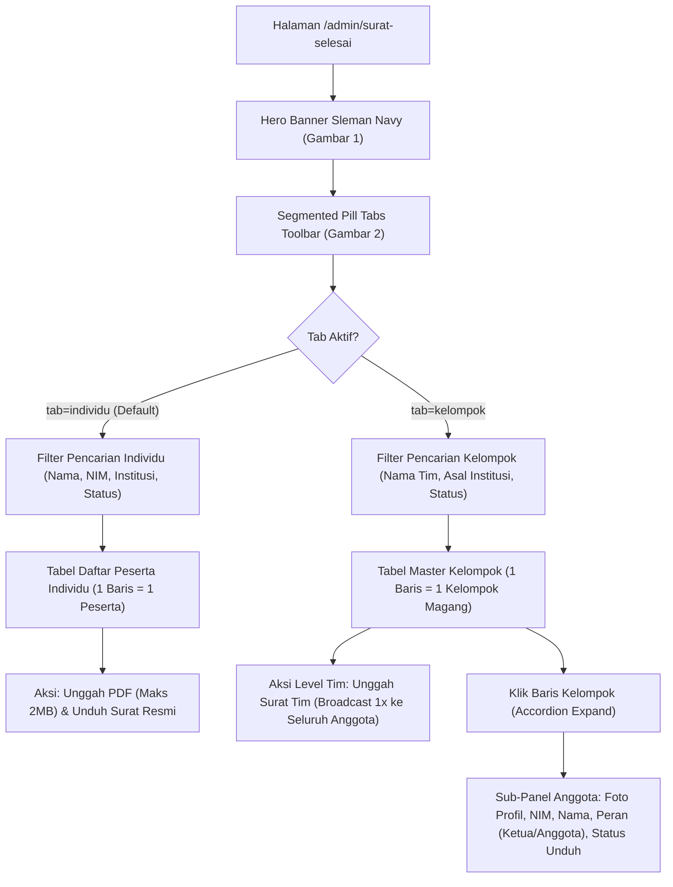

# TASK & PRD PLAN: REVAMP HALAMAN SURAT SELESAI MAGANG DENGAN HERO BANNER MAGKOM & SEGMENTED TAB INDIVIDU VS KELOMPOK (ACCORDION DETAIL)

> **Dari:** Senior Software Architect / Lead Developer  
> **Kepada:** Junior Developer / AI Implementation Engineer (Gemini 3.8 Flash Compatible)  
> **Target Repositori:** `MAGKOM` (Portal Manajemen Magang Diskominfo Kabupaten Sleman)  
> **Status Dokumen:** READY FOR REVIEW / MENUNGGU PERSETUJUAN  
> **Tingkat Prioritas:** High (Core UI/UX Polish: Penyempurnaan Alur Operasional Administrasi)  
> **Tanggal Dokumen:** 24 November 2026  
> **Referensi Gambar User:**
> 1. Gambar 1: `media_1795503964665_a63be890.png` (Komponen Sleman Navy Hero Banner & Tombol Ekspor)
> 2. Gambar 2: `media_1795504019172_28d4bc07.png` (Komponen Segmented Tab / Pill Switch Strip dengan Badge Counter)

---

## 1. 🎯 RINGKASAN EKSEKUTIF & LATAR BELAKANG (PRD)

### 1.1 Latar Belakang Masalah (Problem Statement)
Pada implementasi awal halaman **Surat Selesai Magang** (`/admin/surat-selesai`), data peserta individu dan anggota kelompok disajikan bercampur dalam satu daftar tabel dengan dropdown filter.
Berdasarkan evaluasi antarmuka dan kebutuhan riil staf Administrasi Dinas Kominfo Sleman:
1. **Kebutuhan Pemisahan Sejak Awal (Categorical Split by Default)**:
   Pola operasional penanganan berkas untuk **Peserta Individu** sangat berbeda dengan **Peserta Rombongan Kelompok**.
   - Pada individu: Admin mengunggah berkas untuk 1 perorangan.
   - Pada kelompok: Berkas diunggah **per tim**, di mana 1 kali unggah berlaku untuk seluruh anggota tim. Menggabungkan keduanya dalam satu daftar datar (*flat list*) membuat staf bingung membedakan mana entri tunggal dan mana entri anggota tim.
2. **Kebutuhan Hirarki Master-Detail untuk Kelompok**:
   Staf dinas membutuhkan tampilan yang menampilkan **Nama Kelompok** terlebih dahulu (misal: "Tim Aptika UGM", 3 Anggota). Ketika baris kelompok tersebut **di-klik (expand/accordion)**, baru terbuka daftar nama-nama individu anggota di dalamnya secara lengkap beserta status dan tombol aksi unggah/unduh.
3. **Penyelarasan Visual dengan Standar Desain MagKom (Gambar 1 & Gambar 2)**:
   - Bagian atas wajib mengadopsi **Sleman Navy Hero Banner** (`adm-hero-banner`, persis seperti Gambar 1).
   - Bagian filter kategori wajib mengadopsi **Pill Tab Strip** (`kuota-nav-tabs` / `month-switch-strip`, persis seperti Gambar 2) dengan counter badge jumlah data yang terisolasi.

### 1.2 Sasaran Fitur (Target Objectives)
1. **Hero Banner Sleman Navy Penuh**:
   - Judul: *"Daftar Surat Keterangan Selesai Magang"*
   - Subtitle: *"Penerbitan & Distribusi Berkas Resmi Peserta Individu & Rombongan Kelompok • Dinas Komunikasi dan Informatika Kabupaten Sleman"*
   - Tombol Aksi: Link cepat ke Arsip Alumni & Penempatan Peserta.
2. **Segmented Tabs Kategori Utama di Awal**:
   - **Tab 1: Peserta Individu** (`[User Icon] Peserta Individu [Badge: X]`)
   - **Tab 2: Rombongan Kelompok** (`[Users Icon] Rombongan Kelompok [Badge: Y]`)
   - Menggunakan parameter URL terpisah: `?tab=individu` (default) vs `?tab=kelompok`.
3. **Pencarian Terkontekstualisasi (Contextual Search)**:
   - Di tab Individu: Form pencarian hanya menyaring data peserta individu (Nama, NIM/NISN, Institusi).
   - Di tab Kelompok: Form pencarian menyaring Nama Kelompok, Institusi Tim, atau Nama Anggota Tim.
4. **Tampilan Kelompok Model Accordion (Master-Detail View)**:
   - Menampilkan baris master kelompok (Nama Kelompok, Asal Kampus, Bidang, Pembimbing, Jumlah Anggota, Status Surat Tim).
   - Fitur klik untuk expand/collapse: Menampilkan sub-tabel berisi profil foto, NIM, nama masing-masing anggota tim, dan status berkasnya.
   - Form unggah cepat di level kelompok: Admin mengunggah 1 file PDF, berkas otomatis tersimpan dan terdistribusi ke seluruh anggota tim.

---

## 2. 🛡️ PRINSIP ARSITEKTUR & KEAMANAN (SENIOR GUARDRAILS)

Semua developer / AI junior wajib mematuhi panduan ketat repositori MAGKOM:

1. **JANGAN MERUSAK STRUKTUR DATABASE (Zero-Schema Change)**:
   - Tidak ada migrasi database baru. Logika mengandalkan tabel `penempatan`, `pendaftaran`, `kelompok_magang`, dan `kelompok_anggota` yang sudah ada.
2. **Backend Service Reusability**:
   - Logika penyimpanan dan broadcast kelompok tetap menggunakan service yang sudah ada dan teruji: `App\Services\Admin\Penempatan\SuratSelesaiService.php`.
3. **Aturan Khusus Blade (No Inline Scripts/Styles)**:
   - DILARANG menulis tag `<style>` atau `<script>` di dalam file Blade.
   - Interaksi buka-tutup (accordion expand/collapse) baris kelompok dihandle melalui event delegation JavaScript murni di berkas ES Module: `resources/js/pages/admin/surat-selesai-index.js`.
   - Styling disatukan pada berkas CSS terstruktur: `resources/css/pages/admin/surat-selesai-index.css` dan didaftarkan ke Vite.
4. **IDOR & Storage Traversal Defense**:
   - Seluruh proses unduh berkas wajib melalui route terproteksi otorisasi yang sudah ada: `admin.penempatan.surat-selesai.unduh`.

---

## 3. 🧩 DIAGRAM STRUKTUR TAMPILAN BARU



---

## 4. 📁 INVENTARISASI & MATRIKS PERUBAHAN BERKAS

| No | File Path | Aksi | Tanggung Jawab & Alasan Perubahan |
| :--- | :--- | :---: | :--- |
| 1 | `app/Http/Controllers/Admin/SuratSelesaiController.php` | **Modify** | Pisahkan logika query data antara tab `individu` dan tab `kelompok`. Pada tab kelompok, kelompokkan berdasarkan entitas pendaftaran/kelompok magang lengkap dengan anggotanya. |
| 2 | `resources/views/admin/surat-selesai/index.blade.php` | **Modify** | Perbarui layout dengan `adm-hero-banner` (Gambar 1), segmented tabs strip (Gambar 2), panel tab individu, dan panel tab kelompok dengan interaktivitas accordion. |
| 3 | `resources/css/pages/admin/surat-selesai-index.css` | **Create** | Stylesheet terisolasi untuk tab bar, badge, accordion row, dan sub-table rincian anggota kelompok. |
| 4 | `resources/js/pages/admin/surat-selesai-index.js` | **Create** | Skrip ES Module untuk menangani interaksi klik accordion buka-tutup detail anggota kelompok secara mulus dan aksesibel. |
| 5 | `vite.config.js` | **Modify** | Daftarkan entry point CSS dan JS baru agar terkompilasi dalam pipeline Vite. |
| 6 | `tests/Feature/AdminSuratSelesaiIndividuKelompokTest.php` | **Modify** | Tambahkan pengujian komprehensif untuk navigasi tab individu, tab kelompok, filter pencarian per tab, dan integritas tampilan accordion. |

---

## 5. 📝 PANDUAN LANGKAH-DEMI-LANGKAH IMPLEMENTASI (STEP-BY-STEP)

### Langkah 1: Perbarui Query di `SuratSelesaiController.php`

**File:** [app/Http/Controllers/Admin/SuratSelesaiController.php](file:///g:/MAGKOM/app/Http/Controllers/Admin/SuratSelesaiController.php)

Perbarui method `index()` agar menangani dua mode query terpisah berdasarkan parameter `$activeTab`:

```php
public function index(Request $request): View
{
    $this->authorize('manage', Penempatan::class);

    $activeTab = $request->input('tab', 'individu');
    if (! in_array($activeTab, ['individu', 'kelompok'], true)) {
        $activeTab = 'individu';
    }

    // 1. Hitung counter untuk kedua tab (badge)
    $totalIndividu = Penempatan::where('status', StatusPenempatanEnum::Selesai)
        ->whereHas('pendaftaran', function (Builder $q) {
            $q->where('tipe', 'individu')->whereNull('kelompok_magang_id');
        })
        ->count();

    // Total kelompok dihitung berdasarkan pendaftaran kelompok unik yang penempatannya telah selesai
    $totalKelompok = Pendaftaran::where(function (Builder $q) {
            $q->where('tipe', 'kelompok')->orWhereNotNull('kelompok_magang_id');
        })
        ->whereHas('penempatans', function (Builder $q) {
            $q->where('status', StatusPenempatanEnum::Selesai);
        })
        ->count();

    // 2. Query data sesuai tab aktif
    if ($activeTab === 'individu') {
        $query = Penempatan::query()
            ->where('status', StatusPenempatanEnum::Selesai)
            ->whereHas('pendaftaran', function (Builder $q) {
                $q->where('tipe', 'individu')->whereNull('kelompok_magang_id');
            })
            ->with(['peserta.profil.jurusan', 'bidang', 'pembimbing']);

        if ($request->filled('q')) {
            $keyword = trim((string) $request->input('q'));
            $query->where(function (Builder $q) use ($keyword) {
                $q->whereHas('peserta', fn(Builder $u) => $u->where('nama', 'like', "%{$keyword}%")->orWhere('email', 'like', "%{$keyword}%"))
                  ->orWhereHas('peserta.profil', fn(Builder $p) => $p->where('institusi', 'like', "%{$keyword}%")->orWhere('nim_nisn', 'like', "%{$keyword}%"));
            });
        }

        if ($request->filled('status_surat')) {
            $statusSurat = (string) $request->input('status_surat');
            if ($statusSurat === 'sudah') {
                $query->whereNotNull('file_surat_selesai');
            } elseif ($statusSurat === 'belum') {
                $query->whereNull('file_surat_selesai');
            }
        }

        $items = $query->latest('tgl_ditetapkan_selesai')->latest('id')->paginate(10)->withQueryString();
    } else {
        // Tab Kelompok: Query pendaftaran kelompok yang memiliki penempatan selesai
        $query = Pendaftaran::query()
            ->where(function (Builder $q) {
                $q->where('tipe', 'kelompok')->orWhereNotNull('kelompok_magang_id');
            })
            ->whereHas('penempatans', function (Builder $q) {
                $q->where('status', StatusPenempatanEnum::Selesai);
            })
            ->with([
                'kelompokMagang.anggota.user.profil.jurusan',
                'penempatans' => function ($q) {
                    $q->where('status', StatusPenempatanEnum::Selesai)->with(['peserta.profil.jurusan', 'bidang', 'pembimbing']);
                },
                'penempatans.bidang',
                'penempatans.pembimbing',
            ]);

        if ($request->filled('q')) {
            $keyword = trim((string) $request->input('q'));
            $query->where(function (Builder $q) use ($keyword) {
                $q->whereHas('kelompokMagang', fn(Builder $k) => $k->where('nama_kelompok', 'like', "%{$keyword}%")->orWhere('institusi', 'like', "%{$keyword}%"))
                  ->orWhereHas('penempatans.peserta', fn(Builder $u) => $u->where('nama', 'like', "%{$keyword}%"));
            });
        }

        if ($request->filled('status_surat')) {
            $statusSurat = (string) $request->input('status_surat');
            if ($statusSurat === 'sudah') {
                $query->whereHas('penempatans', fn(Builder $q) => $q->whereNotNull('file_surat_selesai'));
            } elseif ($statusSurat === 'belum') {
                $query->whereHas('penempatans', fn(Builder $q) => $q->whereNull('file_surat_selesai'));
            }
        }

        $items = $query->latest('id')->paginate(10)->withQueryString();
    }

    return view('admin.surat-selesai.index', [
        'activeTab' => $activeTab,
        'totalIndividu' => $totalIndividu,
        'totalKelompok' => $totalKelompok,
        'items' => $items,
    ]);
}
```

---

### Langkah 2: Buat Stylesheet `resources/css/pages/admin/surat-selesai-index.css`

Stylesheet ini mengimplementasikan styling:
- **`adm-hero-banner`** (persis Gambar 1): Latar belakang Sleman Navy gradien, teks judul tegas, subtitle dengan separator titik bullet, dan tombol aksi.
- **`month-switch-strip` & `kuota-nav-tabs`** (persis Gambar 2): Wadah tab putih melengkung, tombol tab aktif (background putih, box-shadow halus, border lembut, teks biru tebal) vs tab non-aktif, badge counter melingkar abu-abu.
- **Accordion Row**: Baris kelompok yang dapat di-klik dengan icon chevron berputar (0deg ke 180deg saat aktif), dan sub-tabel rincian nama anggota tim dengan foto profil, badge peran (Ketua / Anggota), dan tombol aksi.

---

### Langkah 3: Buat JavaScript ES Module `resources/js/pages/admin/surat-selesai-index.js`

Skrip ini menangani:
- Event delegation pada tombol accordion kelompok (`[data-action="toggle-kelompok-detail"]`).
- Membuka / menutup panel detail anggota kelompok (`aria-expanded="true/false"` dan toggle class `is-open`).
- Menjamin tidak ada inline script pada Blade.

---

### Langkah 4: Daftarkan ke `vite.config.js`

Tambahkan entry point:
- `'resources/css/pages/admin/surat-selesai-index.css'`
- `'resources/js/pages/admin/surat-selesai-index.js'`

Lalu jalankan `npm run build`.

---

### Langkah 5: Perbarui Template Blade `resources/views/admin/surat-selesai/index.blade.php`

Gantikan template lama dengan struktur baru:
1. **Hero Banner Khas MagKom (Gambar 1)**:
   ```blade
   <div class="adm-hero-banner">
       <div class="adm-hero-content">
           <div class="adm-hero-text">
               <h1 class="adm-hero-title">{{ __('Daftar Surat Selesai Magang') }}</h1>
               <div class="adm-hero-subtitle">
                   <span>{{ __('Penerbitan & Distribusi Berkas Resmi Peserta') }}</span>
                   <span class="sep">&bull;</span>
                   <span>{{ __('Dinas Komunikasi dan Informatika Kabupaten Sleman') }}</span>
               </div>
           </div>
           <div class="adm-hero-actions">
               <a href="{{ route('admin.arsip.index') }}" class="adm-btn-export-main adm-hero-btn-secondary" style="text-decoration: none;">
                   <svg width="15" height="15" viewBox="0 0 24 24" fill="none" stroke="currentColor" stroke-width="2.5"><polyline points="21 8 21 21 3 21 3 8"></polyline><rect x="1" y="3" width="22" height="5"></rect><line x1="10" y1="12" x2="14" y2="12"></line></svg>
                   <span>{{ __('Arsip Alumni') }}</span>
               </a>
           </div>
       </div>
   </div>
   ```

2. **Segmented Pill Tabs Toolbar (Gambar 2)**:
   ```blade
   <div class="month-switch-strip kuota-unified-toolbar" style="margin-bottom: 1.25rem;">
       <div class="kuota-nav-tabs" role="tablist" aria-label="{{ __('Kategori Surat Selesai Magang') }}">
           {{-- Tab 1: Peserta Individu --}}
           <a href="{{ route('admin.surat-selesai.index', ['tab' => 'individu']) }}" 
              class="kuota-tab-btn {{ $activeTab === 'individu' ? 'active' : '' }}" 
              role="tab" 
              aria-selected="{{ $activeTab === 'individu' ? 'true' : 'false' }}">
               <svg width="16" height="16" viewBox="0 0 24 24" fill="none" stroke="currentColor" stroke-width="2.5"><path d="M20 21v-2a4 4 0 0 0-4-4H8a4 4 0 0 0-4 4v2"></path><circle cx="12" cy="7" r="4"></circle></svg>
               <span>{{ __('Peserta Individu') }}</span>
               <span class="kuota-tab-badge">{{ $totalIndividu }}</span>
           </a>

           {{-- Tab 2: Rombongan Kelompok --}}
           <a href="{{ route('admin.surat-selesai.index', ['tab' => 'kelompok']) }}" 
              class="kuota-tab-btn {{ $activeTab === 'kelompok' ? 'active' : '' }}" 
              role="tab" 
              aria-selected="{{ $activeTab === 'kelompok' ? 'true' : 'false' }}">
               <svg width="16" height="16" viewBox="0 0 24 24" fill="none" stroke="currentColor" stroke-width="2.5"><path d="M17 21v-2a4 4 0 0 0-4-4H5a4 4 0 0 0-4 4v2"></path><circle cx="9" cy="7" r="4"></circle><path d="M23 21v-2a4 4 0 0 0-3-3.87"></path><path d="M16 3.13a4 4 0 0 1 0 7.75"></path></svg>
               <span>{{ __('Rombongan Kelompok') }}</span>
               <span class="kuota-tab-badge">{{ $totalKelompok }}</span>
           </a>
       </div>
   </div>
   ```

3. **Panel Konten Tab Individu**:
   - Menampilkan form filter pencarian nama/NIM/institusi dan tabel peserta individu langsung.

4. **Panel Konten Tab Kelompok (Accordion Master-Detail)**:
   - Menampilkan tabel kelompok magang.
   - Setiap baris kelompok memiliki tombol toggle chevron: *"Lihat {N} Anggota Tim ▼"*.
   - Saat di-klik, muncul sub-baris berisi daftar lengkap nama individu anggota tim, foto profil, peran (Ketua/Anggota), dan status unduh.
   - Form upload di baris master kelompok memungkinkan admin mengunggah 1 surat selesai yang otomatis terdistribusi ke seluruh anggota tim.

---

### Langkah 6: Pembaruan Automated Feature Tests

Perbarui [tests/Feature/AdminSuratSelesaiIndividuKelompokTest.php](file:///g:/MAGKOM/tests/Feature/AdminSuratSelesaiIndividuKelompokTest.php) untuk menguji:
1. Akses default membuka tab `individu`.
2. Akses `?tab=kelompok` menampilkan data kelompok dan daftar anggota saat di-expand.
3. Form pencarian di tab individu menyaring nama individu dengan tepat.
4. Form pencarian di tab kelompok menyaring nama kelompok dengan tepat.
5. Unggah surat pada baris kelompok otomatis mendistribusikan ke seluruh record penempatan anggota kelompok.

---

## 6. 🛡️ VERIFIKASI SEBELUM SELESAI (DEFINITION OF DONE)

Developer / AI pelaksana wajib menjalankan:
```powershell
# 1. Jalankan test suite fitur
./vendor/bin/phpunit tests/Feature/AdminSuratSelesaiIndividuKelompokTest.php

# 2. Analisis statis PHPStan
./vendor/bin/phpstan analyse app/Http/Controllers/Admin/SuratSelesaiController.php --memory-limit=1G

# 3. Code formatting (Pint)
./vendor/bin/pint --test

# 4. Asset compilation (Vite)
npm run build
```

---

## 7. 📌 KEPUTUSAN & PERMINTAAN KONFIRMASI USER

Rencana kerja ini telah dirancang secara detail sesuai persis dengan 2 gambar referensi yang Anda berikan.  
Mohon konfirmasi pengguna:  
**"Apakah Anda menyetujui rencana kerja ini untuk segera diimplementasikan?"**
