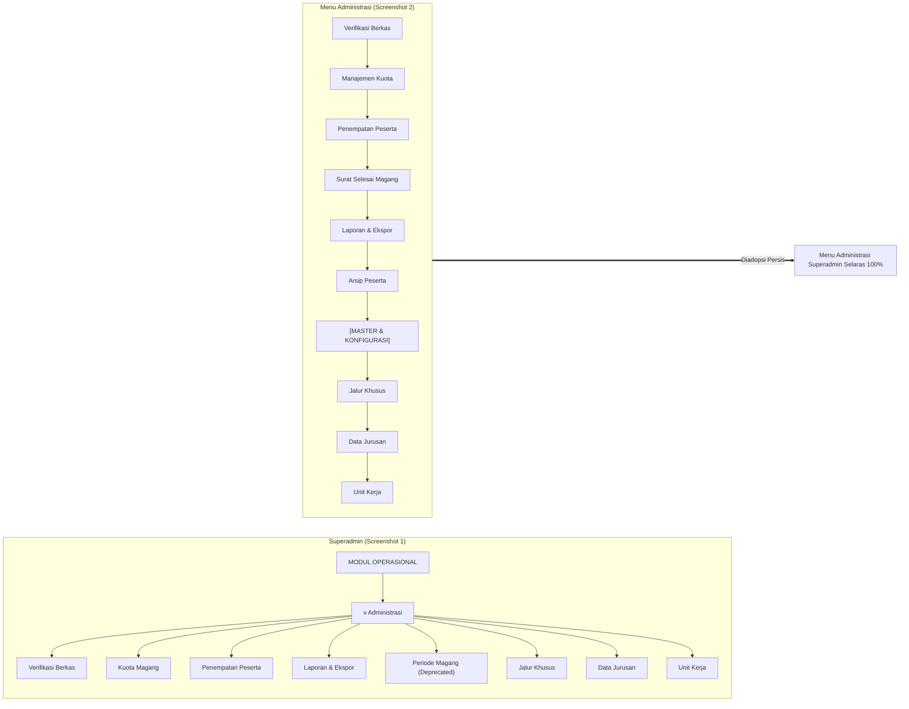

# Plan: Penyelarasan Menu Administrasi Superadmin dengan Navigasi Administrasi Magang

## 1. Analisis Visual & Bukti Screenshot

Berdasarkan perbandingan antara tangkapan layar Superadmin (`media_1795585804168_bfe4bb62.png`) dan tangkapan layar Administrasi yang dikirimkan pengguna (`media_1795586743138_fbd13807.png`):



### Kesimpulan Pemetaan:
1. **Urutan 6 Modul Operasional Inti**:
   - `Verifikasi Berkas` (`admin.pendaftaran.index`)
   - `Manajemen Kuota` (`admin.kuota.index`) — *diubah dari nama lama 'Kuota Magang'*
   - `Penempatan Peserta` (`admin.penempatan.index`)
   - `Surat Selesai Magang` (`admin.surat-selesai.index`) — **[BARU DITAMBAHKAN]**
   - `Laporan & Ekspor` (`admin.laporan.index`)
   - `Arsip Peserta` (`superadmin.arsip.index`) — **[DIPINDAHKAN]**
2. **Pemisah Sub-Header Kategori**:
   - Menambahkan divider pemisah visual `MASTER & KONFIGURASI` di dalam submenu pohon sebelum modul master.
3. **Urutan 3 Modul Master & Konfigurasi**:
   - `Jalur Khusus` (`admin.slot-khusus.index`)
   - `Data Jurusan` (`admin.jurusan.index`)
   - `Unit Kerja` (`admin.bidang.index`)
4. **Eliminasi**:
   - `Periode Magang` **DIHAPUS** (karena terbukti sudah tidak ada di navigasi Administrasi).
   - Dropdown `Peserta` yang sebelumnya berdiri sendiri (hanya dengan 1 tautan) **DIHAPUS** agar sidebar tidak redundan.

---

## 2. Struktur Kode Target pada `resources/views/layouts/dashboard.blade.php`

```blade
@php
    $isOperasionalAdminActive = request()->routeIs('admin.pendaftaran.*')
        || request()->routeIs('admin.kuota.*')
        || request()->routeIs('admin.penempatan.*')
        || request()->routeIs('admin.surat-selesai.*')
        || request()->routeIs('admin.laporan.*')
        || request()->routeIs('admin.arsip.*')
        || request()->routeIs('superadmin.arsip.*')
        || request()->routeIs('admin.bulan.*')
        || request()->routeIs('admin.slot-khusus.*')
        || request()->routeIs('admin.peserta-khusus.*')
        || request()->routeIs('admin.jurusan.*')
        || request()->routeIs('admin.bidang.*')
        || request()->routeIs('superadmin.bulan.*')
        || request()->routeIs('superadmin.slot-khusus.*')
        || request()->routeIs('superadmin.jurusan.*')
        || request()->routeIs('superadmin.bidang.*');
@endphp
<div class="nav-group-container">
    <button type="button" class="nav-group-btn {{ $isOperasionalAdminActive ? 'has-active' : '' }}" data-action="toggle-nav-group" aria-expanded="{{ $isOperasionalAdminActive ? 'true' : 'false' }}">
        <span class="nav-group-btn-left">
            <span class="nav-item-icon">
                <svg width="20" height="20" viewBox="0 0 24 24" fill="none" stroke="currentColor" stroke-width="2" stroke-linecap="round" stroke-linejoin="round">
                    <rect x="4" y="2" width="16" height="20" rx="2" ry="2"></rect>
                    <line x1="9" y1="22" x2="9" y2="2"></line>
                    <line x1="15" y1="12" x2="15" y2="12.01"></line>
                    <line x1="15" y1="16" x2="15" y2="16.01"></line>
                </svg>
            </span>
            <span>{{ __('Administrasi') }}</span>
        </span>
        <svg class="nav-group-chevron" width="16" height="16" viewBox="0 0 24 24" fill="none" stroke="currentColor" stroke-width="2" stroke-linecap="round" stroke-linejoin="round">
            <polyline points="9 18 15 12 9 6"></polyline>
        </svg>
    </button>
    <div class="nav-sub-menu {{ $isOperasionalAdminActive ? 'show' : '' }}">
        {{-- 6 Modul Operasional Magang --}}
        <a href="{{ route('admin.pendaftaran.index') }}" class="nav-sub-item {{ request()->routeIs('admin.pendaftaran.*') ? 'active' : '' }}">{{ __('Verifikasi Berkas') }}</a>
        <a href="{{ route('admin.kuota.index') }}" class="nav-sub-item {{ request()->routeIs('admin.kuota.*') ? 'active' : '' }}">{{ __('Manajemen Kuota') }}</a>
        <a href="{{ route('admin.penempatan.index') }}" class="nav-sub-item {{ request()->routeIs('admin.penempatan.*') ? 'active' : '' }}">{{ __('Penempatan Peserta') }}</a>
        <a href="{{ route('admin.surat-selesai.index') }}" class="nav-sub-item {{ request()->routeIs('admin.surat-selesai.*') ? 'active' : '' }}">{{ __('Surat Selesai Magang') }}</a>
        <a href="{{ route('admin.laporan.index') }}" class="nav-sub-item {{ request()->routeIs('admin.laporan.*') ? 'active' : '' }}">{{ __('Laporan & Ekspor') }}</a>
        <a href="{{ route('superadmin.arsip.index') }}" class="nav-sub-item {{ request()->routeIs('superadmin.arsip.*') || request()->routeIs('admin.arsip.*') ? 'active' : '' }}">{{ __('Arsip Peserta') }}</a>

        {{-- Pemisah Master & Konfigurasi --}}
        <div class="nav-sub-divider-label">{{ __('MASTER & KONFIGURASI') }}</div>

        {{-- 3 Modul Master --}}
        <a href="{{ route('admin.slot-khusus.index') }}" class="nav-sub-item {{ request()->routeIs('admin.slot-khusus.*') || request()->routeIs('admin.peserta-khusus.*') || request()->routeIs('superadmin.slot-khusus.*') ? 'active' : '' }}">
            <span>{{ __('Jalur Khusus') }}</span>
            <span class="sr-only">Slot Khusus</span>
        </a>
        <a href="{{ route('admin.jurusan.index') }}" class="nav-sub-item {{ request()->routeIs('admin.jurusan.*') || request()->routeIs('superadmin.jurusan.*') ? 'active' : '' }}">
            <span>{{ __('Data Jurusan') }}</span>
            <span class="sr-only">Master Jurusan</span>
        </a>
        <a href="{{ route('admin.bidang.index') }}" class="nav-sub-item {{ request()->routeIs('admin.bidang.*') || request()->routeIs('superadmin.bidang.*') ? 'active' : '' }}">
            <span>{{ __('Unit Kerja') }}</span>
            <span class="sr-only">Bidang Dinas</span>
        </a>
    </div>
</div>
```

---

## 3. Rencana Pengujian & Quality Gates

1. **Sinkronisasi Test Suite (`tests/Feature/`)**:
   - Sesuaikan `tests/Feature/SuperAdminNavigationReorganizationTest.php` untuk memverifikasi struktur 9 item ini:
     - `assertSee('Surat Selesai Magang')`
     - `assertSee('Arsip Peserta')`
     - `assertSee('Manajemen Kuota')`
     - `assertDontSee('Periode Magang')`
   - Sesuaikan `tests/Feature/SuperAdminFigmaDesignAlignmentTest.php`.
2. **Kompilasi Aset Frontend**:
   - `npm run build` ➔ memastikan kelancaran aset Vite.
3. **Pemeriksaan Linter & Analisis Statis**:
   - `vendor/bin/pint --test`
   - `vendor/bin/phpstan analyse`
