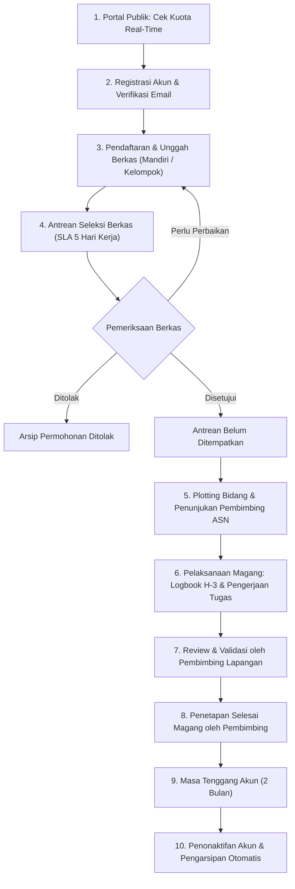

# Ringkasan Produk MAGKOM

| Informasi | Keterangan |
|---|---|
| Status | Verified |
| Terakhir Diverifikasi | 2026-11-15 |
| Cakupan | Gambaran umum produk, konteks kedinasan, batasan sistem |
| Referensi Implementasi | `app/Models/`, `routes/web.php`, `config/` |

---

## 1. Identitas dan Latar Belakang Sistem

**MAGKOM** (Sistem Informasi Manajemen dan Tata Kelola Magang Kominfo) adalah aplikasi web kedinasan yang dibangun khusus untuk mengelola seluruh siklus pelaksanaan Praktik Kerja Lapangan (PKL) bagi siswa SMK dan program magang mahasiswa perguruan tinggi (D3/S1) di lingkungan Dinas Komunikasi dan Informatika (Diskominfo) Kabupaten Sleman.

Sebelum adopsi sistem MAGKOM, pengelolaan magang kedinasan bertumpu pada prosedur manual dan konvensional:
1. Pemohon mengajukan surat permohonan fisik ke loket sekretariat dinas tanpa kepastian ketersediaan kuota pada bidang yang dituju.
2. Penumpukan berkas lamaran fisik memperlambat verifikasi administratif dan menyulitkan pelacakan status permohonan secara mandiri.
3. Alokasi penempatan bidang teknis tidak transparan dan sering kali menimbulkan ketidakseimbangan beban kerja antar-bidang dinas.
4. Pembimbing lapangan mengalami kesulitan mengawasi kehadiran harian serta perkembangan tugas mentee karena pencatatan aktivitas masih menggunakan lembar kerja kertas atau buku kendali manual.

MAGKOM menyatukan seluruh rangkaian proses tersebut ke dalam satu arsitektur terintegrasi, transparan, dan akuntabel, mulai dari publikasi formasi kuota secara real-time hingga pengarsipan permanen peserta pasca-magang.

---

## 2. Permasalahan Bisnis dan Solusi Sistem

### 2.1 Transparansi dan Kepastian Kuota
- **Kendala**: Calon peserta tidak mengetahui apakah formasi jurusan mereka pada bulan tertentu masih tersedia sebelum datang ke dinas.
- **Solusi MAGKOM**: Publikasi sisa kuota umum per jurusan dan per bulan magang secara langsung pada portal publik. Alokasi kuota dikunci secara atomik pada tingkat basis data (`lockForUpdate`) untuk mencegah kondisi perebutan (*race condition*).

### 2.2 Efisiensi Seleksi Administratif
- **Kendala**: Verifikasi berkas fisik membutuhkan waktu lama dan rentan terhadap dokumen yang hilang atau terselip.
- **Solusi MAGKOM**: Alur verifikasi digital berbasis berkas PDF/gambar dengan batasan waktu layanan (SLA) terukur selama 5 hari kerja (*SLA Watchdog*). Verifikator dapat menerbitkan keputusan Diterima atau Ditolak langsung melalui sistem.

### 2.3 Penataan Penempatan Dua Tahap (Two-Stage Placement)
- **Kendala**: Peserta yang lolos administrasi sering kali langsung masuk tanpa kesiapan unit kerja dan ketersediaan pembimbing.
- **Solusi MAGKOM**: Pemisahan tegas antara tahap verifikasi berkas dan tahap alokasi penempatan. Peserta yang lolos seleksi masuk ke antrean *Belum Ditempatkan*, kemudian Administrator mendistribusikan peserta ke bidang teknis dan menunjuk Aparatur Sipil Negara (ASN) pembimbing sesuai batasan rasio beban mentee (maksimal 20 mentee per pembimbing).

### 2.4 Monitoring Aktivitas dan Penugasan Terstruktur
- **Kendala**: Pengumpulan jurnal harian sering kali dirapel di akhir periode magang, sehingga pembimbing tidak dapat memberikan arahan tepat waktu.
- **Solusi MAGKOM**: Sistem memberlakukan aturan batas mundur pengisian logbook maksimal 3 hari kerja (`logbook_maks_mundur_hari = 3`). Pembimbing dapat memberikan instruksi tugas proyek mandiri maupun tugas kelompok serentak (*batch assignment*), dan peserta memiliki fleksibilitas untuk membatalkan pengiriman (*unsubmit*) guna revisi berkas sebelum dinilai oleh pembimbing.

---

## 3. Ruang Lingkup dan Batasan Sistem

MAGKOM beroperasi dalam batasan operasional berikut:

1. **Lingkup Organisasi**: Khusus melayani unit kerja di lingkungan Dinas Komunikasi dan Informatika Kabupaten Sleman yang terdiri dari 5 bidang kerja:
   - Bidang Aplikasi Informatika (Aptika)
   - Bidang Informasi dan Komunikasi Publik (IKP)
   - Bidang Statistik
   - Bidang Persandian
   - Sekretariat Dinas
2. **Karakteristik Pengguna**: Sistem dirancang untuk mendukung peserta magang yang dominan mengakses melalui perangkat ponsel pintar (tampilan responsif *mobile-first*) dan staf kedinasan yang mengelola data melalui komputer desktop.
3. **Mekanisme Informasi Status**: MAGKOM mengutamakan perubahan status pada antarmuka dashboard sebagai instrumen komunikasi utama. Pengiriman email dibatasi hanya untuk keperluan penting (verifikasi alamat email registrasi dan tautan reset kata sandi) guna menghindari beban infrastruktur email kedinasan.
4. **Penyimpanan Berkas Privat**: Seluruh berkas identitas, surat pengantar, dan dokumen persyaratan disimpan pada disk privat terisolasi dan hanya dapat diunduh melalui tautan bertanda tangan digital berbatas waktu (*temporary signed URL*) selama 5 menit.
5. **Kebijakan Pasca-Magang**: Setelah pembimbing menyatakan magang selesai, akun peserta memasuki masa tenggang operasional (*grace period*) selama 2 bulan sebelum dinonaktifkan secara otomatis dan data diarsipkan secara permanen.

---

## 4. Aktor Pengguna dan Peran Sistem

Sistem mendefinisikan 4 peran pengguna berbasis kendali akses peran (*Role-Based Access Control*):

| Peran | Pengguna Riil | Tanggung Jawab Utama | Lingkup Rute |
|---|---|---|---|
| **Peserta Magang** | Siswa SMK dan Mahasiswa (D3/S1) | Melakukan registrasi mandiri atau kelompok, mengunggah berkas persyaratan, memantau antrean seleksi, mengisi logbook harian (maks. H-3), mengunggah laporan tugas, dan melakukan unsubmit tugas untuk revisi. | `/peserta/*` |
| **Pembimbing Lapangan** | Pegawai ASN Diskominfo | Memantau daftar mentee aktif, menerbitkan tugas proyek individu atau serentak (*batch*), mereview dan menyetujui logbook harian, mengelola agenda bimbingan, mengunduh laporan kinerja (Excel/CSV/PDF), dan menetapkan penyelesaian magang. | `/pembimbing/*` |
| **Admin Verifikator** | Staf Administrasi / Tata Usaha | Memeriksa kelengkapan dan validitas berkas pendaftar, memantau antrean SLA 5 hari kerja, mengalokasikan kuota formasi bulanan, melakukan plotting penempatan dua tahap, dan mengunduh berkas bundel arsip. | `/admin/*` |
| **SuperAdmin** | Lead Architect / System Administrator | Mengelola 12 parameter operasional aplikasi, mengonfigurasi matriks perizinan dinamis (13 modul sistem), mengelola akun staf kedinasan, mengelola kuota jalur khusus kemitraan, mengoperasikan backup dan restore basis data, memantau telemetri diagnostik, dan mengelola konten landing page melalui editor visual. Bersifat *Read-Only* pada ranah tugas dan logbook mentee. | `/superadmin/*` |

---

## 5. Ringkasan Alur Bisnis Tingkat Tinggi

Alur utama MAGKOM digambarkan dalam urutan tahapan berikut:

---

## 6. Ringkasan Arsitektur Teknologi

Aplikasi dibangun di atas fondasi teknologi modern yang stabil dan teruji:

- **Bahasa Pemrograman**: PHP 8.3 dengan penegakan tipe data ketat (`declare(strict_types=1);`).
- **Framework Backend**: Laravel 10.x menerapkan pola *Modular Actions & Specialized Queries* (`app/Actions/`, `app/Queries/`, `app/Services/`).
- **Antarmuka Pengguna**: Laravel Blade Templates dengan pemisahan mutlak aset (Zero Inline CSS/JS), mematuhi kebijakan keamanan Content Security Policy (CSP) ketat.
- **Frontend Build Pipeline**: Vite 6.x mengelola 87 entri aset terisolasi (39 stylesheet CSS dan 48 modul JavaScript ES Modules).
- **Basis Data**: MySQL 8.0+ / MariaDB (InnoDB Storage Engine) dengan 24 tabel domain aplikasi dan 5 tabel framework Laravel.
- **Otomatisasi Pengujian**: PHPUnit 10.x dengan 942 automated feature dan unit tests terverifikasi.
- **Pencatatan Audit**: Tabel `audit_log` bersifat append-only dengan sanitasi otomatis terhadap kata sandi dan kredensial sensitif.
