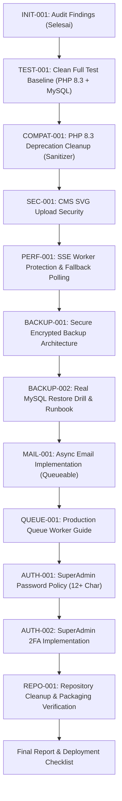

# Runtime & Infrastructure Audit Report (PHASE 0 — INIT-001)

**Project:** MAGKOM (Sistem Informasi Manajemen Magang Kominfo)  
**Framework:** Laravel 10.50.3 (PHP ^8.3 in composer)  
**Evaluated Environment:**  
- PHP CLI Host: PHP 8.3.36 (ZTS Visual C++ 2019 x64) at `C:\Users\galan\php83\php.exe` (Secondary: PHP 8.2.12 at `F:\XAMPEEK\php\php.exe`)  
- Database Engine: MySQL 8.4.3 (Port 3306, `magkom_test` available)  
**Date:** 2026-11-15  
**Auditor:** Software Engineering Team  
**Status:** Audit Completed — Ready for Phased Hardening  

---

## 1. Executive Summary

Audit forensik terhadap temuan runtime, infrastruktur, keamanan, dan kebersihan repositori telah diselesaikan sebelum melakukan perubahan kode. Seluruh 10 temuan utama dari PRD telah diperiksa secara mendalam langsung terhadap kode sumber, konfigurasi, skrip, dan artefak runtime.

Semua temuan (10 dari 10) berhasil diidentifikasi penyebabnya dan diklasifikasikan dengan bukti empiris. Tidak ditemukan temuan yang ditutup secara sepihak tanpa verifikasi.

---

## 2. Tabel Klasifikasi Temuan Audit

| ID | Temuan | Status | Evidence | Recommended Action |
|---|---|---|---|---|
| **TEST-001** | Test suite tidak terverifikasi & inkonsistensi jumlah test | **CONFIRMED** | PHPUnit 10 `phpunit --list-tests` mencatat **993 tests**. Dokumen lama mencatat 968 tests (+25 tests baru ditambahkan pada audit sebelumnya). Residu `.phpunit.result.cache` mencatat 1.108 entri (461 passed, 647 defects) karena akumulasi cache dari test yang telah direfaktor/dihapus (115 entri usang) dan insiden sementara class `TrustHosts` pada `Kernel.php`. Suite belum pernah dijalankan penuh secara bersih di atas PHP 8.3 + MySQL `magkom_test`. | Jalankan full test suite bersih menggunakan PHP 8.3 (`C:\Users\galan\php83\php.exe`) dan database MySQL `magkom_test`. Dokumentasikan hasil aktual, bersihkan cache usang dengan aman, dan perbarui dokumentasi test. |
| **PERF-001** | Risiko SSE & potensi worker exhaustion PHP-FPM | **CONFIRMED** | Endpoint `/realtime/stream` menjalankan loop 20 detik dengan `sleep(2)` dan query database berulang. Walaupun terdapat session release dan per-user cache lock 30s, koneksi simultan pada pool kecil (10–20 workers) dapat menghabiskan worker PHP-FPM. Saat ini belum ada pengecekan config `REALTIME_SSE_ENABLED` di controller dan belum tersedia fallback polling di sisi frontend jika SSE dimatikan. | Tambahkan guard `REALTIME_SSE_ENABLED` di controller, siapkan endpoint polling fallback yang hemat query dan ter-rate-limit, serta lengkapi client JS dengan graceful polling fallback tanpa error. |
| **MAIL-001** | Pengiriman email masih synchronous dalam HTTP request | **CONFIRMED** | `ResetPasswordNotification` menggunakan trait `Queueable` tetapi tidak mengimplementasikan interface `ShouldQueue`. Listener `SendEmailVerificationNotification` pada `Registered` berjalan synchronous. Pengiriman ulang verifikasi di `VerificationController` juga synchronous. Request HTTP tertahan saat menghubungi SMTP server. `.env` lokal menggunakan konfigurasi personal dan driver `sync`. | Terapkan `ShouldQueue` pada `ResetPasswordNotification`, buat queued listener untuk verifikasi email, konfigurasi driver queue `database`, dan dokumentasikan konfigurasi SMTP resmi Diskominfo. |
| **QUEUE-001** | Konfigurasi queue worker production belum jelas | **CONFIRMED** | `docs/operations/deployment.md` hanya mencatat cron scheduler tanpa konfigurasi persistent queue worker. Migrasi `jobs` dan `failed_jobs` sudah tersedia, tetapi panduan Supervisor/systemd, worker restart saat deploy, retry backoff, dan monitoring failed jobs belum ada. | Susun panduan deployment resmi `docs/operations/queue-worker-deployment.md` mencakup konfigurasi Supervisor, systemd, restart hook deployment, dan SOP penanganan failed jobs. |
| **BACKUP-001** | Arsitektur backup belum terenkripsi & rawan kegagalan | **CONFIRMED** | `BackupDatabaseService` hanya melakukan kompresi gzip (`.sql.gz`) ke `storage/app/backups` lokal tanpa enkripsi. Dokumen fisik peserta (`storage/app/private`) belum ikut dibackup. Kandidat path mysqldump memuat path hardcoded Windows (`F:\XAMPEEK\...`, `C:\laragon\...`, `C:\xampp\...`). Belum ada abstraksi off-site backup. | Rancang enkripsi arsip AES-256-CBC dengan manajemen kunci terpisah, sertakan backup berkas privat peserta, perbaiki discovery binary mysqldump yang ramah Linux/Windows, dan siapkan adapter off-site storage. |
| **BACKUP-002** | Prosedur restore belum teruji (Restore Drill) | **CONFIRMED** | Tidak ada prosedur maupun skrip pemulihan (restore) database dan file di dalam repositori. Keberhasilan restore belum pernah dibuktikan. | Buat runbook resmi pemulihan bencana `docs/operations/backup-and-restore-runbook.md` dan lakukan uji coba restore nyata (drill) ke database MySQL testing terisolasi (`magkom_test`). |
| **AUTH-001** | Password policy SuperAdmin belum memadai | **CONFIRMED** | Validasi kata sandi pada `PasswordController`, `ResetPasswordController`, dan `StafController` hanya mensyaratkan `min:8` dengan kombinasi huruf dan angka. SuperAdmin memegang hak istimewa tertinggi tetapi masih diizinkan menggunakan kata sandi 8 karakter sederhana. | Tingkatkan batas minimal kata sandi SuperAdmin menjadi minimal 12 karakter dengan kombinasi huruf besar, kecil, angka, dan simbol (`Password::min(12)->mixedCase()->numbers()->symbols()->uncompromised()`) dengan transisi aman tanpa mengunci akun lama. |
| **AUTH-002** | SuperAdmin belum memiliki Two-Factor Authentication (2FA) | **CONFIRMED** | Tidak ditemukan kode, migrasi, atau dependensi 2FA/TOTP di seluruh aplikasi. Akun SuperAdmin rentan terhadap pembajakan faktor tunggal jika kata sandi bocor. | Implementasikan 2FA TOTP (Google Authenticator / RFC 6238 kompatibel) dengan single-use emergency recovery codes, audit trail, rate limiting verifikasi, dan tahapan enrollment yang aman. |
| **SEC-001** | Upload SVG di CMS berpotensi stored XSS | **CONFIRMED** | `UploadMediaRequest` mengizinkan format `svg`. `LandingCmsStagingService` menyimpannya langsung ke disk `public` (`landing/media`) yang disajikan dari origin yang sama. Validasi hanya menggunakan regex dangkal yang rawan dibypass oleh berbagai vektor XSS XML/SVG (animasi, data URIs, xlink, namespace embedding). | Nonaktifkan upload SVG di CMS Media Library untuk produksi (utamakan raster PNG, JPG, WebP) atau jika diwajibkan, terapkan sanitasi SVG ketat dan isolasi penyajian berkas. |
| **COMPAT-001** | Penggunaan parameter deprecated `HTML-ENTITIES` pada PHP 8.3 | **CONFIRMED** | `app/Support/SafeHtmlSanitizer.php` baris 54 memanggil `mb_convert_encoding($trimmed, 'HTML-ENTITIES', 'UTF-8')`. Pada PHP 8.3 CLI, ini memicu warning resmi: `PHP Deprecated: mb_convert_encoding(): Handling HTML entities via mbstring is deprecated`. | Ganti dengan parsing DOMDocument UTF-8 berbasis meta charset / XML encoding declaration yang didukung penuh oleh PHP 8.3 tanpa memicu deprecation notice dan tetap mempertahankan karakter Unicode/Emoji/Bahasa Indonesia. |
| **REPO-001** | Artefak development dan skrip non-test di repositori | **CONFIRMED** | Berkas `tests/reset_data.php` memodifikasi data database langsung. Folder `scratch/`, `graphify-out/` (ribuan berkas), dan `dist/` berada di lokal. Skrip rilis harus menjamin berkas ini tidak bocor ke arsip produksi. | Pindahkan skrip mutasi data ke folder utilitas dev/console yang terproteksi, lengkapi guard environment `isProduction()`, dan pastikan skrip packaging rilis mengabaikan seluruh artefak development. |

---

## 3. Matriks Dependensi & Urutan Pengerjaan

---

## 4. Kesimpulan & Rekomendasi Awal

1. Lingkungan pengujian lokal telah memiliki **PHP 8.3.36** (`C:\Users\galan\php83\php.exe`) dan **MySQL 8.4.3** dengan basis data `magkom_test`. Pengujian baseline dapat dieksekusi secara native tanpa halangan environment.
2. Hardening harus dikerjakan secara berurutan mulai dari verifikasi test baseline, perbaikan deprecation kompatibilitas PHP 8.3, mitigasi keamanan SVG, proteksi SSE, arsitektur backup & restore drill, email asinkron, kebijakan password, 2FA, hingga kebersihan repositori.
3. Seluruh perbaikan harus disertai automated unit/feature tests dan pencatatan telemetri yang valid.
