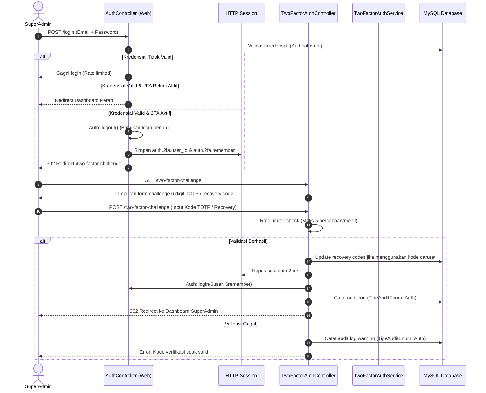

# SuperAdmin Authentication & Two-Factor Security Runbook

**Aplikasi:** MAGKOM (Sistem Informasi Manajemen Magang Kominfo)  
**Tingkat Kerahasiaan:** Dokumen Keamanan Operasional Internal  
**Versi:** 1.0 (Enterprise Multi-Factor Security)  
**Tanggal:** 15 November 2026  

---

## 1. Pendahuluan

SuperAdmin merupakan entitas dengan hak akses tertinggi (God-mode / Full Privileged Access) pada sistem informasi MAGKOM. Akun SuperAdmin memiliki kemampuan memutasi data sistem, mengelola seluruh staf dan akun, mengatur konfigurasi aplikasi, mengakses audit log keamanan, serta memicu proses backup dan restore data.

Untuk mencegah insiden kebocoran kredensial, pembajakan akun (account takeover), dan brute-force attacks, sistem mengimplementasikan perlindungan ganda:
1. **Kebijakan Kata Sandi Khusus SuperAdmin**: Standar minimum 12 karakter kompleks.
2. **Two-Factor Authentication (2FA TOTP RFC 6238)**: Otentikasi lapis kedua berbasis time-based one-time password yang kompatibel dengan aplikasi authenticator standar industri (Google Authenticator, Microsoft Authenticator, 1Password, Bitwarden).
3. **Emergency Single-Use Recovery Codes**: 8 kode darurat yang dienkripsi dan di-*hash* untuk mengatasi kehilangan perangkat authenticator.
4. **Emergency CLI Reset Procedure**: Prosedur pemulihan cepat melalui akses terminal konsol server tanpa membuka risiko *backdoor* pada antarmuka web.

---

## 2. Kebijakan Kata Sandi SuperAdmin

### 2.1 Standar Kompleksitas

Perubahan atau pembuatan kata sandi untuk akun dengan peran `RoleEnum::SuperAdmin` tunduk pada validasi ketat `Illuminate\Validation\Rules\Password`:

| Parameter | Spesifikasi | Keterangan |
|---|---|---|
| **Panjang Minimum** | Minimal **12 karakter** | Mencegah komputasi pemecahan offline (offline hash cracking) |
| **Kombinasi Huruf** | Huruf besar (`A-Z`) & huruf kecil (`a-z`) | `Password::min(12)->mixedCase()` |
| **Karakter Angka** | Minimal 1 angka (`0-9`) | `Password::min(12)->numbers()` |
| **Karakter Khusus / Simbol** | Minimal 1 simbol (`!@#$%^&*()_+-=[]{};':",./<>?`) | `Password::min(12)->symbols()` |
| **Dilarang Kebocoran Publik** | Pemeriksaan kebocoran via k-anonymity HIBP | `Password::min(12)->uncompromised()` (diabaikan jika offline/staging) |

> [!NOTE]
> Peran non-SuperAdmin (Admin, Pembimbing, Peserta) tetap menggunakan standar 8 karakter alphanumeric standar (`min:8`, `letters`, `numbers`) agar tidak menimbulkan friksi pada pendaftar magang reguler.

### 2.2 Mekanisme Transisi Tanpa Lockout

Akun SuperAdmin lama yang sudah ada di database **TIDAK langsung dikunci (locked out)** secara paksa saat patch diterapkan. Validasi kata sandi 12 karakter kompleks ditegakkan pada:
1. Form ubah kata sandi profil SuperAdmin (`UpdatePasswordSettingRequest`).
2. Form manajemen pengguna saat membuat atau mereset password akun ber-role SuperAdmin (`StafController`, `AkunController`).
3. Form reset password lupa kata sandi (`PasswordController`, `ResetPasswordController`).

---

## 3. Arsitektur & Implementasi Two-Factor Authentication

### 3.1 Spesifikasi Teknis

- **Standar Protokol**: RFC 6238 TOTP (Time-Based One-Time Password Algorithm).
- **Library Vendor**: `pragmarx/google2fa` (v9.1.0).
- **Panjang Kode**: 6 digit desimal.
- **Periode Waktu (Time Step)**: 30 detik.
- **Jendela Toleransi Waktu (Window)**: 1 step sebelum dan 1 step sesudah (±30 detik) untuk mengatasi drift waktu pada jam ponsel pengguna.
- **Enkripsi Kunci Rahasia (Secret Key)**: Disimpan dalam kolom `two_factor_secret` menggunakan fungsi enkripsi bawaan Laravel `encrypt()` (AES-256-CBC dengan HMAC-SHA256 signature). Kunci rahasia tidak pernah tersimpan dalam bentuk *plaintext*.

### 3.2 Alur Enrollment (Pendaftaran 2FA)

Enrollment bersifat mandiri (*self-service*) dan bertahap:
1. SuperAdmin masuk ke menu **Pengaturan Keamanan > Otentikasi Dua Faktor** (`/superadmin/security/2fa`).
2. Klik tombol **Aktifkan 2FA**.
3. Sistem membuat *temporary secret* acak (RFC 4648 Base32) yang disimpan di sesi terenkripsi (`auth.2fa.enroll_secret`).
4. Halaman menampilkan:
   - **QR Code** berisi URI standar: `otpauth://totp/MAGKOM:email?secret=...&issuer=MAGKOM`
   - **Manual Secret Key**: Untuk input manual jika kamera ponsel tidak dapat memindai.
5. SuperAdmin memindai QR Code di aplikasi authenticator, lalu memasukkan 6 digit kode yang tampil untuk konfirmasi.
6. Sistem memverifikasi kode pertama tersebut:
   - Jika valid: Secret dipindahkan dari sesi ke database kolom `two_factor_secret`, `two_factor_confirmed_at` diisi timestamp saat ini, dan 8 buah recovery codes acak digenerate.
   - Jika gagal: Ditampilkan pesan kesalahan bahwa kode tidak cocok atau jam perangkat tidak sinkron.

### 3.3 Recovery Codes (Kode Pemulihan Darurat)

1. Saat aktivasi berhasil, sistem membuat 8 buah *single-use recovery codes* (format 10 karakter alfanumerik acak, contoh: `ABCD-1234-EF`).
2. Kode pemulihan di-*hash* menggunakan `Hash::make()` (Bcrypt) dan disimpan dalam format JSON terenkripsi pada kolom `two_factor_recovery_codes`.
3. Pengguna diinstruksikan untuk menyalin atau mengunduh kode tersebut dan menyimpannya di tempat yang aman (password manager / brankas digital).
4. Setiap kode pemulihan hanya dapat digunakan **1 (satu) kali saja (*single-use*)**. Begitu digunakan untuk melewati tantangan 2FA, kode tersebut langsung dihapus dari daftar recovery codes akun.

---

## 4. Alur Intersepsi Login (Two-Factor Challenge)



---

## 5. Prosedur Pemulihan Darurat (Emergency CLI Reset)

Jika akun SuperAdmin kehilangan ponsel/aplikasi authenticator dan tidak memiliki sisa recovery codes, **JANGAN PERNAH** memodifikasi database secara manual menggunakan raw query tanpa audit logging.

Gunakan perintah Artisan darurat yang telah disediakan:

### 5.1 Menjalankan Reset 2FA via Terminal Server

Akses server production melalui SSH aman, lalu jalankan:

```bash
php artisan auth:2fa-reset superadmin@kominfo.go.id
```

Output interaktif:
```text
========================================================
  EMERGENCY RECOVERY: RESET 2FA AUTENTIKASI DUA FAKTOR  
========================================================
Nama Pengguna : Super Administrator
Email         : superadmin@kominfo.go.id
Role          : superadmin

Apakah Anda yakin ingin menonaktifkan 2FA untuk 'superadmin@kominfo.go.id'? (yes/no) [no]:
> yes

✓ 2FA berhasil dinonaktifkan untuk pengguna 'superadmin@kominfo.go.id'. Pengguna kini dapat login kembali menggunakan kata sandi.
```

Untuk skrip otomatisasi atau integrasi non-interaktif:
```bash
php artisan auth:2fa-reset superadmin@kominfo.go.id --force
```

### 5.2 Tindakan Pasca-Reset
1. SuperAdmin yang bersangkutan harus segera login kembali menggunakan kata sandinya.
2. Segera masuk ke menu **Pengaturan Keamanan > Otentikasi Dua Faktor** untuk mendaftarkan perangkat authenticator yang baru.
3. Catat dan simpan 8 kode pemulihan yang baru digenerate.
4. Periksa audit trail di menu **Audit Log Keamanan** (`/superadmin/audit-log`) untuk memastikan peristiwa reset darurat tercatat secara resmi (`2fa.emergency_cli_reset`).
