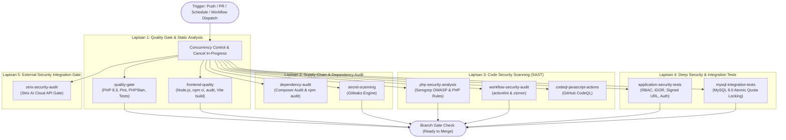

# Panduan CI/CD DevSecOps, Keamanan Aplikasi & GitHub Projects (MAGKOM)

Dokumen ini merupakan panduan standar operasional untuk **Senior DevSecOps Engineer**, **Laravel Security Engineer**, dan seluruh pengembang sistem **MAGKOM (Portal Manajemen Magang Kominfo)**. Panduan ini mencakup arsitektur integrasi berkelanjutan (*Continuous Integration*), audit keamanan bertingkat (*Multi-layer Security Auditing*), pemantauan kualitas kode, tata kelola proyek di GitHub Projects, serta mitigasi risiko siklus hidup dependensi.

---

## 1. Arsitektur Pipeline GitHub Actions

Pipeline CI/CD MagKom diimplementasikan pada file workflow utama:
[`.github/workflows/security.yml`](file:///.github/workflows/security.yml)

Pipeline ini dirancang dengan prinsip **Shift-Left Security**, **Least Privilege**, **Supply Chain Security**, serta **Parallel Fast-Feedback**.



### Karakteristik Utama Arsitektur:
1. **Parallel Execution**: Seluruh job independen berjalan secara paralel untuk mempercepat waktu umpan balik kepada developer (target feedback < 3 menit).
2. **Prinsip Hak Akses Minimum (Least Privilege)**:
   - Root workflow permission dikunci ketat pada `contents: read`.
   - Izin `security-events: write` hanya diberikan khusus kepada job pemindai yang mengunggah berkas SARIF ke GitHub Code Scanning (`php-security-analysis` dan `codeql-javascript-actions`).
3. **Supply Chain Hardening (SHA Pinning)**:
   - Seluruh action pihak ketiga (`actions/checkout`, `shivammathur/setup-php`, `actions/setup-node`, `actions/setup-python`, `github/codeql-action`, `gitleaks/gitleaks-action`) di-pin menggunakan **Full-Length Commit SHA** resmi yang telah diverifikasi, disertai komentar versi rilis untuk kemudahan audit.
   - Opsi `persist-credentials: false` diaktifkan pada semua pemanggilan `actions/checkout` guna mencegah persistensi token autentikasi di dalam runner.
4. **Timeouts & Concurrency**:
   - Seluruh job memiliki batasan `timeout-minutes` (10-20 menit) untuk mencegah *stalled runners*.
   - Konfigurasi `concurrency` melindungi branch utama dan branch kerja aktif: eksekusi pipeline pada **`main`** dan **`test-2`** tidak akan dibatalkan di tengah jalan (`cancel-in-progress: false`), sedangkan pada branch fitur/eksperimen lain pembatalan otomatis aktif untuk menghemat menit runner.

---

## 2. Rincian & Fungsi Setiap Job CI

Pipeline terbagi menjadi 10 job dengan tanggung jawab terisolasi:

| Nama Job | Runner & Runtime | Tujuan & Pemeriksaan | Hak Akses (Permissions) |
| :--- | :--- | :--- | :--- |
| `quality-gate` | `ubuntu-latest`<br/>PHP 8.3 | Memvalidasi sintaks composer, memastikan dependensi PHP 8.3, menjalankan linter Laravel Pint (PSR-12), analisis statis Larastan Level 2, dan seluruh suite unit/feature test in-tree menggunakan SQLite `:memory:`. | `contents: read` |
| `frontend-quality` | `ubuntu-latest`<br/>Node.js 20 LTS | Menjalankan instalasi bersih aset (`npm ci`), audit kerentanan NPM level high/critical (`npm audit`), dan kompilasi produksi Vite 6 (`npm run build`). | `contents: read` |
| `dependency-audit` | `ubuntu-latest`<br/>PHP 8.3 & Node 20 | Memindai basis data kerentanan publik (CVE) pada dependensi Composer (`composer audit --format=table`) dan NPM. | `contents: read` |
| `secret-scanning` | `ubuntu-latest`<br/>Gitleaks v2.3.8 | Memindai seluruh commit dan riwayat git dari potensi kebocoran password, private key, database credential, token API, dan token OAuth menggunakan konfigurasi [`.gitleaks.toml`](file:///.gitleaks.toml). | `contents: read` |
| `php-security-analysis` | `ubuntu-latest`<br/>Docker (Semgrep) | Menjalankan Static Application Security Testing (SAST) berbasis aturan OWASP Top 10 dan PHP security audit rules. Hasil diunggah dalam format SARIF 2.1.0 ke GitHub Security Code Scanning. | `contents: read`<br/>`security-events: write` |
| `workflow-security-audit` | `ubuntu-latest`<br/>actionlint & zizmor | Mengaudit berkas GitHub Actions workflow (`.github/workflows/*.yml`) dari kelemahan sintaks (actionlint) serta celah keamanan konfigurasi CI (zizmor: excessive permissions, script injection, unpinned uses). | `contents: read` |
| `application-security-tests` | `ubuntu-latest`<br/>PHP 8.3 (SQLite) | Mengeksekusi rangkaian pengujian keamanan inti aplikasi: verifikasi berkas & audit trail, isolasi SuperAdmin, proteksi brute-force & rate limiting, deep defense penetration test, endpoint security.txt, serta proteksi IDOR pembimbing. | `contents: read` |
| `mysql-integration-tests` | `ubuntu-latest`<br/>MySQL 8.0 Service | Menjalankan pengujian konkurensi atomik (`tests/Feature/QuotaConcurrencyTest.php`) pada basis data MySQL 8.0 asli untuk memvalidasi perilaku *row locking* (`lockForUpdate`) yang tidak dapat direpresentasikan oleh SQLite. | `contents: read` |
| `codeql-javascript-actions` | `ubuntu-latest`<br/>GitHub CodeQL | Menjalankan analisis keamanan mendalam CodeQL pada kode sumber JavaScript/TypeScript dan workflow GitHub Actions. (Catatan: PHP dianalisis terpisah melalui Semgrep karena CodeQL tidak mendukung PHP). | `contents: read`<br/>`security-events: write` |
| `strix-security-audit` | `ubuntu-latest`<br/>Python 3.12 | Gerbang integrasi Strix AI Security. Memverifikasi konektivitas token Strix Cloud API secara aman dan mengatur alur pemindaian aktif (DAST) berbasis target staging terkonfigurasi. | `contents: read` |

---

## 3. Integrasi Pemindai Keamanan (Security Scanners)

### A. Gitleaks (Secret Scanning)
- **Engine**: Gitleaks Action v2.3.8.
- **Konfigurasi**: [`.gitleaks.toml`](file:///.gitleaks.toml) pada root repositori.
- **Target**: Memastikan tidak ada token rahasia, API keys, private keys, database credentials, atau nilai `.env` produksi yang tidak sengaja ter-commit.
- **Allowlist**: Berkas `.env.example`, `phpunit.xml`, serta artefak mock pengujian dikecualikan secara eksplisit untuk mencegah *false positive*.

### B. Semgrep (PHP & Laravel SAST)
- **Engine**: Semgrep CE (Community Edition) via container Docker resmi `returntocorp/semgrep`.
- **Ruleset**:
  - `p/php`: Pemindaian kelemahan umum PHP (deserialisasi objek berbahaya, command injection, path traversal).
  - `p/owasp-top-ten`: Pemindaian standar OWASP Top 10 (SQL Injection, XSS, broken access control, insecure design).
  - `p/security-audit`: Audit sanitasi input dan fungsi sensitif.
- **Output**: Berkas SARIF (`semgrep.sarif`) diunggah langsung ke tab GitHub **Security → Code scanning alerts**.

### C. actionlint & zizmor (CI/CD Supply Chain Security)
- **actionlint**: Mengoreksi kesalahan sintaksis GitHub Actions, ekspresi logika `${{ ... }}`, tipe event, serta konsistensi parameter step.
- **zizmor**: Menganalisis postur keamanan pipeline:
  - Mencegah pemberian `GITHUB_TOKEN` berlebih (*excessive permissions*).
  - Memastikan seluruh aksi menggunakan commit hash (*unpinned action references*).
  - Mencegah kebocoran credential lewat artifact runner (*artipacked*).
  - Mencegah eksploitasi `pull_request_target`.

### D. GitHub CodeQL (JavaScript & Workflows)
- **Cakupan**: Khusus memindai kode JavaScript frontend (`resources/js/`) dan konfigurasi GitHub Actions.
- **Pemberitahuan Khusus**: CodeQL **TIDAK** memindai kode sumber PHP Laravel. Pengujian statis keamanan PHP sepenuhnya ditangani oleh Semgrep dan test suite in-tree.

---

## 4. Integrasi Strix AI Security & Penjelasan Mekanisme Scan

Workflow menyertakan job `strix-security-audit` untuk menghubungkan repositori dengan platform **Strix AI Pentesting**.

> [!IMPORTANT]
> ### Klarifikasi Teknis Terkait Pemeriksaan Strix
> Pada implementasi sebelumnya, workflow hanya menjalankan request:
> ```bash
> GET https://app.strix.ai/api/v1/scans?limit=5
> ```
> Panggilan tersebut **hanya mengambil daftar riwayat scan yang telah tercatat sebelumnya**, dan **BUKAN** bukti bahwa uji penetrasi baru telah dijalankan atau diselesaikan.
> 
> MagKom menerapkan pendekatan audit yang jujur (*honest reporting*):
> 1. Pemanggilan API pada push/PR rutin diverifikasi secara transparan sebagai **pemeriksaan konektivitas token**, bukan penetration test aktif.
> 2. Active penetration testing (DAST) memerlukan target staging aktif (`STRIX_TARGET_URL`) dan **tidak dijalankan otomatis ke lingkungan produksi**.
> 3. Pemindaian aktif dapat dipicu secara terkendali melalui **GitHub Actions Workflow Dispatch** (`run_strix_scan: true`) atau melalui CLI `strix` pada runner terisolasi.
> 4. Keamanan internal aplikasi MagKom tetap terjamin 100% oleh rangkaian in-tree test, Semgrep, dan Gitleaks meskipun token Strix tidak dikonfigurasi.

---

## 5. Tata Kelola GitHub Projects & Manajemen Pekerjaan

Repositori MagKom dihubungkan secara resmi dengan **GitHub Projects V2**:

- **Nama Project**: `MAGKOM | Engineering & Security`
- **URL Project**: [https://github.com/users/EvilAekt/projects/2](https://github.com/users/EvilAekt/projects/2)
- **Visibility**: `Private` (Terkunci untuk pengelola repositori).

### A. Custom Fields yang Dikonfigurasi
1. **Status**:
   - `Todo`: Tugas atau temuan baru yang belum dimulai.
   - `In Progress`: Sedang dikerjakan oleh developer.
   - `In Review`: Dalam proses review kode atau pengujian PR.
   - `Blocked`: Terkendala masalah teknis, dependensi, atau keputusan bisnis.
   - `Done`: Selesai, lulus seluruh test CI, dan di-merge ke branch utama.
2. **Priority**:
   - `Critical` (Merah): Blocker, celah keamanan tinggi, sistem lumpuh.
   - `High` (Oranye): Fitur penting atau bug berdampak besar.
   - `Medium` (Kuning): Peningkatan reguler atau siklus rilis normal.
   - `Low` (Biru): Perbaikan minor atau kosmetik.
3. **Work Type**:
   - `Bug`, `Feature`, `Security`, `Maintenance`, `Documentation`.
4. **Area**:
   - `Backend`, `Frontend`, `Authentication & RBAC`, `Database`, `Public Portal`, `Pendaftaran`, `Admin`, `Pembimbing`, `Peserta`, `SuperAdmin`, `DevOps & Infrastructure`.
5. **Target Date**:
   - Tipe data kalender (`Date`) untuk memetakan tanggal penyelesaian tugas.

### B. Tampilan Project (Views)
1. **Development Board** (`BOARD_LAYOUT`): Tampilan papan Kanban yang dikelompokkan berdasarkan kolom `Status`.
2. **Backlog** (`TABLE_LAYOUT`): Tabel komprehensif seluruh tugas pending beserta prioritas, modul, dan estimasi waktu.
3. **Security Dashboard** (`TABLE_LAYOUT`): Tampilan khusus penyaringan item bertipe `Security` untuk memantau mitigasi celah dan hasil audit.
4. **Roadmap** (`ROADMAP_LAYOUT`): Linimasa visual berdasarkan field `Target Date`.

### C. Otomatisasi GitHub Projects
Pengelola dapat mengaktifkan otomatisasi bawaan melalui menu **Project Settings → Workflows**:
- **Item added to project** : Set Status otomatis ke `Todo`.
- **Item closed** : Set Status otomatis ke `Done`.
- **Pull request merged** : Set Status otomatis ke `Done`.
- **Auto-add to project** : Otomatis menambahkan issue berlabel `bug`, `feature`, atau `security` dari repositori `EvilAekt/MAGKOM`.

---

## 6. Template Standar Issue & Pull Request

Untuk menjaga konsistensi pelaporan dan mempermudah pelacakan pekerjaan, telah disediakan template berikut:

1. [**Laporan Bug**](file:///.github/ISSUE_TEMPLATE/bug_report.yml):
   Memuat modul terdampak, langkah reproduksi sistematis, perilaku yang diharapkan vs aktual, dan informasi lingkungan peramban/OS.
2. [**Permintaan Fitur**](file:///.github/ISSUE_TEMPLATE/feature_request.yml):
   Memuat tujuan fitur, problem statement, usulan alur kerja, kriteria penerimaan (*acceptance criteria*), dan modul terkait.
3. [**Pull Request Template**](file:///.github/PULL_REQUEST_TEMPLATE.md):
   Memuat ringkasan perubahan, referensi issue, tipe perubahan, checklist pengujian lokal, analisis dampak keamanan & RBAC, serta konfirmasi tidak adanya perubahan destructive pada database atau Blade.
4. [**Kebijakan Keamanan (SECURITY.md)**](file:///SECURITY.md):
   Menegaskan pelaporan kerentanan secara privat ke `keamanan-informasi@magkom.go.id` dan melarang pembuatan issue publik untuk celah keamanan.

---

## 7. Rekomendasi Tata Kelola Repositori (Branch Protection untuk `main` & `test-2`)

Berdasarkan audit repositori, branch **`main`** dan branch **`test-2`** saat ini belum memiliki aturan perlindungan (*Branch not protected*). Karena **`test-2`** berfungsi sebagai working baseline aktif dan **`main`** sebagai production release baseline, kedua branch ini wajib dilindungi dengan aturan yang sama.

Sangat direkomendasikan untuk menerapkan aturan berikut pada menu **Settings → Rules → Rulesets** (atau **Branches → Add branch protection rule**) dengan target branch: **`main`** dan **`test-2`**:

1. **Target Branches**:
   - Pola pencocokan: `main` dan `test-2` (atau `refs/heads/main`, `refs/heads/test-2`).
2. **Require a pull request before merging**:
   - Memerlukan minimal 1 persetujuan (*approving review*) untuk tim dengan multi-kontributor, atau checklist PR self-review untuk pengembang mandiri.
   - Menolak merge langsung (*direct push bypass*) tanpa proses Pull Request.
3. **Require status checks to pass before merging** (Status Checks Wajib):
   - `PHP 8.3 Quality Gate & Test Suite`
   - `Frontend Quality & Asset Compilation`
   - `Secret Scanning (Gitleaks)`
   - `PHP & Laravel Static Security Analysis (Semgrep)`
   - `Workflow Security & Linter Audit (actionlint & zizmor)`
   - `Laravel In-Tree Security Test Suites`
   - `MySQL 8 Database Concurrency & Quota Locking`
4. **Require branches to be up to date before merging**: Mencegah konflik tersembunyi pada basis kode `test-2` maupun `main`.
5. **Block force pushes**: Mencegah penimpaan riwayat git (`git push --force`) pada `test-2` dan `main`.
6. **Prevent branch deletion**: Mengunci `test-2` dan `main` dari penghapusan branch secara tidak sengaja.
7. **Aktifkan Secret Scanning & Push Protection**: Fitur bawaan GitHub Advanced Security untuk memblokir commit yang terindikasi membocorkan rahasia secara preemptive.

---

## 8. Prosedur Pengujian Lokal Sebelum Push (Developer Checklist)

Setiap pengembang wajib menjalankan pemeriksaan lokal berikut sebelum membuat commit atau membuka Pull Request:

### 1. Backend & Code Style
```bash
# Validasi struktur composer.json
composer validate --strict

# Validasi kesesuaian platform runtime
composer check-platform-reqs

# Audit dependensi PHP
composer audit

# Linter gaya kode PSR-12
php vendor/bin/pint --test

# Analisis statis Larastan Level 2
php vendor/bin/phpstan analyse --memory-limit=1G

# Eksekusi seluruh automated test suite
php artisan test
```

### 2. Frontend & Build Aset
```bash
# Instalasi bersih dependensi npm
npm ci

# Audit dependensi frontend
npm audit --audit-level=high

# Kompilasi produksi Vite
npm run build
```

### 3. Keamanan & Kredensial
```bash
# Pemindaian kebocoran kredensial dengan Gitleaks
gitleaks git --no-banner -c .gitleaks.toml

# Analisis statis keamanan PHP dengan Semgrep
semgrep scan --config "p/php" --config "p/owasp-top-ten" app/

# Audit berkas workflow
actionlint .github/workflows/security.yml
zizmor .github/workflows/security.yml
```

---

## 9. Penanganan Troubleshooting CI/CD

| Indikasi Masalah | Penyebab Umum | Langkah Penyelesaian |
| :--- | :--- | :--- |
| `quality-gate` gagal pada `check-platform-reqs` | Versi PHP pada runner tidak sesuai batasan `composer.json` (`^8.3`). | Pastikan step `shivammathur/setup-php` menggunakan `php-version: '8.3'`. Di mesin lokal, gunakan PHP 8.3 native. |
| `quality-gate` gagal pada `pint --test` | Terdapat format kode PHP yang tidak mematuhi PSR-12 / Laravel Pint. | Jalankan `php vendor/bin/pint` di lokal untuk memformat otomatis berkas yang terdampak, lalu commit perubahannya. |
| `frontend-quality` gagal pada `npm ci` | `package-lock.json` tidak sinkron dengan `package.json`. | Jalankan `npm install` di lokal untuk memperbarui lockfile secara presisi, lalu commit `package-lock.json`. |
| `secret-scanning` gagal (leaks found) | Gitleaks mendeteksi string menyerupai API key, token, atau credential. | Jika kredensial riil, segera revoke token tersebut dan gunakan environment variable. Jika merupakan kunci uji coba dummy, tambahkan polanya ke allowlist `.gitleaks.toml`. |
| `mysql-integration-tests` gagal | Koneksi database MySQL runner belum siap (*healthcheck failed*) atau migrasi bentrok. | Periksa konfigurasi healthcheck pada blok `services.mysql` di `.github/workflows/security.yml`. Pastikan `php artisan migrate --force` berhasil sebelum test dijalankan. |
| `strix-security-audit` peringatan API | Secret `STRIX_API_TOKEN` belum dimasukkan pada GitHub Secrets. | Tambahkan secret pada **Settings → Secrets and variables → Actions** di repositori GitHub. |

---

## 10. Analisis Risiko Teknis: Siklus Hidup Laravel 10 (Technical Risk)

> [!WARNING]
> ### Risiko Keamanan: Laravel 10 End of Life (EOL)
> Repositori MAGKOM saat ini berjalan pada **Laravel 10.x** dengan fondasi dependensi Symfony 6.4 LTS.
> Berdasarkan siklus rilis resmi Laravel (*Laravel Support Policy*):
> - **Dukungan Bug Fixes**: Berakhir pada **6 Agustus 2024**.
> - **Dukungan Security Fixes**: Berakhir pada **4 Februari 2025**.
>
> Hal ini menyebabkan perintah `composer audit` mendeteksi adanya 18 security advisories pada paket turunan (seperti `symfony/http-kernel`, `symfony/mime`, `symfony/routing`, dan `dompdf/dompdf`) yang membutuhkan versi framework yang lebih baru untuk perbaikan permanen.

### Rekomendasi Roadmap Peningkatan (Framework Upgrade Roadmap):
Sesuai aturan rekayasa, pembaruan framework major **tidak dilakukan pada pekerjaan ini** demi menjaga stabilitas fungsionalitas sistem. Namun, roadmap transisi berikut disiapkan untuk dieksekusi secara terencana pada siklus pemeliharaan berikutnya:

1. **Fase 1 — Audit Dependensi Eksternal**:
   - Memverifikasi kesiapan paket pihak ketiga: `barryvdh/laravel-dompdf`, `sentry/sentry-laravel`, `larastan/larastan`, dan `laravel/socialite` terhadap Laravel 11/12.
2. **Fase 2 — Migrasi Struktur Konfigurasi Laravel 11**:
   - Laravel 11 mengadopsi struktur aplikasi yang lebih ramping (*lean skeleton*): penyederhanaan `app/Http/Kernel.php` ke `bootstrap/app.php` dan pemindahan middleware rute.
3. **Fase 3 — Eksekusi pada Branch Terisolasi (`chore/laravel-11-upgrade`)**:
   - Menjalankan `composer require laravel/framework:^11.0 --no-update` dan penyesuaian dependensi dev.
   - Menjalankan migrasi database di lingkungan staging.
4. **Fase 4 — Regression Testing Penuh**:
   - Memastikan seluruh 942 tests dan 6.132 assertions PHPUnit lulus tanpa regresi.
   - Menjalankan kembali `composer audit` untuk memverifikasi resolusi CVE Symfony.

