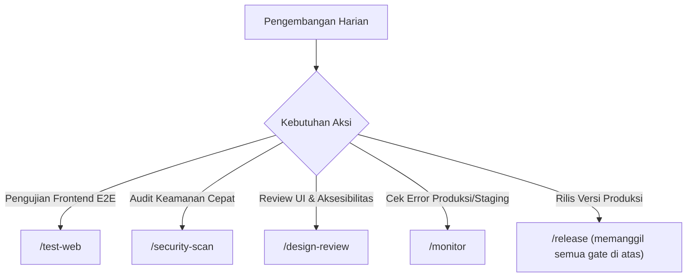

# Manual & Spesifikasi Ekosistem Tooling (TOOLING.md)

Dokumen ini mencatat seluruh perangkat bantu (*toolkit*), server MCP, antarmuka baris perintah (CLI), serta repositori skill yang telah dipasang dan dikonfigurasi pada Antigravity untuk alur kerja web development harian.

---

## 1. Inventaris Toolkit Terpasang

### A. Model Context Protocol (MCP) Servers
Dikonfigurasi pada `~/.gemini/config/mcp_config.json`:

| Nama MCP | Tipe Transport | Endpoint / Command | Status Kredensial | Fungsi Utama |
| :--- | :--- | :--- | :--- | :--- |
| **`TestSprite`** | Stdio (Local) | `npx.cmd -y @testsprite/testsprite-mcp@latest` | **Aktif** (8 tools terdaftar) | Pengujian fungsionalitas dan interaksi UI berbasis AI |
| **`composio`** | SSE (Remote) | `https://connect.composio.dev/mcp` | **Aktif** (11 tools terdaftar) | Integrasi ke 1500+ layanan (GitHub, Slack, Jira, dll.) |
| **`cloudflare`**| SSE (Remote) | `https://docs.mcp.cloudflare.com/mcp` | **Aktif** (2 tools terdaftar) | Dokumentasi, arsitektur, dan best practice Cloudflare |
| **`playwright`**| Stdio (Local) | `npx.cmd --package ajv --package @executeautomation/playwright-mcp-server` | **Aktif** (Fixed dependency ajv) | Otomasi browser, navigasi, dan visual testing |
| **`sentry`** | SSE (Remote) | `https://mcp.sentry.dev/mcp` | **Aktif** (Base official endpoint) | Inspeksi error runtime, exceptions, dan crash tracking |
| **`datadog`** | SSE (Remote) | `https://mcp.datadoghq.com/v1/mcp` | **Aktif** (DD-API-KEY terkonfigurasi) | Telemetri performa, APM traces, dan server latency |
| **`strix`** | Native CLI/Skill| `.agents/skills/` & Strix CLI | **Aktif via Skills** | Penetrasi testing dan audit keamanan otomatis |

---

### B. Command-Line Interface (CLI) Tools

| Nama CLI | Versi Terpasang | Metode Instalasi | Lokasi Eksekusi / Konfigurasi | Keterangan & Biaya |
| :--- | :--- | :--- | :--- | :--- |
| **Graphify** | `v0.9.89` (`graphifyy`) | `pip install graphifyy` | `python -m graphify` / `.agents/rules/graphify.md` | **$0 token cost** untuk mode `--code-only` (AST). Telah menghasilkan graph 2.230 node di `graphify-out/`. |
| **Strix** | *(Persiapan CLI OSS)* | GitHub Release binary / Sandbox Docker | `ghcr.io/usestrix/strix-sandbox:1.3.0` | Memerlukan Docker Desktop aktif + OpenAI API key (`STRIX_LLM=openai/gpt-4o-mini`). |

---

### C. Skill Repositories & Ekstensi Agent

| Repositori Sumber | Skill Terpasang | Lokasi Direktori | Peran & Tanggung Jawab |
| :--- | :--- | :--- | :--- |
| **`nextlevelbuilder/ui-ux-pro-max-skill`** | `ui-ux-pro-max` | `.agents/skills/ui-ux-pro-max/` | Penentu konsep visual, palet warna, tipografi, dan design tokens awal. |
| **`pbakaus/impeccable`** | `impeccable` (v4.5.2) | `.agents/skills/impeccable/` | Konstruksi komponen, audit heuristik UI, micro-interactions, polish. |
| **`jakubkrehel/skills`** | `better-interface`, `interface-review`, `explain-interface`, `better-ui`, `better-typography`, `better-colors`, `better-accessibility`, `better-layout`, `better-writing` (9 skills) | `.agents/skills/` | Quality gate detail sebelum merge (aksesibilitas WCAG 2.2, copy text, layout alignment). |
| **`usestrix/strix`** | 9 skills pentest (`penetration-testing-with-strix`, `owasp-top-10-testing`, dll.) | `.agents/skills/` | Eksekusi audit keamanan terarah berbasis PoC eksploitasi nyata. |

---

## 2. Cara Penggunaan & Alur Kerja Harian (Slash Commands)



1. **`/test-web`** : Memeriksa dev server dan memicu pengujian AI TestSprite.
2. **`/security-scan`** : Memeriksa celah keamanan localhost via Strix mode quick.
3. **`/design-review`** : Menjalankan audit desain `impeccable` + `jakubkrehel/interface-review`.
4. **`/monitor`** : Membaca log error Sentry dan telemetri Datadog/Cloudflare secara read-only.
5. **`/graphify .`** : Memperbarui knowledge graph codebase AST lokal di `graphify-out/`.

---

## 3. Langkah Pembaruan (Update Guide)

- **Memperbarui Paket Graphify**:
  ```bash
  python -m pip install --upgrade graphifyy
  ```
- **Memperbarui Skills via CLI**:
  ```bash
  npx skills update -p -y
  ```
- **Memperbarui UI/UX Pro Max**:
  ```bash
  npx uipro-cli update
  ```
